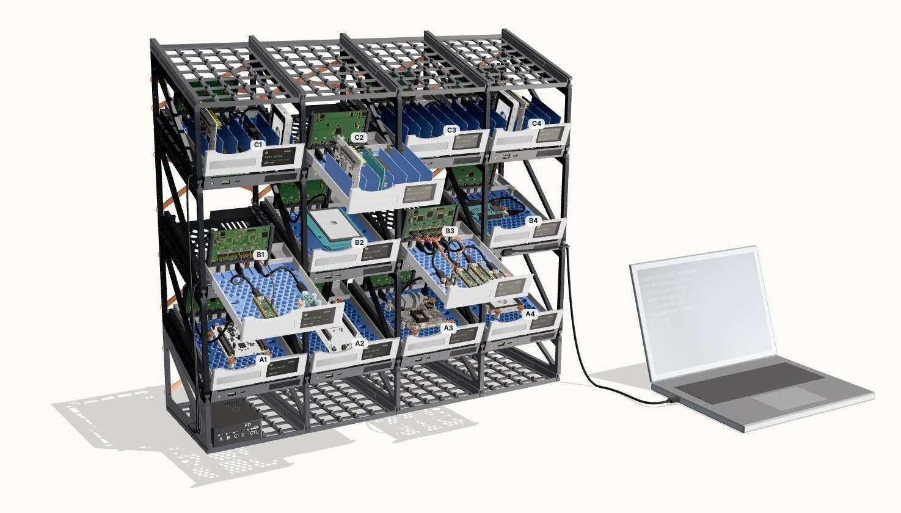

# BitBunk

**A 3D-printed, tilted test rack for development boards, twelve bays in its default 4 × 3 layout: each bay a
sliding drawer whose boards are power-switched, current-metered and exposed over the network with USB/IP by
a Zephyr-powered ESP32-S3 under the drawer.**

The repository is still called `hw-testing-rack` and will be renamed.



The 3D model of the rack as it is designed today, not a photograph: no rack has been built.
[Open the model](https://kartben.github.io/hw-testing-rack/viewer/) to turn it round.

## Status

Nobody has built a BitBunk yet.  On 2026-11-24:

- The printed frame is at v0.2 and has not been built: no part of it has been printed.  The mechanics are
  printable and parametric, the power box included.  Still to design: a double-width bay, and a front
  display on the drawers (the bay node v1.0 has no connector for one).
- Five PCBs (bay node, power hub, DATA ×6, DATA ×4, camera pod) pass ERC and DRC and went through a
  schematic review, a datasheet audit and a design review.  **Their v1.0 went to fabrication on
  2026-11-11** and is frozen: a change to a PCB now takes a new revision
  ([electronics.md › Revisions at the fab](docs/electronics.md#revisions-at-the-fab)).  None is on a bench
  yet; what to check when they arrive: [Check each PCB](docs/build/check-the-pcbs/index.md).
- The firmware (0.5.0, bay node and power hub) builds.  Its tests run on Zephyr's native_sim, and parts of
  it have run on bought ESP32-S3 boards that stand in for the PCBs (a XIAO ESP32-S3, an M5Stack CoreS3).
  It has never run on a bay node or on a power hub.

Every size, mass and print time comes from CAD or a slicer, every voltage and current from a schematic or a
datasheet.  Board outlines marked `verified: false` in `mechanical/boards/boards.yaml` are approximate.

## Documentation

The documentation is a website: **<https://kartben.github.io/hw-testing-rack/>**

| Section | On the site | Source on GitHub |
|---|---|---|
| Plan: how it works, choose a size, cost, what to order | [plan/](https://kartben.github.io/hw-testing-rack/plan/index.html) | [docs/plan/index.md](docs/plan/index.md), [stages.md](docs/plan/stages.md) |
| Print: measure, print settings, the parts | [print/](https://kartben.github.io/hw-testing-rack/print/index.html) | [docs/print/index.md](docs/print/index.md) |
| Build: the PCBs, a bay, the rack, flashing | [build/](https://kartben.github.io/hw-testing-rack/build/index.html) | [docs/build/index.md](docs/build/index.md) |
| Use: power, USB/IP, console, wires, analyzer, camera, CI | [use/](https://kartben.github.io/hw-testing-rack/use/index.html) | [docs/use/index.md](docs/use/index.md) |
| Reference: every action, the PCBs, cables, `bayctl`, the APIs | [reference/](https://kartben.github.io/hw-testing-rack/reference/index.html) | [docs/reference/index.md](docs/reference/index.md) |

The [interactive 3D model](https://kartben.github.io/hw-testing-rack/viewer/) and the
[logic analyzer page](https://kartben.github.io/hw-testing-rack/analyzer/) run in a browser.  With nothing
on the desk, a simulated bay serves the firmware's page and API:
[Try it without hardware](docs/plan/try-it-without-hardware.md).

For contributors, outside the site: [CONTRIBUTING.md](CONTRIBUTING.md), [docs/dev/](docs/dev/) (working on the
firmware and the PCBs, regenerating the outputs, why the rack is built the way it is) and the design notes
directly under [docs/](docs/) ([docs/dev/notes.md](docs/dev/notes.md) lists them).

## Repository layout

```
config/       rack.yaml, the single source of truth (rows, bays, tilt, dimensions, population); lab.example.yaml
mechanical/   OpenSCAD parts, the board library (boards/boards.yaml), the committed STL files
electronics/  the five PCBs as schematic-as-code (design.py), their KiCad projects and fab/ outputs; the generators
firmware/     Zephyr applications of the bay node and the power hub, their boards, drivers and tests
zephyr/       this repository as a Zephyr module, and the patches to the Zephyr that firmware/west.yml pins
tools/        build.py, bom.py, plate_layout.py, bayctl, kicad.sh, the render and drawing scripts
site/         the three.js 3D model, published at /viewer/
bom/          the rack's bill of materials (generated by tools/bom.py) and sourcing notes
render/       Blender scenes for the renders
docs/         the documentation site (Sphinx, MyST Markdown) and the design notes
```

## License

Hardware (mechanical and electronics design files): **CERN-OHL-P-2.0**.
Software (tools, viewer, firmware): **Apache-2.0**.  See [LICENSE](LICENSE).
