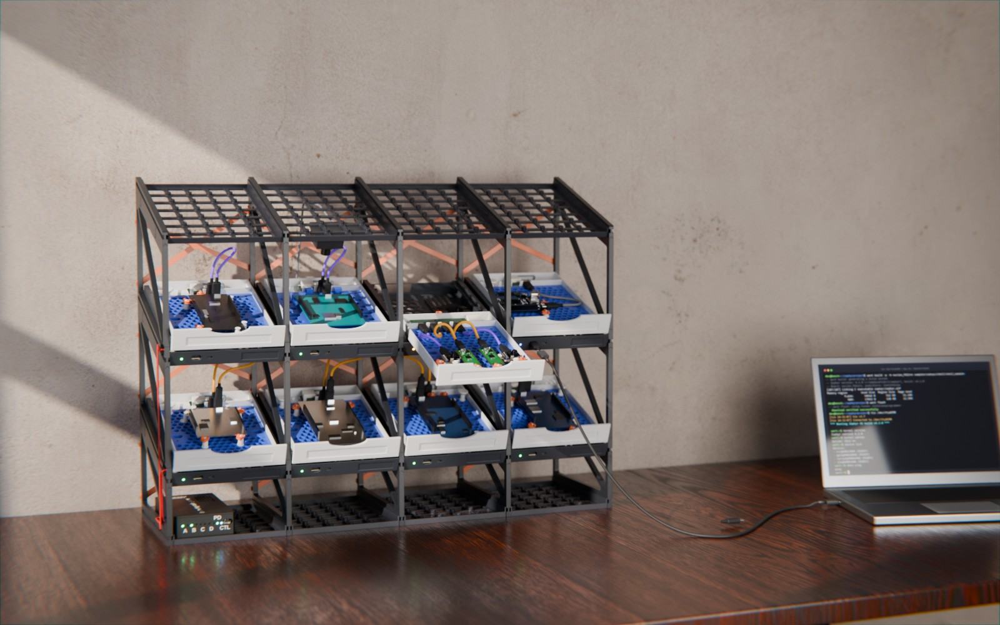
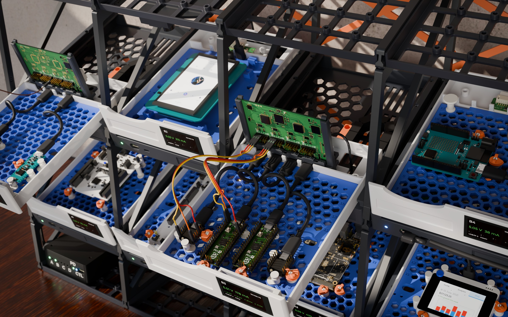
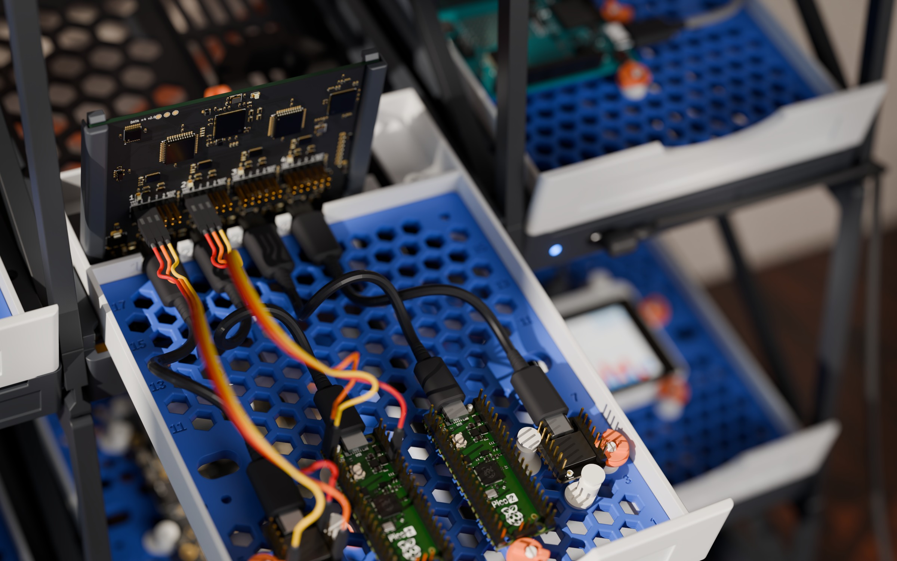
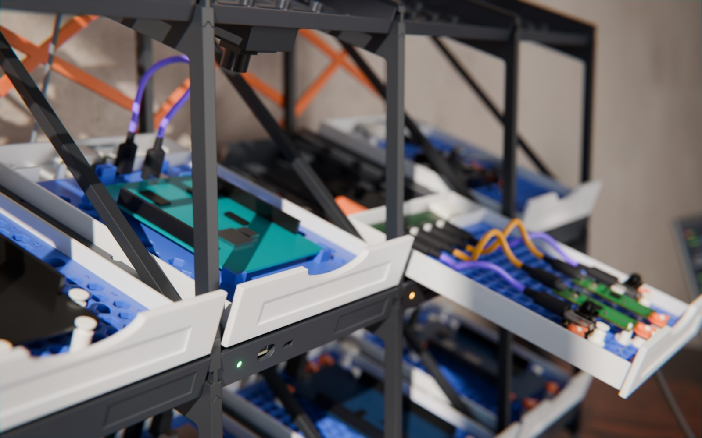
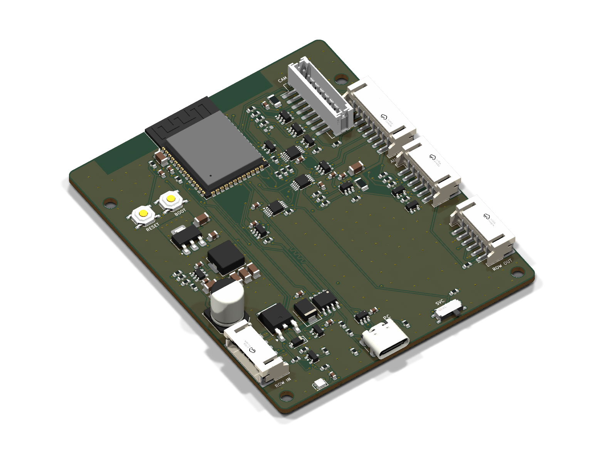

# hw-testing-rack

**An all-printed, tilted test rack for development boards (12 in its default
4 × 3 layout) — every board in its own sliding drawer, power-switched,
current-metered and exposed over the network with USB/IP by a Zephyr-powered
ESP32-S3 in each bay.**



**[▶ Interactive 3D model](https://kartben.github.io/hw-testing-rack/)** · [BOM](bom/README.md) ·
[Architecture](docs/architecture.md) · [Mechanics](docs/mechanical.md) · [Cabling](docs/cabling.md) ·
[Power](docs/power.md) · [Electronics](docs/electronics.md) · [Assembly](docs/assembly.md) ·
[Firmware](docs/firmware.md) · [CI](docs/ci.md)

## Highlights

* **Printed panel frame, no aluminium** — side walls ("ladders") shared by
  neighbouring bays, stacked row on row with snap hooks; trays slide into
  their grooves and click in; a taut X brace behind every bay keeps it square.
  Rows tilt 20° so every board, LED and label faces you, and the grid grows
  in both directions.
* **Drawers that stay connected** — each bay is a drawer sliding 140 mm along
  the slope; a drag chain hidden in the floor carries the cable, so you can
  pull a board out to probe it while it keeps running.
* **Swappable form-factor plates** — boards screw (or snap) onto a plate
  generated from a small board library (UNO, Nucleo-64/144, Pico, ESP32
  DevKitC, nRF DKs, FRDM, …) that drops into any drawer.
* **One ESP32-S3 per bay** — switches the board's 5 V (current-limited,
  default on), measures V/I (INA226), drives UART/RESET/BOOT lines, and
  exports the board's USB with Zephyr's USB/IP host service.  Plug a laptop
  into the bay's front port and the USB data path switches to it — the
  "classic" way still works, even with no firmware.
* **One USB-C charger** — a printed power box under the first column holds
  the hub: a USB PD 3.1 sink (20 or 28 V from one charger, no mains in the
  rack) and an eFuse per row; a 60 V-rated buck in every bay.  The same row
  cables carry a CAN bus for the rack controller ([can.md](docs/can.md)).
* **Cameras** — optional XIAO ESP32S3 Sense pods hang from any bay's ceiling.
* **Everything is generated** from [`config/rack.yaml`](config/rack.yaml):
  OpenSCAD parts, KiCad schematics *and* PCBs (schematic-as-code, Freerouting),
  the BOM with LCSC part numbers, and the interactive viewer.

| | |
|---|---|
|  |  |
| A drawer pulled out, board still connected | Raspberry Pi Pico 2 on its plate, UNO R4 WiFi next door ([real models](docs/boards-3d.md)) |
|  |  |
| Printed drawer fronts and status LEDs along a row | Bay node — ESP32-S3, 2 USB muxes, TPS2553, INA226, 60 V buck |

Neutral technical renders: [the rack](docs/img/hero.jpg), [one bay exploded](docs/architecture.md),
[side view](docs/mechanical.md).

## Repository layout

```
config/rack.yaml          single source of truth (rows, bays, tilt, dimensions, population)
mechanical/               OpenSCAD: lib/, parts/, boards/boards.yaml, generated/ (from the config)
electronics/
  tools/                  schematic-as-code (eda.py), PCB builder (pcbgen.py), catalogue, LCSC resolver
  bay-node/               design.py + generated KiCad project, fab/, docs/
  power-hub/              design.py + generated KiCad project, fab/, docs/
  data-port/              the drawer's USB-C port board: design.py + generated KiCad project, fab/, docs/
  camera-pod/             the camera pod's board (lead, camera header, 3.3 V, LEDs): design.py + KiCad, fab/, docs/
  lib/                    custom symbol(s), cached JLC basic passives
site/                     GitHub Pages: three.js viewer + BOM page (assets generated)
bom/                      full rack BOM (CSV + summary)
render/                   Blender scene + photoreal renders
tools/                    build.py (config/STL/web), kicad.sh, bom.py, jlc_mcp.py, notice/ (FreeCAD line art)
docs/                     design documentation
```

## Building

Prerequisites: Python ≥ 3.10 with `pyyaml numpy trimesh` (`pip install -r tools/requirements.txt`),
Docker (for KiCad 10, Freerouting and — if not installed locally — OpenSCAD).

```bash
python tools/build.py all                    # config → STLs → web viewer assets
tools/kicad.sh bay-node --route --fab        # schematic, PCB, autoroute, Gerbers/BOM/CPL, renders
tools/kicad.sh power-hub --route --fab
tools/kicad.sh data-port --route --fab
tools/kicad.sh camera-pod --route --fab
python tools/bom.py                          # full rack BOM
python -m http.server -d site 8000           # open http://localhost:8000
```

For screenshots the viewer takes URL parameters: `?bay=B4&openbay=1&view=dut&hideui`
pulls bay B4's drawer out and frames its DUT cable (DATA port to board), with no UI.

Photoreal renders (Blender + Cycles) start from `render/assembly.glb`, baked
from the same scene as the viewer by `python tools/assembly_glb.py --hq` (`--hq`:
full-resolution part meshes instead of the viewer's lighter ones).  Either
render headless in Docker (`tools/render.sh hero`) or drive a Blender you
already have open — GPU and all — through the Blender MCP add-on's socket:

```bash
python tools/blender_live.py exec render/live_scene.py                    # (re)build the scene
python tools/blender_live.py exec render/live_render.py hero              # → docs/img/hero.jpg
python tools/blender_live.py exec render/live_render.py drawer:B3 docs/img/drawer.jpg

python tools/assembly_glb.py --hq --explode-bay B2 --out render/bay-exploded.glb   # one bay, layers apart
python tools/blender_live.py exec render/live_scene.py render/bay-exploded.glb
python tools/blender_live.py exec render/live_render.py exploded
```

The photo shots (`docs/img/photo-*.jpg`) use their own scene: a small office
lit through a window, PETG with 0.2 mm layer lines and
rounded edges, scanned oak and plaster (CC0 textures from Poly Haven), a laptop
showing a Zephyr shell, wired to bay B4 by a USB-C cable that hangs as a real
one would (a catenary), depth of field and lens effects:

```bash
python tools/fetch_render_assets.py                     # CC0 textures + vendor board models → render/assets/
python tools/board_models.py                            # normalise the board models (docs/boards-3d.md)
python render/screen_terminal.py                        # the laptop's screen → render/assets/
python tools/assembly_glb.py --hq --with-pc-cable --open-bays B3 --out render/assembly-photo.glb
python tools/blender_live.py exec render/live_photo.py build
python tools/blender_live.py exec render/live_photo.py shot desk          # desk, drawer, detail → docs/img/photo-*.jpg
```

Change the rack in `config/rack.yaml` (tilt, rows, columns, panel thickness,
which bays get cameras, which board sits where) and rebuild.

## Status

v0.2 — the printed panel frame replaces the aluminium frame, **not yet
built**.  Mechanics are printable and parametric; still to design: the power
box and double-width bays (see [mechanical.md](docs/mechanical.md)).  Both PCBs
pass ERC and DRC with full schematic parity but are **autorouted drafts
awaiting human review** (see [electronics.md](docs/electronics.md)); the node
firmware: [firmware.md](docs/firmware.md).
Board outlines marked `verified: false` in `boards.yaml` are approximate.

## License

Hardware (mechanical and electronics design files): **CERN-OHL-P-2.0**.
Software (tools, viewer, firmware): **Apache-2.0**.  See [LICENSE](LICENSE).
