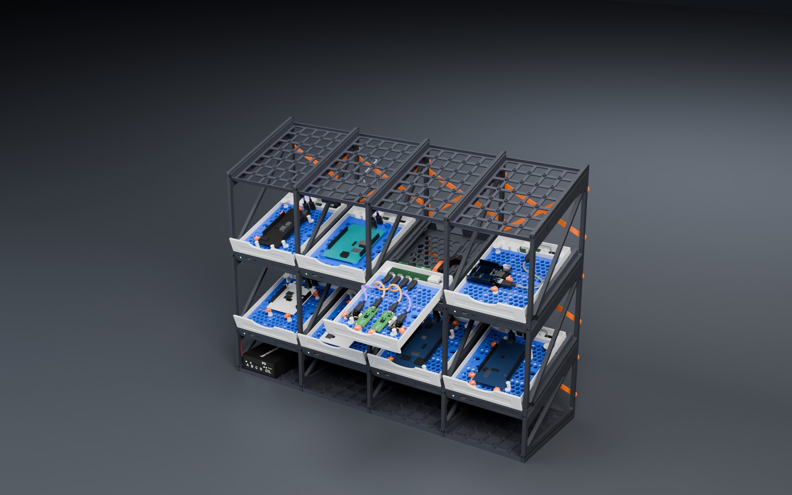

# hw-testing-rack

**A 3D-printed, tilted test shelf for up to 16 development boards — every
board in its own sliding drawer, power-switched, current-metered and exposed
over the network with USB/IP by a Zephyr-powered ESP32-S3 in each bay.**



**[▶ Interactive 3D model](https://kartben.github.io/hw-testing-rack/)** · [BOM](bom/README.md) ·
[Architecture](docs/architecture.md) · [Mechanics](docs/mechanical.md) · [Cabling](docs/cabling.md) ·
[Power](docs/power.md) · [Electronics](docs/electronics.md) · [Assembly](docs/assembly.md) ·
[Firmware](docs/firmware.md)

## Highlights

* **Stadium shelf** — 2020 aluminium frame, rows tilted 20° by printed tier
  brackets so every board, LED and label faces you.  Each row is its own
  module with its own layout: 4 standard bays, or 2 double-width bays for
  i.MX-class EVKs.
* **Drawers that stay connected** — each bay is a drawer sliding 140 mm along
  the slope; a drag chain hidden in the floor carries the cable, so you can
  pull a board out to probe it while it keeps running.
* **Swappable form-factor plates** — boards screw (or snap) onto a plate
  generated from a small board library (UNO, Nucleo-64/144, Pico, ESP32
  DevKitC, nRF DKs, FRDM, …) that drops into any drawer.
* **One ESP32-S3 per bay** — switches the board's 5 V (current-limited,
  default on), measures V/I (INA226), drives UART/RESET/BOOT lines, and
  exports the board's USB with Zephyr's USB/IP host service.  Plug a laptop
  into the bay's front port and the USB data path switches to it — the
  "classic" way still works, even with no firmware.
* **Plug in one cord** — fanless 200 W PFC supply inside the base, IEC inlet
  with fuse and switch, 24 V bus with an eFuse per row and a 60 V-rated buck
  in every bay.
* **Cameras** — optional XIAO ESP32S3 Sense pods hang from any bay's ceiling.
* **Everything is generated** from [`config/rack.yaml`](config/rack.yaml):
  OpenSCAD parts, KiCad schematics *and* PCBs (schematic-as-code, Freerouting),
  the BOM with LCSC part numbers, and the interactive viewer.

| | |
|---|---|
|  |  |
| Bay node — ESP32-S3, 2 USB muxes, TPS2553, INA226, 60 V buck | A drawer pulled out, board still connected |

## Repository layout

```
config/rack.yaml          single source of truth (rows, bays, tilt, dimensions, population)
mechanical/               OpenSCAD: lib/, parts/, boards/boards.yaml, generated/ (from the config)
electronics/
  tools/                  schematic-as-code (eda.py), PCB builder (pcbgen.py), catalogue, LCSC resolver
  bay-node/               design.py + generated KiCad project, fab/, docs/
  power-hub/              design.py + generated KiCad project, fab/, docs/
  lib/                    custom symbol(s), cached JLC basic passives
site/                     GitHub Pages: three.js viewer + BOM page (assets generated)
bom/                      full rack BOM (CSV + summary)
render/                   Blender scene + photoreal renders
tools/                    build.py (config/STL/web), kicad.sh, bom.py, jlc_mcp.py
docs/                     design documentation
```

## Building

Prerequisites: Python ≥ 3.10 with `pyyaml numpy trimesh` (`pip install -r tools/requirements.txt`),
Docker (for KiCad 10, Freerouting and — if not installed locally — OpenSCAD).

```bash
python tools/build.py all                    # config → STLs → web viewer assets
tools/kicad.sh bay-node --route --fab        # schematic, PCB, autoroute, Gerbers/BOM/CPL, renders
tools/kicad.sh power-hub --route --fab
python tools/bom.py                          # full rack BOM
python -m http.server -d site 8000           # open http://localhost:8000
```

Photoreal renders (Blender + Cycles) start from `render/assembly.glb`, baked
from the same scene as the viewer by `python tools/assembly_glb.py`.  Either
render headless in Docker (`tools/render.sh hero`) or drive a Blender you
already have open — GPU and all — through the Blender MCP add-on's socket:

```bash
python tools/blender_live.py exec render/live_scene.py                    # (re)build the scene
python tools/blender_live.py exec render/live_render.py hero              # → docs/img/hero.jpg
python tools/blender_live.py exec render/live_render.py drawer:C2 docs/img/drawer.jpg

python tools/assembly_glb.py --explode-bay C3 --out render/bay-exploded.glb   # one bay, layers apart
python tools/blender_live.py exec render/live_scene.py render/bay-exploded.glb
python tools/blender_live.py exec render/live_render.py exploded
```

Change the shelf in `config/rack.yaml` (tilt, row layouts, bay pitch, which
bays get cameras, which board sits where) and rebuild.

## Status

v0.1 — design complete end to end, **not yet built**.  Mechanics are
printable and parametric; both PCBs pass ERC and DRC with full schematic
parity but are **autorouted drafts awaiting human review** (see
[electronics.md](docs/electronics.md)); the node firmware is a plan
([firmware.md](docs/firmware.md)).  Board outlines marked `verified: false`
in `boards.yaml` are approximate.

## License

Hardware (mechanical and electronics design files): **CERN-OHL-P-2.0**.
Software (tools, viewer, firmware): **Apache-2.0**.  See [LICENSE](LICENSE).
