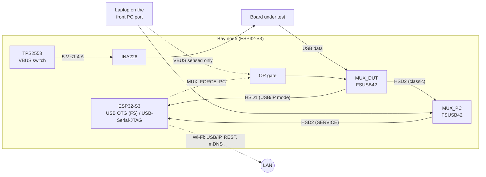

# Architecture

hw-testing-rack is a desk-sized, tilted ("stadium") rack, printed end to end,
that holds 12 development boards in its default 4 × 3 layout (more by adding
columns or rows) and makes every one of them reachable over the network
**and** pluggable by hand:

* each bay has its own **bay node** — an ESP32-S3 that switches the board's
  5 V, measures its current, and exposes its USB port over **USB/IP**
  (Zephyr's `usbip` host service);
* each bay is a **drawer** that slides out 140 mm along the slope while the
  board stays powered and connected (a drag chain hidden under the floor
  carries the cable);
* boards are screwed onto **form-factor plates** that drop into any drawer;
* one **USB-C PD charger** powers the rack through a **power box** under the
  first column: the hub negotiates 20 or 28 V, an eFuse per row, and the rack
  controller (CAN master), see [power.md](power.md) and [can.md](can.md);
* optional **camera pods** look down into selected bays.


*One bay (C3), bottom to top: the tray with the bay-node PCB and the drag chain, the drawer, the form-factor plate, the board (ESP32-C6-DevKitC), and the camera pod hanging from the ceiling above.*

## Rows, bays and columns

The structure is the **panel frame** (config: `frame:` and `rows:` in
[`config/rack.yaml`](../config/rack.yaml)): printed side walls ("ladders")
stand between the columns and are shared by neighbouring bays, one ladder per
row, stacked on base ladders and topped by cap strips; each bay's **tray**
slides into the grooves of its two ladders; an X **brace** behind every bay and
row keeps the grid square.  Rows are tilted 20° by default and stacked
`rows[].height` apart; the column pitch is 165.8 mm.  The default build is
three rows of four bays.

Changing the config regenerates everything that depends on it: the OpenSCAD
constants, the web scene, the BOM and the PCB outlines/connector positions.

## One bay, top to bottom

```
            ┌───────── ceiling: tray of the row above, or the cap plate (camera pod inserts) ─────────┐
            │                                                                                         │
 drawer ──▶ │  [front panel + label]  board on its plate  ⟵ short USB ⟶ [DATA port] [rear bay]       │
 ledges ──▶ ├──── C-channel lips ────────────────────────────────────────────────── magnet detent ──┤
 plenum ──▶ │  [bay node PCB]  ─ext cable→ [chain fixed end] ⊂═══ drag chain U ═══⊃ [foot]          │
 fascia ──▶ │  PC USB-C · status LED · SERVICE switch                                                 │
            └──────── tray: runners in the grooves of the ladders on both sides (tilted) ────────────┘
```

* **Tray** (printed): slides into the ladders' grooves and clicks in; forms
  the 23 mm *plenum* that hides the bay node and the drag chain; its front
  wall is the fascia, its bottom the ceiling of the bay below; two side
  ledges under C-channel lips carry the drawer, the left one the
  closed-position magnet.
* **Drawer** (printed): front panel with label recess and finger pull, plate
  pocket, rear bay with a panel-mount USB-C female (DATA, in the left or right
  position: whichever is farther from the board's USB) and the cable window; a
  foot under the rear carries the chain's moving end.
* **Plate** (printed, per board form factor): heat-set-insert or snap-pin
  standoffs at the board's holes, or corner fences for hole-less boards.

See [mechanical.md](mechanical.md) and [cabling.md](cabling.md).

## Data paths and modes



| SERVICE switch | Laptop on PC port | DUT data goes to | Use |
|---|---|---|---|
| off | no | ESP32-S3 USB OTG → **USB/IP** over Wi-Fi | default, remote |
| off | yes | the laptop (**classic mode**) — automatic, even with no firmware | debugging on the bench |
| on | any | disconnected; laptop ↔ ESP32 USB-Serial-JTAG | flash / debug the node itself |

Firmware can also force classic mode (`MUX_FORCE_PC`).  In every mode the
node keeps control of the board's power (switch it off/on, read V/I) and of
the AUX lines (UART, open-drain RESET/BOOT).

**Speed.** The ESP32-S3 has one internal full-speed PHY: through USB/IP every
board enumerates at 12 Mbit/s.  That is plenty for CMSIS-DAP/J-Link/ST-LINK
probes, UARTs and DFU; mass-storage drag-and-drop of large images is slower.
Classic mode is a plain analog path (the FSUSB42 is a 480 Mbit/s switch), so a
laptop gets full high-speed.

## Power

A USB PD 3.1 charger (140 W EPR recommended, 5 A e-marked cable) → the power hub
in the power box under A1 (AP33772S sink: 20 V, or 28 V EPR on the controller's
request; TVS, NMOS switch, one 1.6 A TPS26600 eFuse per row, off until the
contract is final) → one 6-pin JST PH feed per row (VRACK, CAN, POS) →
daisy-chained bay to bay through the ladders → each bay node's own 60 V LMR51635
buck to 5 V.  Details and alternatives (a 24 V brick, internal mains supply,
PoE++) are in [power.md](power.md); the rack bus is in [can.md](can.md).

## Software

Each node runs Zephyr: `uhc_dwc2` (ESP32-S3 OTG in host mode) + the
`usbip` host service + Wi-Fi + a small REST/shell API for power, AUX and
telemetry, mDNS-advertised as `bay-<id>.local`.  See [firmware.md](firmware.md).

```console
$ usbip list -r bay-b3.local
$ sudo usbip attach -r bay-b3.local -b 1-1     # the Pico in B3 is now a local USB device
```
