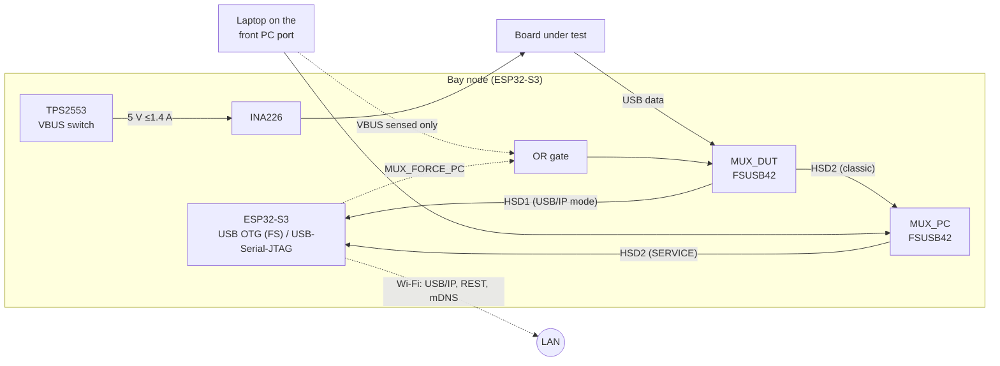

# Architecture

hw-testing-rack is a desk-sized, tilted ("stadium") shelf that holds up to 16
development boards and makes every one of them reachable over the network
**and** pluggable by hand:

* each bay has its own **bay node** — an ESP32-S3 that switches the board's
  5 V, measures its current, and exposes its USB port over **USB/IP**
  (Zephyr's `usbip` host service);
* each bay is a **drawer** that slides out 140 mm along the slope while the
  board stays powered and connected (a drag chain hidden under the floor
  carries the cable);
* boards are screwed onto **form-factor plates** that drop into any drawer;
* a single **mains cord** feeds an internal 24 V fanless PSU in the base;
* optional **camera pods** look down into selected bays.


*One bay (C3), bottom to top: carrier base with the bay-node PCB and the drag chain, removable deck, drawer guides, drawer, form-factor plate, the board (ESP32-C6-DevKitC), and the camera pod hanging from the row above.*

## Rows, bays and units

The shelf is a stack of independent **row modules** (config: `rows:` in
[`config/rack.yaml`](../config/rack.yaml)).  A row is two 2020 beams held at
the shelf tilt (20° by default) by two printed **tier brackets** bolted to the
four corner posts, and a row of **carrier units** (160 mm pitch).  Each row
has its own `layout`, e.g. `[1, 1, 1, 1]` (four standard bays) or `[2, 2]`
(two double-width bays for i.MX-class EVKs).  The default build is
A/B/C = 4 bays, D = 2 double bays → 14 bays on 16 units.

Changing the config regenerates everything that depends on it: the OpenSCAD
constants, the web scene, the BOM and the PCB outlines/connector positions.

## One bay, top to bottom

```
            ┌─────────── ceiling: carrier of the row above (camera pod inserts) ──────────┐
            │                                                                             │
 drawer ──▶ │  [front panel + label]  board on its plate  ⟵ short USB ⟶ [DATA port] [rear bay] │
 deck   ──▶ ├──── guides (C-channel) ──────────────── slot ─────────────── magnet detent ──┤
 plenum ──▶ │  [bay node PCB]  ─ext cable→ [chain fixed end] ⊂═══ drag chain U ═══⊃ [foot] │
 fascia ──▶ │  PC USB-C · status LED · SERVICE switch                                       │
            └──────────────── front and rear 2020 beams (tilted) ─────────────────────────┘
```

* **Carrier base** (printed): sits on the row's two beams, forms the 20 mm
  *plenum* that hides the bay node and the drag chain; its front wall is the
  fascia; its bottom plate is the ceiling of the bay below.
* **Deck** (printed, removable): the bay floor; carries the drawer guides,
  the chain slot and the closed-position magnet.
* **Drawer** (printed): front panel with label recess and finger pull, plate
  pocket, rear bay with a panel-mount USB-C female (DATA, in the left or right
  position: whichever is farther from the board's USB) and the cable window; a foot under the rear reaches through the deck slot to the chain.
* **Plate** (printed, per board form factor): heat-set-insert or snap-pin
  standoffs at the board's holes, or corner fences for hole-less boards.

See [mechanical.md](mechanical.md) and [cabling.md](cabling.md).

## Data paths and modes



| SERVICE switch | Laptop on PC port | DUT data goes to | Use |
|---|---|---|---|
| off | no | ESP32-S3 USB OTG → **USB/IP** over Wi-Fi | default, remote |
| off | yes | the laptop (**classic mode**) — automatic, even with no firmware | debugging on the bench |
| on | any | disconnected; laptop ↔ ESP32 USB-Serial-JTAG | flash / debug the node itself |

Firmware can also force classic mode (`MUX_FORCE_PC`).  In every mode the
node keeps control of the board's power (switch it off/on, read V/I) and of
the AUX lines (UART, open-drain RESET/BOOT).

**Speed.** The ESP32-S3 has one internal full-speed PHY: through USB/IP every
board enumerates at 12 Mbit/s.  That is plenty for CMSIS-DAP/J-Link/ST-LINK
probes, UARTs and DFU; mass-storage drag-and-drop of large images is slower.
Classic mode is a plain analog path (the FSUSB42 is a 480 Mbit/s switch), so a
laptop gets full high-speed.

## Power

24 V from a Mean Well UHP-200-24 (fanless, PFC) in the base → power hub
(reverse protection, TVS, one TPS26600 eFuse per row) → one JST-VH feed per
row → daisy-chained bay to bay → each bay node's own 60 V buck to 5 V.
Details and alternatives (external brick, USB-C PD EPR, PoE++) in
[power.md](power.md).

## Software

Each node runs Zephyr: `uhc_dwc2` (ESP32-S3 OTG in host mode) + the
`usbip` host service + Wi-Fi + a small REST/shell API for power, AUX and
telemetry, mDNS-advertised as `bay-<id>.local`.  See [firmware.md](firmware.md).

```console
$ usbip list -r bay-b3.local
$ sudo usbip attach -r bay-b3.local -b 1-1     # the Pico in B3 is now a local USB device
```
