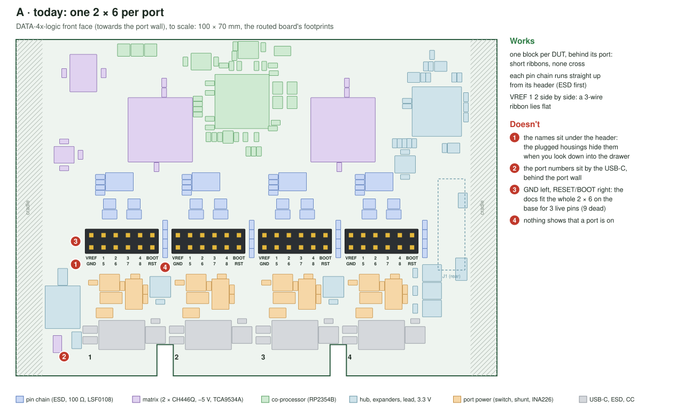
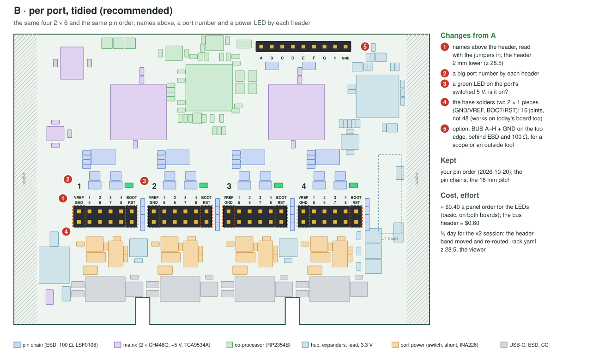
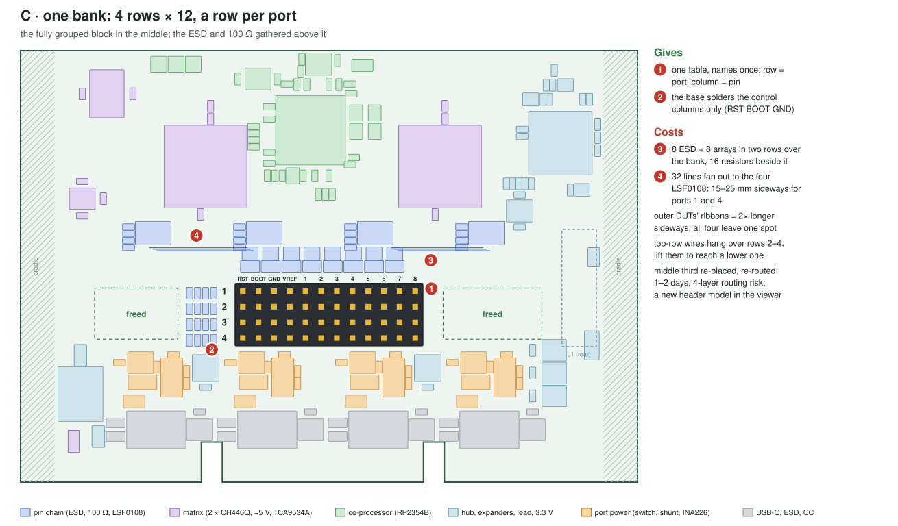
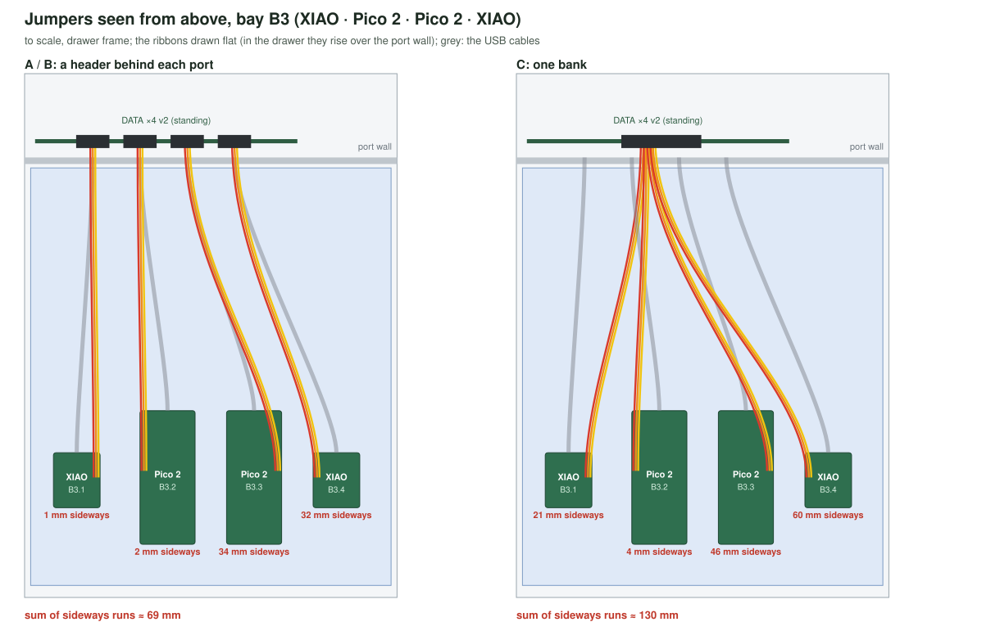

# DATA-4x-logic: usability and simplification review

**Status (2026-10-20): review only, nothing changed on the board.**  **Applied 2026-10-21** in the v2 session's pass (one re-route): findings 1 (layout B, the user's "oui je valide"), 2 (the bias from +5V_MX, with the VREF dividers at 10k / 10k: through 100k / 100k an unwired VREF floats up to ≈ 2.1 V on the bias current and the group passes), 3 (the VBUS LEDs), 4 (U12 out), 5 (22 Ω, earlier) and 7 (docs); 6, the bus header, later.  The BOM: 17 extended types (the 22 Ω swap had taken the 20 to
18 already), the panel order $229.91 → $226.88.  The user asked for a usability review of
the DATA-4x-logic (the standing DATA ×4 v2, [electronics.md](electronics.md) › "DATA ×4 v2.0"): the Dupont
headers ("je me demande si on pourrait pas avoir quelque chose de complètement groupé si au final les
connexions sont complètement virtuelles"), features in excess or missing, and what would simplify the
board.  Mock-ups, to scale from the routed board's footprints:
[`electronics/data-port-x4-v2/docs/review/`](../electronics/data-port-x4-v2/docs/review/).

Costs are per **panel order** as the rack orders it: 2 panels, so 2 logic and 2 base boards, $237.21
(`tools/bom.py` › `panel_order(2)`, with 92f09f4's preferred tier: 20 extended types to load).  The logic's own share is ≈ $76 of it: parts $30.5, 11 extended part
types $33.8 (at $3.07 each, loaded once per order), L1's minimum purchase $9.5, joints ≈ $2.
*Obvious*: an engineering call the board's session makes and reports; *user*: a real trade-off.

## Ranked findings

| # | Finding | Call | $ a panel order | Effort | Risk |
|---|---|---|---|---|---|
| 1 | Keep one header per port, tidied (**layout B**): names above the header, the header 2 mm lower (z 28.5), a big port number by each | obvious (names, numbers); the layout is the user's | 0 | ½ day | low |
| 2 | Untie each pin group from its USB port: bias the LSF0108's Vref_B/EN from +5V_MX, not PORTn_VBUS.  A group becomes a voltage domain any board can use | obvious, told to the user | 0 | 1 h + re-route | low |
| 3 | A green VBUS LED per port, by its header | user (the open LED question) | +0.40 | in 1 | low |
| 4 | U12 out: the co-processor's 3.3 V from +3V3 through a ferrite | obvious | −3.50 | 1 h | low |
| 5 | R23/R24: 22 Ω basic (C25092) instead of 27 Ω extended | obvious | −3.07 | 10 min | none |
| 6 | A BUS A–H + GND header on the top edge, for a scope or an outside tool | user | +0.60 | ½ day | low |
| 7 | The base solders two 2 × 1 pieces (GND/VREF, BOOT/RST), not the 2 × 6 | obvious (docs, viewer) | ≈ 0 | docs | none |
| 8 | One bank (**layout C**, 4 × 12) | user: not recommended | 0 | 1–2 days | medium |
| 9 | The 12 MHz crystal as JLC basic (C9002) | not recommended | −4.30 | 1 h | the stock UF2 |
| 10 | A smaller matrix, or one 24-bit expander for all | not recommended | −5 / −6 | days | half the pins / firmware |

Findings 1–7 fit one pass of the v2 session and one re-route: about a day, −$5.6 a panel order net.  None
changes the board's size, its 4 layers, the cradle interface or the panel.

## 1. The Dupont headers: four groups or one block?

### The four groups are voltage domains

The crosspoints make any pin-to-pin link virtual, but the pins are not interchangeable.  Each port's
eight pins pass through that port's LSF0108, whose A side is referenced to the VREF wired on that
header: the I/O voltage of the board those pins go to.  Two boards at 3.3 V and 1.8 V cannot share one
group.  So the board has four groups whatever the header looks like: four VREFs, each with its own eight
pins.

Today each group is also tied to its USB port: the LSF0108's Vref_B and EN come from PORTn_VBUS through
200k, so a group passes nothing while its port is off.  That tie is not needed (finding 2).  An unwired
VREF already isolates a group: its 100k divider pulls it to 0 V, which closes every channel, and the
design relies on that.  A board that is off takes its VREF down with it, so it is isolated too.  Bias
Vref_B from +5V_MX instead, and a group becomes a free voltage domain:
- a board needing more than 8 pins takes two groups (both VREFs to its rail);
- a board powered from elsewhere (its own supply, a debugger) can use a group;
- one thin bias line (it carries µA) feeds the four 200k resistors, instead of four PORTn_VBUS branches
  climbing 25–30 mm through the header band.  +5V_MX passes at x 7.7 on B.Cu, level with them; the LSF0108's
  bias wants a supply about 1 V above the highest VREF (TI requires 0.8 V and recommends 1.0 V), so a 5 V
  source, not +3V3.  With +5V_MX at 4.75 V, VREF tops out at ≈ 3.9 V; a 5 V board takes VREF from its own
  3.3 V pin (electronics.md › DATA ×4 v2, "The VREF rule").

The rule changes from "a switched-off port isolates its pins" to "a board that is off isolates its
pins".  Physically each board still sits in front of its port, so its group stays the header behind it.

### Three layouts

| | A: today | **B: per port, tidied** | C: one bank, 4 × 12 |
|---|---|---|---|
| Per-port VREF | beside its eight pins | same | one row per group, VREF in it |
| Boards and jumpers (B3) | each ribbon straight back to the header behind its port; sideways ≈ 69 mm in all | same | all four leave one 30 mm block: ≈ 130 mm in all, up to 60 mm for B3.4, over the inner boards' USB cables |
| Labelling | names under the header: once the housings (≈ 14 mm long) are in, anything 1–3 mm under them is hidden from above.  Port numbers by the USB-C, behind the port wall | names above the header, a big port number and a power LED by each | one table: column names once, row = port; the pins of a full brick hard to tell apart |
| Plugging | one 2 × 6 per board | same | the top row's wires hang over rows 2–4 |
| ESD, pin chain | straight up from the header, ESD first, nothing crosses | same | 8 ESD and 8 arrays in two rows over the bank; ports 1 and 4 run 15–25 mm sideways to their LSF0108; rows 2–4 escape between row 1's pins (1–2 tracks a gap) |
| Area, layers | — | same | same parts; two header sites freed with nothing to put there; 4 layers kept, the busiest band re-routed |
| Cradle, drawer window | clear | clear | clear |
| Hand soldering | 48 joints | 48; base 16 | 48 (two 2 × 12 stacked); base 12 |
| Viewer | — | header z 28.5 | a new header model, the ribbons solved again |
| Base (GND, RESET, BOOT) | the docs fit the whole 2 × 6, 9 pins dead | two 2 × 1 pieces | the three control columns |
| Adapter boards (decided 10-19, later) | one 2 × 6 housing per board (a 2 × 6 IDC socket, ≈ 20 mm, does not fit the 18 mm pitch twice) | same | a 1 × 12 housing per board |

**Pick: B, with finding 2.**  Grouping buys one label table and costs longer, converging ribbons, a
re-placed middle third and a re-route, for no electrical gain: the groups stay four whatever the
header.  B keeps what works in A (one block per board, straight ribbons, straight pin chains) and fixes
what doesn't: the names you can't read once wired, the hidden port numbers, no sign of a port being on.
Moving GND, RESET and BOOT together at one end was considered and dropped: it would change the pin order
the user set on 10-20, and the base gets the same 4 pins per port from two 2 × 1 pieces anyway.

## 2. Features in excess

| Block (logic only) | $ a board | Verdict |
|---|---|---|
| 2 × CH446Q, 32 pins on 8 buses | 3.20 | Keep: it is the feature, sized to the maximum (decided).  4 pins a port would drop one CH446Q, four ESD and four arrays (≈ $2.2 a board, ≈ $5 an order) and half the pins: no. |
| −5 V (TPS60400) | 0.79 + type | Keep: without it R_on doubles (120–225 Ω at a single 5 V) and I²C fails: at 400 kHz, and a 1.8 V board's low. |
| TCA9534A (matrix, RUN, BOOTSEL, mark) | 1.37 + type | Keep: wires and BOOTSEL survive a co-processor reboot.  One TCA6424A ($1.77, C80692) for all 24 lines would save a type and ≈ $6 an order, but re-place the base's expanders and change the node's I²C map: no. |
| RP2354B, crystal, L1 | 2.46 + 3 types | Keep.  L1 (the AOTA, and its $9.5 minimum purchase) and the arrays were settled on 10-20.  The crystal could be C9002 (basic, 12 MHz, but 20 pF and 80 Ω ESR against the ABM8's 10 pF and 50 Ω): $4.30 saved, but the stock gusmanb UF2 and Raspberry Pi's advice assume the ABM8.  Not worth a day-one risk. |
| U12, the co-processor's own AP2112K | 0.18 + type | **Cut** (finding 4).  +3V3_CP from +3V3 through a ferrite (C1017, already on the board).  U3 takes ≈ 30–50 mA more: ≈ +0.1 W, ≈ +6 °C, and the hub likely draws less than its 330 mA (High-Speed) behind a full-speed-only host.  The +3V3_CP island stays; the base leaves the ferrite off. |
| R23/R24 27 Ω (extended) | type | **22 Ω basic** (finding 5): on 2 cm of full-speed link to the hub, 22, 27 or 33 Ω make no difference. |
| 4 × LSF0108 | 4.57 | Keep: 1.8 V boards (Nordic DKs can run their I/O at 1.8 V) and the isolation. |
| 8 × TPD4E05U06, 8 × 100 Ω arrays | 0.70 | Keep: hand-plugged pins; the ESD type is the base's too (U4), no fee. |
| VREF dividers (100k / 100k) | 0.01 | Keep: they are also the pull-down that isolates an unwired group. |
| Switched 2.2k bus pull-ups (RN6/RN7) | type | Keep: only our Zephyr firmware drives them (the stock UF2 leaves them off, I²C at 100 kHz on the 10k); DNP them (−$3.07) only if that firmware is dropped. |
| ±5 V sense dividers, D1, SWD pads | 0.03 | Keep: cheap diagnostics. |

The logic block is lean: U12 and the 27 Ω type are its only pure overhead, −$6.6 a panel order
together.

## 3. Features missing

| Feature | Verdict | Cost |
|---|---|---|
| Is a port on? | **Yes** (finding 3): a green LED on each port's switched 5 V (before the shunt, so the INA226 doesn't count it), by its header's number; KT-0805G and 1k, both already on the board.  The layout study drew port LEDs on the top edge and the viewer draws four; the routed board has none | +$0.40 a panel order (both boards) |
| Names readable once wired, port numbers where you look | **Yes** (layout B) | 0 |
| A way onto the buses | **User**: BUS A–H + GND, a 1 × 9 through-hole on the top edge (x 59–80, free of parts), behind 2 × TPD4E05U06 and 2 × 100 Ω arrays (types on the board).  A scope sees a virtual wire's real edges, which the 8-channel digital analyzer can't; an outside tool (a USB–UART, a bench analyzer) joins a bus.  3.3 V only, like the buses; not fitted on the base | +$0.60 |
| VREF present? | No hardware: the co-processor's ADC reads VREF / 2 already.  Our firmware should show it and warn "pins wired, no VREF"; with the stock UF2 nobody reads it, so the docs keep saying "wire VREF" | 0 |
| A GND per row, keying | No: one GND per header, the USB cable carries ground; Dupont housings have no key and a shrouded 2 × 6 (≈ 23 mm) does not fit the 18 mm pitch | — |
| An LED per bus | No: it would load the bus | — |
| A "3V3" pin beside VREF, for a jumper cap on 3.3 V boards | No: one forgotten cap puts 3.3 V on a 1.8 V board | — |
| Strain relief for the ribbons | A tie point on the cradle under the headers (Mechanics), not the board | — |

Firmware check, no board change: RESET and BOOT should only ever be pulled low or released (open drain,
as the TCA9534A's RUN and BOOTSEL), never driven high through the 1k into a 1.8 V board.

## 4. Simplifications that keep every function

1. **Groups untied from the ports** (finding 2): R111, R211, R311, R411 move their top end from PORTn_VBUS to
   +5V_MX.  One bias line instead of four VBUS branches, and any board can use any group.
2. **One 3.3 V regulator for the board** (finding 4): U12 out, a ferrite in; one extended type less.
3. **One extended type less on the USB** (finding 5): 22 Ω basic.
4. **The base's header**: two 2 × 1 pieces per port (`cabling.md`, the B1 comment in `rack.yaml`, the
   viewer's base header).  It works on today's board.
5. **One label change**: the names above the header, the port numbers beside it (layout B).

What can't be simplified without losing a decided function: the −5 V (I²C at 400 kHz), the LSF0108s
(1.8 V boards), the ESD and 100 Ω (hand-plugged pins), the TCA9534A (wires that survive the co-processor),
and the 4 layers, already the minimum.

## If the user picks B

For the v2 session, in one pass and one re-route:
- `design.py`, the header band:
  - the headers 2 mm lower (`rack.yaml` › `header.z` 28.5, `odd_z` / `even_z`), the RESET/BOOT resistor
    columns with them;
  - the names above, the port numbers beside them;
  - a VBUS LED and its 1k per port on PORTn_5V_SW;
  - if wanted, the bus header with its ESD and arrays on the top edge.
- `design.py`, the rest: R k+11 on +5V_MX; U12 and C30 out, a ferrite from +3V3 to +3V3_CP (in
  `logic_only`); R23/R24 22 Ω C25092.
- Then the fab files, the panel, the BOM (20 → 18 extended types), `electronics.md` (the pins'
  isolation rule, the block table), `cabling.md` (two 2 × 1 on the base), `site/assets/rack.json`.
