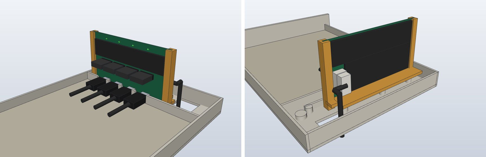
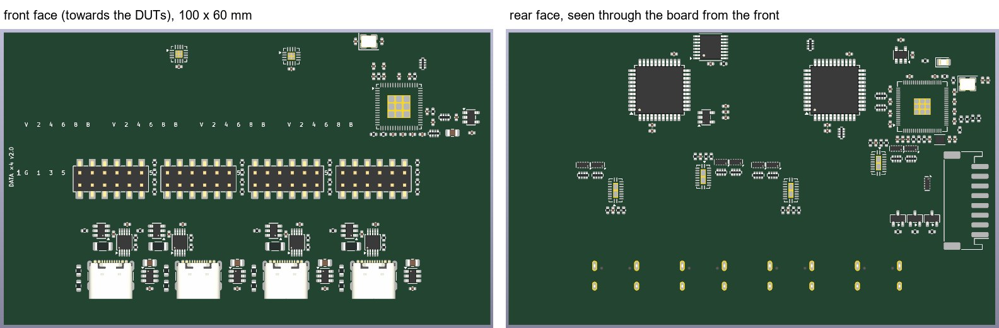
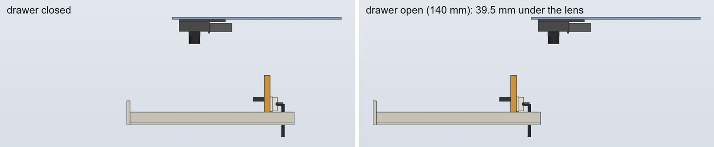
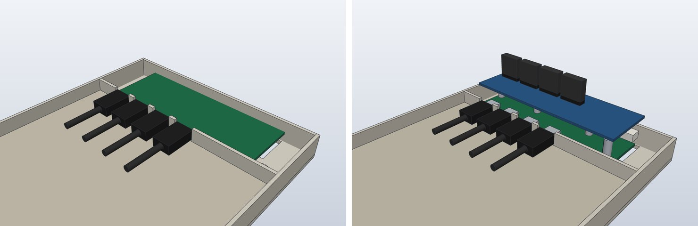

# DATA ×4 v2: more room for the board (layout options)

**Status (2026-10-20): study only, nothing designed or changed.**  The v2 board (analyzer, crosspoint
matrix, level shifters: [data-x4-v2-research.md](data-x4-v2-research.md)) does not route at 108 × 37 mm on
4 layers, and on 6 layers Freerouting plateaus at 25–40 open links.  The user asked whether either of these
would make it easy:
- a much deeper board ("une profondeur de genre 50 mm");
- a board standing vertically at the back of the drawer, with vertical USB-C receptacles.

They then proposed holding the vertical board in a slot, and settled its size at **100 mm long × 60 mm
high**, "or a little more if it helps".

*Option B, exact solids in SolidCraft.*  Left, from the front: the four USB-C plugs in the port wall's
U's, the 2 × 6 headers with their Dupont housings, and the port LEDs along the top edge.  Right, from the
rear: the printed cradle (orange) on the drawer's DATA ×4 bosses, and the PH 8 lead coming up from the
cable window to the board's rear face.

## Options compared

The baseline is the v2 board as it is being routed: 108 × 37 mm, 6 layers, 214 parts on both sides,
horizontal in the drawer's 40 mm rear bay (drawer 208 deep, c0330ae).

| | Today | A: deeper, horizontal | **B: vertical** | C: mezzanine |
|---|---|---|---|---|
| Board | 108 × 37, notch 22 × 7 | 108 × 50 | **100 × 60** (fits up to 120 long, and 100 high with a notch under the camera's lens) | v1′ (base) + a 108 × 35 analyzer hat |
| Area per side | 3,842 mm² | 5,246 mm² (+37 %) | 6,000 mm² (+56 %); 7,000 at 100 × 70 | 2 × ≈ 3,800 mm² (two boards) |
| Part fill (courtyards ÷ one side) | 48 % top, 22 % bottom | 35 % / 16 % | 45 % if single-sided (v1: 62 %) | — |
| Open signal links, routing proxy, 6 layers | 67 | 46 (stretched) | 61 at 100 × 60, 66 at 100 × 70 (quick banded re-placement); 37 for today's placement stretched to 120 × 60 | not tried |
| Same at 4 layers | — | — | 118 / 108 (banded), 72 (stretched): out of reach | — |
| Drawer, tray, frame | — | rear bay 53, drawer 219, tray and frame ≈ 221 deep: every ladder, floor and cap plate, brace, tray and drawer reprinted, chain geometry rechecked | **unchanged**: a printed cradle on today's DATA ×4 bosses | unchanged: 4 standoffs on v1′'s holes |
| Universal drawer (DATA port, v1, v1′) | yes | yes, deeper | yes | yes |
| USB-C | USB4105 × 4, horizontal | same | HRO TYPE-C-31-D-06 × 4, vertical | USB4105 × 4 on v1′ |
| Headers (2 × 6 per port) | pins up, behind the wall | pins up | front face, pins forward, z 32 | pins up, on the hat |
| SolidCraft, drawer closed and open | — | **346 mm³ into the rear wall** | no interference; the stroke sweeps 39.5 mm under the camera's lens (29.5 at 70 mm high), 70 mm under the tray above | no interference |
| Viewer (B3) | stand-in | regenerate everything | new vertical stand-in + cradle | hat + standoffs |
| Assembly notice | — | every frame page | one new step | one new step |
| JLC, 5 / 10 boards (PCB + PCBA + parts) | $355 / $501 | $355 / $501 (6L), $346 / $493 (4L) | **$295 / $452** (100 × 60, 6L, one face, Economic); $271 / $419 at 4L if it ever routed | $310 / $457 (2-design panel) or $363 / $518 (2 orders) |

**Recommended: B at 100 × 60 (or 100 × 70), 6 layers, every part on one face, held in the slotted cradle.**
- It leaves the frame and the drawer as they are, and the drawer stays universal.
- It gives 56–82 % more room, enough for one face.  JLC's Economic assembly applies, and the ≤ 100 mm
  board pays no engineering fee: ≈ $295 / $452 for 5 / 10 boards, −$59 / −$49.
- It puts the headers where the jumpers go, facing the boards.
- It does not make routing easy.  The extra room helps, but placement decides more than area, and
  4 layers stayed out of reach in every proxy.  The layout remains the v2 design session's work, with the
  co-processor right beside the crosspoints.

## Routing room: an experiment

To see what room alone buys, the v2 session's placed board (2026-10-20 09:30, read-only copy) was turned
into routing proxies.  All of them went through the same flow:
1. the locked pre-routes and the outer GND pours removed, the DSN exported by KiCad 10;
2. Freerouting 2.5.0 on zephyrbox, at most 40 passes (it stops earlier when a pass gains nothing);
3. the session imported back into KiCad, the zones refilled.

KiCad's unconnected items are then split in three:
- pads of the plane nets (GND, +3V3, +5V): the v2 flow ties each to its plane with a via after the import;
- local supplies (+3V3_CP, +1V1, −5 V, VBUS, VREF, sense lines): islands and short wide tracks in the v2
  flow;
- **signal links**, the real work.

The baseline here is worse than the v2 session's own 25–40, because that flow pre-routes the USB pairs,
the shunts and the plane ties.  Compare the rows with each other, not with that figure.

| Proxy | Layers | Board | Signal links | Local supplies | Plane-net pads |
|---|---|---|---:|---:|---:|
| Today's placement | 6 | 108 × 37 | 67 | 18 | 57 |
| A: today's placement stretched, y × 1.35 | 6 | 108 × 50 | 46 | 8 | 63 |
| Stretched, x × 1.11, y × 1.62 | 6 | 120 × 60 | 37 | 11 | 63 |
| Stretched | 4 | 120 × 60 | 72 | 15 | 65 |
| Stretched further | 4 | 120 × 80 | 82 | 15 | 67 |
| B, banded (below) | 6 | 115 × 60 | 41 | 16 | 59 |
| B, banded | 4 | 115 × 60 | 99 | 21 | 76 |
| **B, banded** | 6 | **100 × 60** | 61 | 19 | 60 |
| B, banded | 4 | 100 × 60 | 118 | 31 | 65 |
| B, banded | 6 | 100 × 70 | 66 | 15 | 55 |
| B, banded | 4 | 100 × 70 | 108 | 24 | 68 |

"Stretched" scales every part's position about the rear-left corner: parts keep their sides,
orientations and relative order.

"Banded" is closer to what a vertical board would really get.  The same 214 parts move as blocks into
horizontal bands, each block keeping its internal placement.  Top to bottom:

| Band (z over the drawer bottom) | Front face (towards the DUTs) | Rear face |
|---|---|---|
| 40–60 | hub, crystal, LDO, both TCA6408A, the port LEDs | both CH446Q, TCA9534A, charge pump; the RP2354B block |
| 26–38 | the four 2 × 6 headers, their 1 k / 100 k | per port: 100 Ω arrays, TPD4E05U06 × 2, LSF0108; the PH 8 on the right (100 mm board) |
| 16–24 | per port: TPS2553, shunt, INA226, right over its receptacle | the lead's I²C buffers |
| 2–16 | the receptacles at z 11, USBLC6, CC resistors | — (the cradle's base is at z 7.8–10.8) |

At 100 × 70 the extra 10 mm goes between the top band and the headers.

What it shows:
- **Room helps when the placement is good.**  Stretching today's placement to 1.37 × and 1.87 × the area
  cut the open signal links from 67 to 46 and 37.
- **A quick re-placement did not.**  The banded boards moved whole blocks as they were: the co-processor
  ended far from the left crosspoint, and the blocks' fan-outs still face their old directions.  They did
  no better: 41 at 115 × 60, 61 at 100 × 60, 66 at 100 × 70.  Placement decides more than area.
- **4 layers stays out of reach.**  Every 4-layer proxy left 72–118 signal links, and the v2 session also
  stayed above 85 at 4 layers.  So the 4-layer prices below are not realistic.  With every part on one
  face, a 6-layer board still has B.Cu as a free routing layer.
- **Freerouting finishes none of them.**  On the same 108 × 37 board, the v2 session's own flow
  (pre-routes, plane handling, structural fixes) leaves 28 links after 21 passes, where this proxy flow
  leaves 67 signal links.  A 100 × 60 board gives that
  work more room: a band for buses A–H, a column per port, the co-processor beside both CH446Q and the
  TCA9534A.  Its rule holds there too: no overlapping +5V and +3V3 areas on one layer.
- **Untested.**  The one-face placement JLC's Economic needs, and the vertical receptacle's footprint
  (16 pads in two rows at 0.5 mm, four shell legs): the proxies keep the USB4105.

## Option A: horizontal, ≈ 50 mm deep

- **Fit.**
  - A 108 × 50 board from the port wall's back face (drawer y 166) reaches y 216.  SolidCraft finds
    346 mm³ in the drawer's rear wall (y 206–208).
  - It needs a 53 mm rear bay, so a 219 mm drawer and a ≈ 221 mm tray.  The Mechanics session found that
    ≥ 45 mm already needs `CARRIER_D` 210 → 220.
- **What changes.**
  - `config/rack.yaml` › the carrier and drawer depths.
  - Every ladder (the rear posts move), the floor and cap plates, every brace, every tray and drawer.
  - The chain's bend and end-piece asserts.
  - The rack becomes 10 mm deeper: the whole printed frame is reprinted for one board.
- **A′: the same board without a deeper frame.**  Take the 13 mm from the DUT plate instead (rear bay
  42 → 55).  The plate shrinks from 159.4 to 146.4 mm deep (−8 %) in every bay, and each bay's layout has
  to be checked again.
- **Gain.**  +37 % area with the same topology: 67 → 46 signal links in the experiment.  Not enough on its
  own.

## Option B: vertical, at the back of the drawer

*The tray above in blue, the camera pod in grey.*

**Length: 100 mm.**
- The board spans drawer x 4–104.  It is centred on the four ports (x 26, 44, 62, 80), with 18 mm left
  outside the outer ones.
- Its right end stops short of the cable window (x 100.9–122.5) and the chain foot's lock screw (x 128).
  The lead comes straight up there, and the screw stays in reach.
- Up to 120 mm fits (x 3–123), but that brings the board over the window and the front-right boss.
- 100 mm also keeps the board within JLC's 100 mm (JLC section).

**Height: 60 mm, or 70.**
- The tray above's underside is 131.9 mm over the drawer's underside: row pitch 165 × cos 20° minus the
  23.1 mm plenum.  Its front edge is 56.4 mm back along the slope.
- The camera pod (`camera_pod.scad`) hangs from it.  Its lowest parts, over the drawer's underside:
  - the M12 lens (Ø 14) to z 101.5;
  - the lens holder (14 × 14) to z 111;
  - the baffle to z 114.5;
  - the sleeve with the Mega's case to z 117.
- The drawer's 140 mm stroke carries the board under the pod.  SolidCraft puts the swept volume:
  - 39.5 mm under the lens with a 60 mm board (top at z 62), 70 mm under the tray;
  - 29.5 mm under the lens with a 70 mm board.
- A 100 mm-high board would hit the lens.  A 22 × 6.5 mm notch in its top edge over the lens's track
  (drawer x 45–67) clears it by 4 mm.  The Mega's sizes are still placeholders in `camera_pod.scad`, so
  any notch must be generous.
- Open, the board stands at y 33, 23 mm in front of the row above: its front face is in full reach from
  above.

**USB-C.** Vertical (top-mount) receptacles, mouth away from the board, through the port wall's existing
U's.  JLC-stocked, USB 2.0, 16-pin, SMD with shell legs (2026-10-20):

| Part | LCSC | Height | Stock | Price | Note |
|---|---|---:|---:|---:|---|
| **HRO TYPE-C-31-D-06** | C2689964 | 6.4 mm | 2,736 | $0.28 | footprint 8.1 × 5.4 mm, 4 legs (0.6 mm holes); the pick |
| XYECONN TYPE-C-F08-2TDW | C22385226 | 6.4 mm | 572 | $0.40 | second source, same height |
| HRO TYPE-C-31-D-11 | C5370448 | 6.5 mm | 368 | $0.42 | 10.8 × 4 mm footprint |
| HRO TYPE-C-31-E-17 | C7424785 | 6.0 mm | 1,104 | $1.42 | |
| HRO TYPE-C-31-D-15 family | C22464480… | 8.8–17.5 mm | 180–500 | $0.65–0.89 | too tall: moves the board onto the rear bosses |

- At the 18 mm pitch, 9.9 mm is left between footprints for the USBLC6 and the CC resistors.
- The mouth sits 1 mm behind the port wall's back face, with the axis at z 11 as today.  A straight
  plug's overmold enters the U as it does now, with 0.52 mm to each side.
- The board's front face is then at y 173.4, ≥ 1.0 mm from the front bosses and clear of the rear ones.
- A vertical receptacle takes the plug force along the board's normal.  The cradle's base sits right
  behind the receptacles, so plugging in pushes the board onto it.

**Headers.**
- 2 × 6 SMD headers (vertical, today's footprint) on the front face, one per port at its receptacle's x,
  at z 32 (16 mm above the wall's top).
- The pins point forward over the plate.  The Dupont housings go on horizontally and the ribbon drops
  forward to the DUT.  That path is shorter than today's, which goes up from a horizontal board and over
  the wall.
- The housings (z 29.5–34.5) overhang only the plate's last 7 mm, above the USB plugs' cables.
- The port LEDs sit on the top edge of the front face, where the user and the camera see them.

**Holding: the slot (user's idea).** A printed cradle acts as a card guide:
- a base screwed onto today's DATA ×4 bosses with the same PT 2.6 × 8 from above, leaving the cable window
  open;
- two uprights, each with a 1.9 mm slot for the board's 1.6 mm edges;
- the board slides in from above.  Its bottom edge rests on the drawer floor, with the base's front edge
  0.1 mm behind it, where the plugs push;
- a clip, or one PT 2.3 screw, at each upright's top keeps the board from lifting when a Dupont or a cable
  is pulled.

The board needs no holes.  SolidCraft gaps: 0.15 mm per side in the slots, 0.1 mm to the base.  Slots in
the drawer floor itself would also work, but they would change the universal drawer and would have to stay
under the horizontal boards' bare undersides.  The cradle keeps the drawer as it is.

**Lead.** The PH 8 lead comes up through the existing cable window, right of the board, into a top-entry
PH 8 (B8B-PH-SM4-TB) on the rear face near the right end, at mid-height.  Nothing changes from J7 to the
window.

**Assembly order.**
1. Screw the cradle onto the bosses.
2. Bring the lead up through the window and plug it into the board.
3. Slide the board down into the slots, receptacles towards the wall, and clip it.
4. Plug in the DUT cables and the Duponts.

The board comes out the same way, without tools once the lead is unplugged.

**Drawer.**
- Unchanged.  B uses about 22 mm behind the port wall (to y 188); the rest of the rear bay is the cradle's
  base over today's bosses.
- The single DATA board, v1 and v1′ keep their bosses and ledges.  The cradle only needs nothing on the
  floor above z 7.8 in the band y 172.5–176.5 behind the port wall, which is true today.
- If v1′ ends up ≤ 28 mm deep, the rear bay could shrink again and give the plate those 10 mm back.  That
  is the Mechanics session's call.
- A sled bay's port block has the same rear bay, so it takes the same cradle.  With the sled out, the
  headers face the user ≈ 110–150 mm inside the bay.

## Option C: a mezzanine (v1′ + an analyzer hat)

- v1′ (hub, USB-C, power switching and measurement) stays horizontal on its bosses.  A second board above
  it, on 4 standoffs at z 24, carries the headers, ESD, LSF0108s, both CH446Q and the RP2354B.
- A 2 × 10 2.54 stacking pair links them: 5 V, 3V3, GND, I²C, INT, the four RESET/BOOT pairs and the
  co-processor's USB.
- SolidCraft: no interference, drawer closed or open.  The Dupont housings reach z 42, and the hat clears
  the USB plugs and v1′'s PH.
- **Cost.**
  - v1′ needs a fifth hub port for the co-processor (USB2517I instead of USB2514B, +$2.7) and the stacking
    header.  Its session is redesigning it now.
  - Two boards mean two designs: one panel in one order, or two orders.
- **Gain.**  It is modular: bays without an analyzer keep v1′ alone.  But the matrix stays crowded under its
  four headers on a 108 × 35 hat.

**Not kept.**
- A vertical board with a short horizontal strip for the USB-Cs: it needs a 30+ pin right-angle
  board-to-board link and two assemblies, while vertical receptacles are in stock at $0.28.
- Two vertical boards back to back: B has room to spare already.

## What each option changes elsewhere

- **B3 viewer** (`tools/webscene.py`, `config/rack.yaml` › `pcb.data_port_x4_v2`).
  - A: only the deeper geometry, regenerated.
  - B: the v2 stand-in becomes vertical.  Its outline, receptacles and header pins turn towards −y,
    `route_jumpers` starts the ribbons forward instead of up, the PH 8 lead ends on the rear face, and the
    cradle is a new printed part.  About the size of the v2 stand-in's own change.  Done (2026-10-20): B3
    shows it in its cradle, from this study's geometry until the v2 session's own.
  - C: a second outline and standoffs.
- **Assembly notice** (`tools/notice`).  Today its drawer step shows the single DATA port board only.
  - A: every frame page regenerated (the pipeline does it), every callout checked.
  - B: one step (cradle, board, lead).
  - C: one step (standoffs, hat).
- **BOM.**
  - B: the cradle (≈ 10 g PETG), the board's 4 × PT 2.6 × 8 now holding the cradle, and 4 × C2689964
    instead of 4 × USB4105.
  - C: the stacking pair, 4 standoffs and their screws, a second PCB.

## JLC cost

Figures from the JLC-cost session (2026-10-20): the jlcpcb.com calculator for the bare boards, JLC's fee
page and capabilities page for the assembly.  USD, indicative, no shipping.  The parts are held equal: 39
types, ≈ 1,082 joints, $154.62 / $278.50 of components for 5 / 10 boards.

Two JLC rules decide it:
- **Economic PCBA takes 2, 4 and 6 layers, one face only.**  Every v2 part and the HRO receptacle are
  "Economic and Standard".  The RP2354B's 0.4 mm QFN-80 is right at Economic's finest pitch.
- **Standard PCBA bills at least 70 × 70 mm, with rails.**  So today's 108 × 37 is billed as 108 × 70.

| Option | Bare PCB, 5 / 10 | Assembly | Order, 5 boards | 10 boards |
|---|---|---|---:|---:|
| Today: 108 × 37, 6L | $55.40 / $61.10 (billed 108 × 70) | Standard, two faces ($127 in fees) | $355 | $501 |
| A: 108 × 50, 6L | same | same | $355 | $501 |
| A: 108 × 50, 4L | $47.20 / $52.70 | same | $346 | $493 |
| B: 120 × 60, 6L | $55.10 / $60.60 | **Economic, one face ($74 in fees)** | $301 | $447 |
| B: 120 × 60, 4L | $46.90 / $52.20 | same | $293 | $439 |
| B: 120 × 80, 4L | $48.70 / $55.70 | same | $295 | $443 |
| **B: 100 × 60, 4L** | **$25.30 / $32.00** (≤ 100 × 100 offer, no engineering fee) | Economic, one face | **$271** | **$419** |
| B: 100 × 70, 4L | $25.40 / $32.20 | same | $272 | $419 |
| B: 100 × 60 or 70, 6L | $49.30–49.40 / $65.00–65.20 | same | $295–296 | $452 |
| B: 100 × 60, 4L, both faces | $25.40 / $32.20 (billed 100 × 70) | Standard, two faces | $325 | $472 |
| B: 100 × 60, 6L, both faces | $49.40 / $65.20 (billed 100 × 70) | Standard, two faces | $349 | $505 |
| C: both boards on one 108 × 74 4L panel | $64.04 / $69.84 | Economic, one order | $310 | $457 |
| C: two designs, two orders | $89.20 / $95.00 | two Economic orders | $363 | $518 |

Notes:
- **100 mm long is the threshold.**  At ≤ 100 mm the engineering fee ($25 at 4L, $33 at 6L) goes away, and
  JLC's ≤ 100 × 100 offer applies, with ENIG too: $8 / $14 at 4L for 5 / 10 PCBs, $32 / $47 at 6L.  The
  offer stops at 10 PCBs.  At 6L, ten boards cost more under the offer ($65.00) than at 120 × 60 ($60.60).
- Height is nearly free: 100 × 70 and 100 × 80 cost $0.10–0.40 more than 100 × 60.
- Standard's rails must run along the 100 mm edges.  Rails on the short edges make the board 110 mm long,
  and the fee comes back.
- 6 layers force ENIG.  At 4L, lead-free HASL would save $12 more (100 × 60: $259 / $406), but ENIG stays
  the choice for the RP2354B's 0.4 mm QFN-80, which is at Economic's pitch limit.
- One-face Economic saves ≈ $53 per order against today's two-face Standard order.  B has the room to put
  every part on one face.
- The vertical USB-C saves $9.88 / $15.40 more, not in the totals: $0.28 against $0.63–0.73 for the USB4105.
  LCSC also holds 2,580 of it, where it holds no USB4105, so JLC can refill it.  It is rated 5 A at 5 V:
  enough for the DUT ports, not for PD.
- C's 2.54 mm stacking pair is through-hole: soldered by hand (≈ $0.30 a set) or by JLC (≈ $3.6 an order).
- Still unknown without Gerbers: the exact rails and panel, any fee for the USB-C's "assembly difficulty
  high", and whether JLC X-rays these QFNs.

## Method and files

- **Fit checks.**  SolidCraft 0.15 CLI on exact B-rep solids built from `mechanical/generated/config.scad`.
  - The solids:
    - the drawer: floor, walls, port wall with its four U's, bosses, ledges, foot boss and cable window;
    - the DUT plate;
    - the tray above, and the camera pod from `camera_pod.scad`'s numbers;
    - the boards, receptacles and plugs (USB-IF overmold 12.35 × 6.5 × 20);
    - the headers and Dupont housings;
    - the PH 8 header, plug and lead;
    - the cradle.
  - The checks:
    - `inspect.interference` and `inspect.clearance`, with the drawer closed and open (−140 mm);
    - a swept volume of the board over the stroke, against the tray above and the pod.
  - The scripts and results are in the session notes folder (`data-x4-v2-layout/`).
- **Routing proxies.**  KiCad 10 Python on a copy of the v2 session's board, Freerouting 2.5.0 on
  zephyrbox, KiCad's DRC for the counts.
