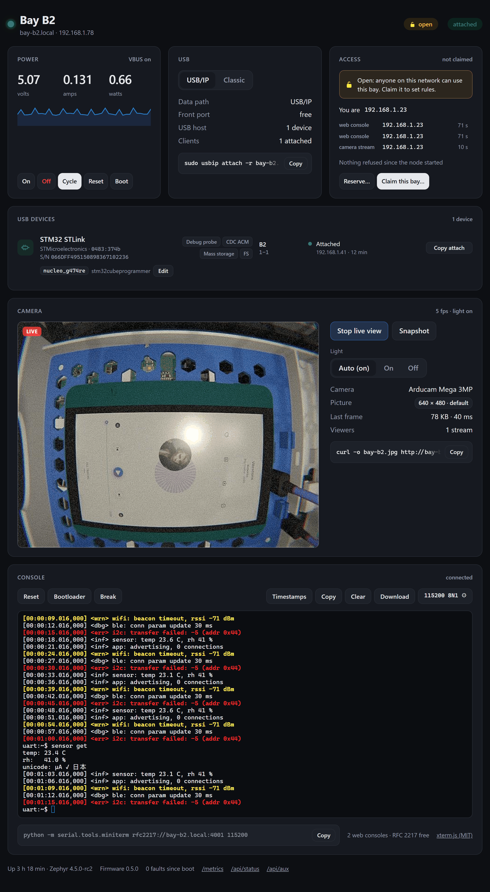
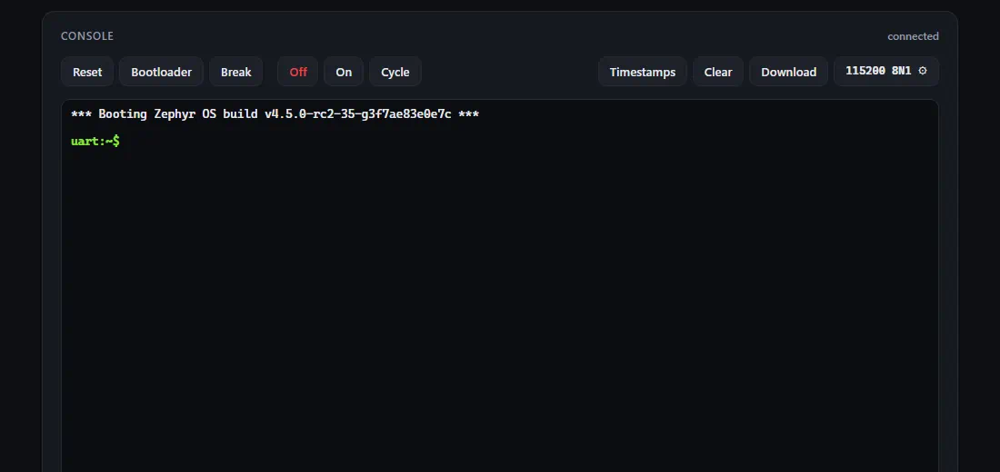
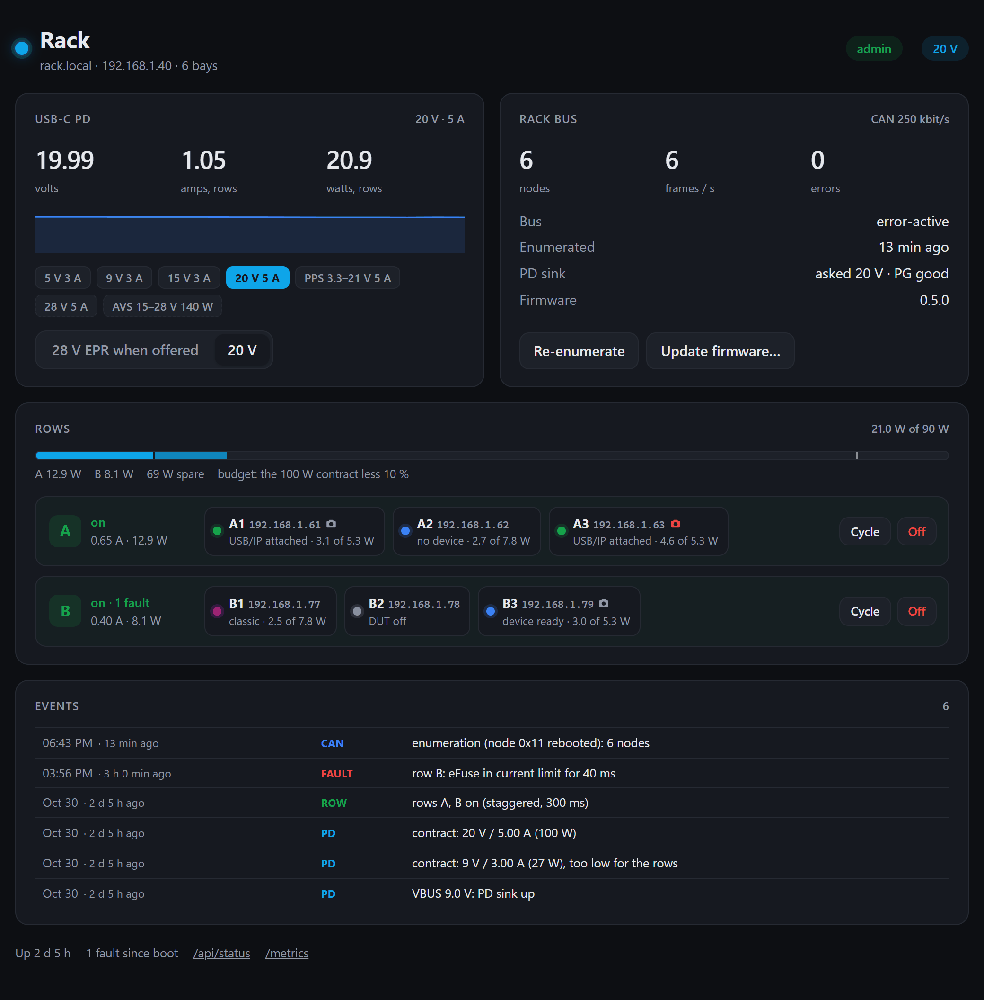
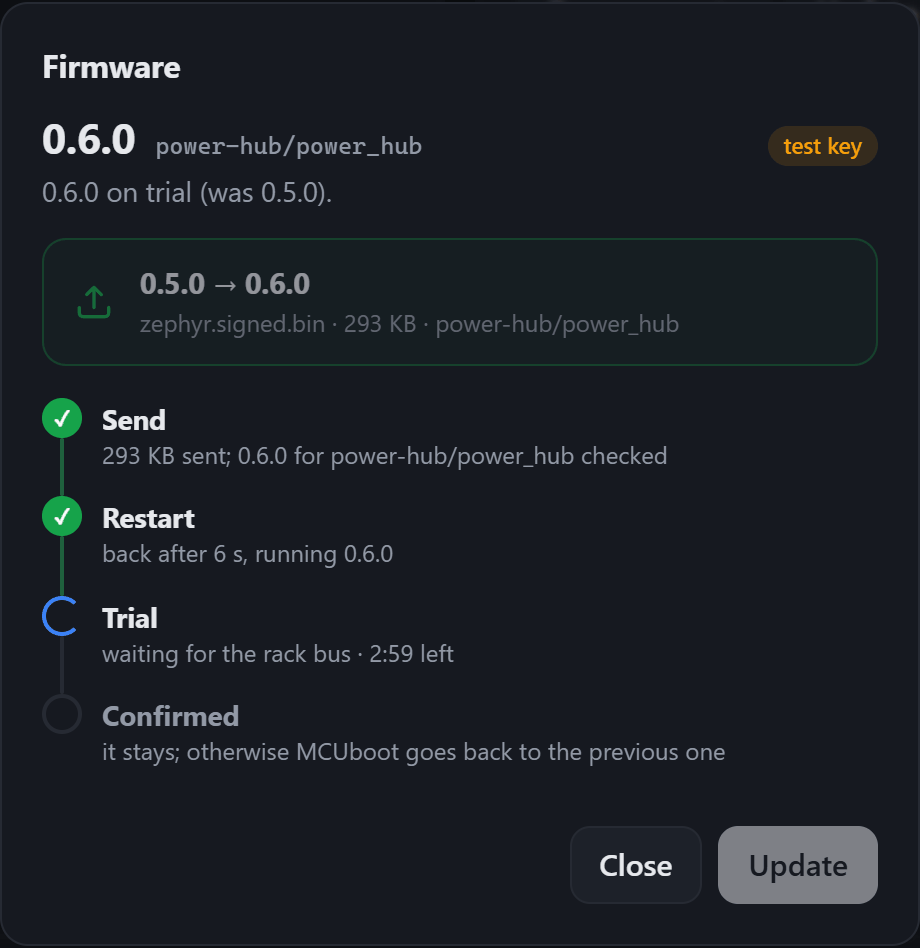

# Firmware

The bay nodes and the power hub run **Zephyr** — the shelf doubles as a
dogfooding rig for Zephyr's new USB host stack.  The firmware lives in
[`firmware/`](../firmware/): the bay node
([`firmware/README.md`](../firmware/README.md): build, flashing, shell, pin
map), the power hub ([`firmware/power-hub/README.md`](../firmware/power-hub/README.md)),
and what they share ([`firmware/common`](../firmware/common/)): the rack bus
protocol ([rack-protocol.md](rack-protocol.md)), the CH224A and CH446Q
drivers, Wi-Fi, the web pages' CSS, helpers and tooling.

> **Status:** both boards and applications build against Zephyr main
> (pinned in `firmware/west.yml`); the rack bus protocol runs on a simulated
> rack (native_sim); hardware bring-up has not started.

## What Zephyr provides (main, Oct 2026)

* **USB/IP host service** — `subsys/usb/host/usbip.c`: exports a device
  attached to a host controller to a Linux `usbip` client.  Experimental,
  one device per controller (exactly our 1-board-per-node topology).  Docs:
  *Services → USB → USB/IP protocol support*.
* **DWC2 host controller driver** — `drivers/usb/uhc/uhc_dwc2.c` with the
  ESP32-S3 full-speed OTG quirk (`espressif,esp32-usb-otg-fs`), merged via
  zephyrproject-rtos/zephyr#102967 and follow-ups (tracking issue #102931).
  Control, bulk and interrupt IN transfers; interrupt OUT, isochronous and
  split transactions (hubs) are not implemented yet.
* Wi-Fi, mDNS, telnet shell, settings, HTTP server, Prometheus library,
  `ti,ina226` sensor driver, `worldsemi,ws2812-pulse-io` LED strip on the
  RMT: all used by the node application.  MCUboot + mcumgr OTA is available
  but not used yet.

## Board and application

| | |
|---|---|
| Board | `bay_node/esp32s3/procpu` in `firmware/boards/hwtr/bay_node/` (ESP32-S3-WROOM-1-N8R8: 8 MB of flash, two 3.62 MB image slots and 256 KB for the DATA ×4 co-processor's image; 8 MB of octal PSRAM for the camera's frames and a few large buffers; the pin map of a DevKitC-1 v1.1), pin map from `electronics/bay-node/design.py` |
| Bindings | `hwtr,dut-port` (TPS2553 EN/FAULT, AUX RESET/BOOT, INA226, AUX UART), `hwtr,usb-mux` (MUX_FORCE_PC, PC_DET, SVC) |
| Stand-in | `esp32s3_devkitc/esp32s3/procpu` + `firmware/bay-node/boards/esp32s3_devkitc_procpu.overlay` (same GPIO map) |
| Bench node | `m5stack_stamps3/esp32s3/procpu` + `firmware/bay-node/boards/m5stack_stamps3_procpu.*`: serial console, network and web page on a StampS3, no USB host (its USB-C is the node's console) |
| Application | `firmware/bay-node/` |
| Power hub | `power_hub/esp32s3/procpu` in `firmware/boards/hwtr/power_hub/`, application `firmware/power-hub/`, bindings `hwtr,power-hub`, `hwtr,rack-rows`, `wch,ch224a` |
| Shared | `zephyr/module.yml` at the repository's root makes it a Zephyr module (the boards, bindings and `firmware/common/`): west finds it in the workspace made from `firmware/west.yml` (sysbuild too), and each application adds it for other workspaces |
| Host side | [`tools/bayctl.py`](../tools/bayctl.py): power, reset, USB/IP, consoles, twister hardware map, labgrid / PDUDaemon configs ([ci.md](ci.md)) |
| Build | `west build --sysbuild -b bay_node/esp32s3/procpu hw-testing-rack/firmware/bay-node` in a workspace made from `firmware/west.yml` (MCUboot, then the application signed for it) |

## Node application

| Feature | Status | How |
|---|---|---|
| USB/IP export of the DUT | written | `CONFIG_USBIP=y`, `zephyr_uhc0` → OTG controller; client: `usbip attach -r bay-<id>.local -b 1-1` |
| Power control | written; the v1.0 rule tested on native_sim, not on hardware | IO41 → TPS2553 EN, kept on at boot (pull-up: the board is on before the firmware runs); `bay power on/off/cycle`.  Since the TPS26600 on VIN (node v1.0, `dut_port`'s `vin-efuse`), IO41 drives its SHDN, off at boot (pull-down) and on only through [the DATA lead's power-on rule](#the-data-leads-power-on-rule-node-v10) |
| Over-current | written | FAULT on IO40 (interrupt): logged, counted, VBUS cut and latched after 1 s in current limit; v1.0: the eFuse's ~FLT switches DATA_VIN off at once |
| Telemetry | written | INA226 (0x40, 50 mΩ) through the sensor API → V, I, P in the shell, `GET /api/status` and Prometheus `/metrics` |
| Modes | written | reads PC_DET (IO13) and SVC (IO15); `bay mode classic\|usbip` drives MUX_FORCE_PC (IO14), persisted in settings |
| SERVICE mode | written | stops the USB host and gives the ESP32-S3's single PHY back to the USB-Serial-JTAG (flash/JTAG from the front port); restarts it afterwards |
| AUX console | written, host-tested | UART1 (IO47/IO21) shared by a web console in the status page (xterm.js over a WebSocket, 16 KB replayed to late clients), an RFC 2217 server on port 4001 (pyserial, labgrid, esptool) and raw TCP on port 4000; baud/format/Enter/echo saved per bay; BREAK; TX released while the DUT is off |
| AUX RESET/BOOT | written | pulses on IO12/IO48 (`bay reset`, `bay boot`, console buttons), optionally RFC 2217 DTR/RTS like an ESP auto-reset circuit |
| Status LED | written | WS2812B on IO38 (RMT): fault / service / classic / power off / no network / USB/IP idle / enumerated / attached |
| Identity | written | `bay id <id>` (settings) → hostname `bay-<id>.local` over mDNS; without an id, the rack position from the hub (`bay-c3.local`) |
| Discovery | written, tested on native_sim | DNS-SD under the hostname: `_http._tcp`, `_usbip._tcp` while the DUT is on the S3's USB, `_rfc2217._tcp` while it listens; TXT `id`, `pos`, `fw`, `mode`, `slots` (DATA ×4); kept in step every 2 s (`firmware/common/lib/dnssd.c`).  The hub: `_http._tcp` |
| Rack bus | written, tested on a simulated rack | CAN (IO18/IO17) + POS (IO16 in, IO42 out): position from the hub (`C3` = node 0x23), STATUS every second, INFO, ALERT on DUT faults, the hub's commands (refused while the bay is reserved); [rack-protocol.md](rack-protocol.md) |
| Access control | written, tested on native_sim | per node: which address may use status, control, console, USB/IP, shell, camera (Zephyr packet filter for TCP, a check per HTTP request); a CI reservation (lease); kicks and a refusal log; admin key claimed with a press on BOOT, admin requests signed (HMAC).  See [`firmware/README.md`](../firmware/README.md#access-control) |
| Board targets | written, tested on native_sim | per slot, in NVS: the Zephyr board, west runner, probe id and console twister uses, saved for the USB device in the slot (another board is flagged); set on the page from suggestions by USB ID (`mechanical/boards/boards.yaml`), read by `bayctl hwmap`.  See [`firmware/README.md`](../firmware/README.md#board-targets) |
| Control interface | written | `bay …` shell on the UART test pads and over telnet; status page, serial console and JSON API on `http://bay-<id>.local/` (`/api/power`, `/api/reset`, `/api/boot`, `/api/mode`, `/api/aux`) |
| Updates | written, tested on native_sim; update and rollback run on the bench XIAO (2026-11-03), not on a bay node yet | over Wi-Fi: MCUboot (sysbuild), signed images sent with the admin key, a test boot, the new firmware confirms itself once Wi-Fi and the rack bus are back, else MCUboot goes back; the page, `bayctl update`.  [Programming › Over the network](#over-the-network); USB through the front port in SERVICE mode |
| Camera | written, simulated, not on hardware | optional Arducam Mega on J6 (`arducam,mega` on SPI2, 4 MHz) and its light (`pwm-leds` on LEDC, 25 kHz): snapshots and an MJPEG stream on TCP 8081 for every client at once, frames in PSRAM cut at their JPEG end, the light only while someone watches; per-bay settings (resolution, quality, exposure and gain auto or manual, white balance, brightness, contrast, saturation, sharpness, display rotation) applied between frames; its own access right; STATUS tells the hub.  [`firmware/README.md`](../firmware/README.md#camera) |



*The status page at `http://bay-<id>.local/`, here with a USB/IP client
attached and the node not claimed yet (open).  More states and the API in
[`firmware/README.md`](../firmware/README.md#web-page-and-api), access
control in [its own section](../firmware/README.md#access-control).*



*The DUT's serial console in the same page, recorded on native_sim (the
node's real console code, Zephyr's shell sample as the DUT); details in
[`firmware/README.md`](../firmware/README.md#serial-console).*

### The DATA lead's power-on rule (node v1.0)

In `src/dut.c` and `src/ports.c` (`dut_port`'s `vin-efuse`), tested on native_sim
(`firmware/bay-node/tests/data_lead`), not on hardware yet.  From node v1.0, J7.1 carries the rack's VIN (20–28 V) through a
TPS26600 eFuse (U9: ≈ 1.76 A limit, 4–5 ms soft start, current limit with auto-retry), and the DATA
board makes its own 5 V from it.  The eFuse is **off** until the firmware turns it on: its SHDN
(IO41, `DUT_EN`) has a 10k pull-down, and the firmware holds IO41 low until the checks pass.

1. **Before switching on**, with IO41 low: on only when SCL and SDA idle high (IO1, IO2, bus released)
   and the node's own INA226 (0x40) answers.  A DATA lead plugged 1:1 instead of "Same direction"
   holds SCL near 0.6 V (J7.7 lands on the DATA board's GND, through its ESD diode): keep it off and
   report "DATA lead reversed?".  (That lead harms nothing even switched on: J7.1 meets the DATA
   board's unconnected pin 1.)
2. **Switching on**: IO41 high.  `~FLT` (IO40) is also low while the eFuse is off or ramping: ignore it
   for 20 ms after IO41 goes high.  Then the INA226's bus voltage must reach VIN (within ≈ 1 V) and FLT
   must be high; otherwise off again (a camera lead in J7 shorts J7.1 to GND through the pod: the
   eFuse limits, FLT goes low, the bus voltage stays near 0).  The node does not measure VIN before
   the eFuse, so the firmware checks a floor instead: `CONFIG_BAY_DATA_VIN_MIN_MV`, 15 V.
3. **The board answers**: the DATA board's expander (0x20) within 1 s (its converters start above
   13.5 V, its hub's reset holds ≤ 560 ms).  No answer: switch off (no board, or the wrong lead on J7)
   and probe again only on the next `bay power on`.
4. **While on**: FLT low, or the board stops answering on I²C (two missed polls in a row), switches
   IO41 low at once and keeps it low until the next `bay power on` (no auto-retry from the firmware: the eFuse already retries every
   512 ms in a hard short).  The same when the lead is pulled: a board that goes away turns J7 off,
   so a lead plugged into a live J7 meets 0 V.
5. **No INT line** (map B: J7.8 is GND): poll the DATA board's expanders and INA226s every 10–20 ms.
   The INA226 alerts run transparent (Mask/Enable LEN = 0) so each poll reads the live state, or the
   poll reads Mask/Enable every time (that read clears a latched alert).  IO4 now carries the camera's CS (IO8 before).
   In the firmware: the expanders' inputs (each port's ~FAULT) every `CONFIG_BAY_PORTS_POLL_MS`, 20 ms
   on v1.0; the ports' INA226s keep no alert (Mask/Enable stays 0) and are read when a port's draw is
   needed.
6. **Status**: `bay power on` (`dut_power_set()`) fails with the reason, also kept for the status page
   and the API (`dut_lead_state()`): the lead reversed, no INA226, a short, a fault, no board, the board
   gone.  A short, a fault and a board that went away latch a DUT fault (the hub gets an ALERT).
7. **Budget**: the node's INA226 now reads the DATA board's VIN current (1 A at 20 V is 20 W, ≈ 4 A at
   5 V): the DATA ×4 admission and shedding thresholds in mA at 5 V
   ([multi-dut-node.md](multi-dut-node.md#power-budget)) become a power budget (the INA226's power
   register), checked against the row's share of the rack's budget.  In the firmware: shunt current ×
   bus voltage, against the hub's grant for the bay (GRANT, [rack-protocol.md](rack-protocol.md)) or
   `CONFIG_BAY_PORTS_LIMIT_MW` without one.

## Power hub application

| Feature | Status | How |
|---|---|---|
| USB-C PD | written, compile-tested | the CH224A asks for 9 V by itself; VBUS on the ADC, I²C pull-ups on once VBUS is up, the CH224A driver initialized once the chip answers (`zephyr,deferred-init`); asks for 20 V, or for 28 V EPR when offered once opted in (`CONFIG_HUB_PD_EPR`, `hub pd epr`, saved; locked out by `CONFIG_HUB_EPR_ALLOWED`, off until L1 is rated ≥ 60 V), or 20 V first and 28 V once a row draws 1.2 A (`CONFIG_HUB_PD_ADAPTIVE`), and checks VBUS reaches it within 5 % (28 V falls back to 20 V); PG high sheds the rows; never above 28 V (`regulator-max-microvolt`) |
| Rows | written | eFuse enables held across a controller reset (pad hold); off until the contract has held 500 ms, then staggered (300 ms); `hub row <A–D> on\|off\|cycle`, the page, `POST /api/row` |
| Shedding | written | from the measured row currents (IMON): above 90 % of the contract for 1 s the next row in the shed order goes off, back when the contract has room again |
| Faults | written | each eFuse's FLT while its row is on, past the soft start; a contract lost (PG) as an event |
| Rack bus master | written, tested on a simulated rack | enumeration over the POS tokens, the node table, commands with retries, the RACK frame every second |
| Bay power grants | written, tested on native_sim (the share, the frame) | every second, each bay's share of its row's eFuse and of the contract, less the node itself, as a GRANT frame ([rack-protocol.md](rack-protocol.md)): what the node may switch its DATA ports on with |
| Web, shell | written | status page (PD offers, rows and their bays, rack bus, events), JSON API, `/metrics`, `hub …` shell on the console USB-C (no telnet) |
| Access | written | reading is open; the page's actions (rows, contract, enumeration, node commands) are admin requests signed with the hub's key, claimed with a press on its BOOT button (`firmware/common/lib/admin.c`, as the bay nodes) |
| Updates | written, tested on native_sim, not on hardware | as the bay nodes (same code, `firmware/common/lib/update.c`): [Programming › Over the network](#over-the-network); the console USB-C otherwise |



*The hub's page at `http://rack-<id>.local/`; the rows and the bays link
to each bay's own page.  More in
[`firmware/power-hub/README.md`](../firmware/power-hub/README.md).*

## Programming

Both boards are flashed over USB through the ESP32-S3's own
**USB-Serial-JTAG**: it shows up as a serial port (`/dev/ttyACM*` on Linux,
`/dev/cu.usbmodem*` on macOS, `COMx` on Windows) and resets the chip into its
ROM loader by itself when esptool asks (DTR/RTS handled in silicon).  Neither
board needs an auto-reset circuit, nor a BOOT press in normal use.  Build in
the workspace made from `firmware/west.yml`, then:

```bash
west flash -d build                               # the port found by itself, or:
west flash -d build --esp-device /dev/ttyACM0
```

With `--sysbuild` (the default from here on) that writes MCUboot and the
signed application ([Over the network](#over-the-network)); without it, the
application alone at 0 (simple boot), with no update over the network.

`west flash --erase` once on a module that ran other firmware (settings).

### Bay node

The node runs from its row (VRACK), never from the USB port: its row must be
on (the hub turns rows on by itself; `hub row <A–D> on` otherwise).  On a
desk, feed 15–30 V on J1 (pin 1 +, pins 2 / 5 GND): the buck starts above 13.5 V.

| | How | Bay closed? |
|---|---|---|
| **First flash** (blank module) and **updates** | slide **SERVICE** on (fascia, LED yellow), laptop on the front **PC** USB-C, `west flash`, SERVICE off.  SERVICE routes the PC port to the ESP32's USB pins in hardware (MUX_PC); the running firmware then stops its USB host and gives the PHY to the USB-Serial-JTAG.  A blank module has no USB host: the port is there at once | yes: the PC port and SERVICE are on the fascia |
| **Wedged firmware** (it takes the PHY for its USB host and crashes before letting it go) | SERVICE on, laptop plugged, pull the drawer out (the tray is open above the node), **hold BOOT** and either tap **RESET** or power-cycle the row from the hub's page (the row's other bays restart too): the ROM loader starts with the PHY on the USB-Serial-JTAG; `west flash`, release | no: drawer out.  BOOT is clear; RESET sits partly under the drawer's left ledge (use BOOT and the row cycle) |
| **Last resort** | UART0 test pads TP1–TP4 (bottom side, under the module) with a 3.3 V USB-UART, BOOT held at reset | no: node off its standoffs |

After a flash the port drops for a second (reset), comes back, and the node
picks SERVICE up again; `bay status` and the LED show it.

**Once, at the first flash (irreversible):** burn the eFuse that disables USB-OTG download (`espefuse.py --port <port> burn_efuse DIS_USB_OTG_DOWNLOAD_MODE 1`).  In USB-OTG download boot the ROM drives IO40 high and IO39 / IO38 low (ESP32-S3 Hardware Design Guidelines §1.3.13, Table 12).  On the node IO40 is DUT_FLT_N: it would fight the TPS2553D's open-drain ~FAULT if the DUT faults then.  We never use OTG download: UART0 and USB-Serial-JTAG download, our two flashing paths, stay.  An eFuse can't be unburnt; never burn `STRAP_JTAG_SEL` (GPIO3 floats).  Datasheet audit F5.

### Power hub

| | How | Box closed? |
|---|---|---|
| **First flash and updates** | laptop on the hub's **console USB-C** (front wall, under A1, engraved "USB"), `west flash`.  That port also powers the controller (not the rows), so a hub with no PD charger, or on a desk, can be flashed too | yes |
| **Wedged firmware** | the console USB-C is wired straight to the ESP32's USB pins and the hub's firmware never takes the PHY: esptool resets it into the ROM loader whatever the firmware does, short of firmware that reconfigures IO19/IO20 | yes |
| **Last resort** | **BOOT** (SW2) and **RESET** (SW1), rear-left corner, top side: a pin through the lid's two holes (RST, BOOT, debossed beside them), down a guide tube onto each button; UART0 pads TP1–TP4 on the bottom side (lid off, 4 × M3×8, and the hub off its spacers) | yes, with a pin |

**Once, at the first flash (irreversible):** burn the eFuse that disables USB-OTG download (`espefuse.py --port <port> burn_efuse DIS_USB_OTG_DOWNLOAD_MODE 1`).  In USB-OTG download boot the ROM drives IO40 high and IO39 / IO38 low (ESP32-S3 Hardware Design Guidelines §1.3.13, Table 12).  On the hub IO40 is PD_SCL: it would back-feed an unpowered CH224A through SCL, which I2C_PU exists to avoid.  We never use OTG download: UART0 and USB-Serial-JTAG download, our two flashing paths, stay.  An eFuse can't be unburnt; never burn `STRAP_JTAG_SEL` (GPIO3 floats).  Datasheet audit F5.

The row enables are held across the controller's resets (pad hold), so
flashing the hub should not power-cycle the rack: to be checked on the first
hub.

### Over the network

> **Status:** written; tested on native_sim (`firmware/common/tests/update`:
> the upload into slot 1, the test boot request, the trial, the rollback),
> against the simulated boards (the pages, `bayctl`), and built for every
> board.  **On an ESP32-S3**, the bench XIAO (`xiao_esp32s3`, MCUboot's test
> key, its 1.31 MB slots), 2026-11-03, with `bayctl`'s update over Wi-Fi:
> 1053 KB sent in 21–23 s, the node back 58–59 s after the start (the swap
> included), confirmed 6 s later.  A bench build whose health check never
> passes (a 40 s trial) restarted unconfirmed and MCUboot put the previous
> firmware back: running again 143 s after the start.  Still to check on the
> first boards: the bay node's own layout (3.62 MB slots), the rack bus in
> the trial, the watchdog, a power loss during a swap.

Both boards boot through **MCUboot**, built in front of the application by
sysbuild: `west build --sysbuild`.  `west flash` then writes MCUboot at 0
and the signed application in slot 0 (`0x20000`); every board needs that
one USB flash before its first update over the network (a board flashed
before, with simple boot, too).

```bash
west build --sysbuild -b bay_node/esp32s3/procpu -d build-bay hw-testing-rack/firmware/bay-node
west flash -d build-bay                  # MCUboot, then the signed application
# without west: esptool ... write-flash 0x0 build-bay/mcuboot/zephyr/zephyr.bin \
#                                      0x20000 build-bay/bay-node/zephyr/zephyr.signed.bin
# what an update sends: build-bay/bay-node/zephyr/zephyr.signed.bin
```

| Step | What happens |
|---|---|
| Begin | an admin request, `POST /api/update/begin` with the image's size and SHA-256, signed with the device's admin key like every other admin action (`X-Bay-Auth`, [`firmware/common/lib/admin.c`](../firmware/common/lib/admin.c)), gets a single-use ticket (one minute, this address).  Refused while the running firmware is on trial; a reserved bay only with `force` |
| Upload | `POST /api/update?ticket=…` with the image: written to slot 1 as it streams in (no copy in RAM), hashed and read on the way.  Refused at the first bytes if it is not an MCUboot image, at the end if the size, the SHA-256 or the image id differ; nothing is written for anyone without the key |
| Test boot | MCUboot is asked for a test swap and the device restarts 1.5 s later.  MCUboot checks the signature (ECDSA P-256), swaps (swap using offset) and boots the new firmware: on the bench XIAO the node answers again ≈ 35 s after the restart, swap, boot and Wi-Fi included |
| Trial | the new firmware must get back, for 5 s in a row and within 3 minutes (`CONFIG_HWTR_UPDATE_TRIAL_S`), what worked when the image arrived: Wi-Fi, and the rack bus (a node: an address from the hub and the hub heard; the hub: CAN error-active with at least one node).  An update on a desk, without a rack, only needs Wi-Fi.  The watchdog (`watchdog0`, 30 s) runs meanwhile |
| Confirmed, or rolled back | it confirms itself and stays; otherwise (not healthy in time, or hung) it restarts unconfirmed and MCUboot swaps the previous firmware back.  The page, `/api/update` and the hub's event log say which |

**Image id.**  The build writes `<application>/<board>` (`bay-node/bay_node`,
`power-hub/power_hub`, `bay-node/esp32s3_devkitc`) into the signed image, as
a protected TLV (0xa0) the signature covers ([`firmware/common/sysbuild.cmake`](../firmware/common/sysbuild.cmake));
the firmware refuses an image built for another application or board, so
a hub image cannot land on a bay.  An image flashed over USB has no trial:
it is confirmed as it is.

**From a browser.**  The hub's page: *Rack bus › Update firmware…*; a bay's
page: *Manage access › Firmware › Update…* (admin).  The page reads the
image before sending it (version, image id) and follows the four steps.



**From the command line** ([`tools/bayctl.py`](../tools/bayctl.py), with the
rack's admin key in `BAYCTL_KEY`):

```bash
python tools/bayctl.py update build-bay/bay-node/zephyr/zephyr.signed.bin B3
python tools/bayctl.py update build-bay/bay-node/zephyr/zephyr.signed.bin --all
python tools/bayctl.py update build-hub/power-hub/zephyr/zephyr.signed.bin --hub
```

`--all` takes the nodes the hub lists, one after the other, and stops at
the first one whose new firmware does not stay: a firmware that fails on
one node does not go to the next.  Reserved bays are skipped (`--force`
updates them anyway).  The hub is `rack.local` unless `BAYCTL_HUB` or `config/lab.yaml`
says `hub:`.

**Cost.**  MCUboot: 48 KB of its 64 KB partition.  The images: 1.07 MB (bay,
camera included), 0.79 MB (hub), in 3.62 MB slots (the bay node: Zephyr's 8 MB layout
with 128 KB less in each, for the `coproc` partition, `boards/hwtr/bay_node/bay_node-partitions.dtsi`;
the hub keeps 3.75 MB).  RAM: MCUboot's layout
leaves the application 18 KB less DRAM; with the USB/IP buffer pool down
from 64 KB to 48 KB the bay was at 96.6 % (12.7 KB free).  The camera
costs DRAM too (its thread, the driver's fixed 4 KB work-queue stack, four
more sockets), paid back by moving CPU-only buffers to the PSRAM (the
16 KB AUX log, the 3 KB HTTP response buffer; `BAY_EXT_RAM` in `bay.h`):
96.8 % (11.8 KB free) on the bay node, 96.9 % on the DevKitC; the frames
take 1 MB of the 1.5 MB PSRAM heap.  Next lever if the node runs short:
`CONFIG_ESP32_WIFI_NET_ALLOC_SPIRAM` puts the network's buffers and TCP
connections (≈ 30 KB) in PSRAM, to be measured against USB/IP throughput
first.  The hub: 66.5 %.

#### Signing key

MCUboot boots only images signed with the key it was built with; the key
stays out of the repository.

* **By default, MCUboot's public test key** (`bootloader/mcuboot/root-ec-p256.pem`):
  the build warns, the page shows *test key*.  Anyone can sign an image
  these boards boot (sending it still needs the admin key).  Fine on a desk
  and in CI (the CI artifacts are named `firmware-<board>-test-key`), not
  for a rack.
* **Your own:** make one once, keep it (and a backup) outside the
  repository, and point the build at it:

  ```bash
  python bootloader/mcuboot/scripts/imgtool.py keygen -t ecdsa-p256 -k ~/keys/rack-signing.pem
  export HWTR_SIGNING_KEY=$HOME/keys/rack-signing.pem     # an absolute path
  west build --sysbuild -p -b bay_node/esp32s3/procpu -d build-bay hw-testing-rack/firmware/bay-node
  ```

  (or `-- -DSB_CONFIG_BOOT_SIGNATURE_KEY_FILE=\"/path/to/key.pem\"`).  Build
  pristine (`-p`) after changing it.  MCUboot gets the public half, the
  image its signature: every board takes one USB flash with that MCUboot,
  and from then on only images signed with that key.  Lose the key and
  every board needs a USB flash again; moving from the test key to your own
  is such a flash too.

### Later: over the rack bus, from the hub

Upload the image once to the hub, which broadcasts it on CAN to every node
at once (they all run the same firmware): ≈ 1–1.5 min for 1 MB at
250 kbit/s, for the whole rack, and it works for a node without Wi-Fi.  It
needs a transfer layer on top of [rack-protocol.md](rack-protocol.md)
(chunks, CRC, nodes asking for the chunks they missed): about a week, worth
it once the Wi-Fi updates have run on hardware.  The trial and the rollback
stay as they are.

### What the hardware gives, and what it could add

* **No auto-reset circuit is needed** on either board: the USB-Serial-JTAG
  does it.
* **Bay node:** fine for flashing with the bay closed.  Recovering a wedged
  node needs the drawer out; with BOOT clear of the ledge and the row cycle
  from the hub, RESET is not needed.  A firmware fix would avoid even that
  in most cases: read SERVICE before the USB host starts, and leave the PHY
  to the USB-Serial-JTAG when it is on.
* **Power hub:** the console USB-C is reachable with the box closed and
  covers flashing and recovery.  BOOT and RESET (top-actuated, rear-left
  corner, box (15.1, 127.1) and (15.1, 133.6)) are reached with a pin through
  two holes in the lid, each with a guide tube down to 1 mm above its button.

First boot (Wi-Fi credentials, bay or rack id): [`firmware/README.md`](../firmware/README.md#first-boot)
and [`firmware/power-hub/README.md`](../firmware/power-hub/README.md#first-boot).

## Open items

* **The matrix expander (U10, TCA9534A at 0x38), through its driver since 2026-11-03** — the CH446Q
  drivers drive P0–P4 (DAT, CK, STB, RST) through the `ti,tca9538` driver, and `coproc reload` will drive
  P5–P6 (RUN, BOOTSEL) the same way, so MARK (P7, the coproc node's `mark-gpios`) goes through it too: the
  driver writes its cached output register with each pin it sets, a raw write would be undone.  `src/ports.c`
  starts the driver the first time the chip answers (it is `zephyr,deferred-init`, and absent on a base
  board); after each DUT_5V on, configuring MARK writes the chip's output and direction registers back from
  the driver's copy, the crosspoints' lines with them.  The ports ztest checks both on the emulated board.
  **Not tried on hardware** (no DATA ×4 yet).

* **The pin matrix, `/api/wires` (`src/wires.c`, since 2026-11-03)** — any of the 32 port pins on one of the
  buses A–H, through the two CH446Q's mux driver.  What is asked is kept apart from the switches: a port's
  pins open before it goes off and close again once it is on; a change opens every switch it moves before it
  closes any (break-before-make); after DUT_5V the driver's copy is cleared and the pins come back with
  their ports.  The CH446Q driver writes DAT on its own before CK or STB rises (the datasheet audit's TAS
  and TDS).  The native_sim test (`firmware/bay-node/tests/wires`) runs `ports.c`, `wires.c` and the real
  expander and crosspoint drivers against two CH446Q emulated behind the emulated board: the exact switch
  per pin and bus, break-before-make, a port off and on, a DUT_5V cycle, MARK toggling during a 16-pin
  change (nothing garbled), POST's body.  From a laptop: `bayctl wire B3 A=2:P1,3:P2 --name A="UART B3.2 TX"`
  (`bayctl wire B3` shows it, `--open-all` clears it); the bay page's Wires card
  ([firmware/README.md › Wires](../firmware/README.md#wires)) stages pins and names and applies them
  together; `dev_server.py --ports 4` simulates the matrix, with made-up VREF readings
  (`/dev/vref?port=4&mv=200` holds a port open).  **Not tried on hardware.**  **No VREF reading** on the v1.0: only
  U11's ADC sees VREF (GPIO40–43), and gusmanb's analyzer does not report it, so the 0.65 V hold waits on a
  reading (`"vref_mv": null`); which way to get one is the user's choice.  **On the bench, when the boards
  arrive:**
  1. The crosspoint map: each port pin (P1–P8 of each header) on each bus, read with the analyzer or a
     meter, against `port_pins` in `data-x4.dtsi` (the X lines) and the bus order D C B A E F G H (the Y
     lines).
  2. Break-before-make: move a pin between two buses with a signal on one and watch the other, on a scope
     or with the analyzer itself (no overlap of the two switches).
  3. MARK during a reset: Capture and reset on the bay page, the Mark lane falling as the board leaves
     reset.
  4. A port off: its pins open first (no current into the unpowered board through the bus).
  5. The CH446Q's R_on at ±5 V (the datasheet audit's U4e), and a 1.8 V board's I²C through it.

* **DATA ×4 co-processor (U11, an RP2350B with no flash, since 2026-11-03)** — it runs from SRAM what is
  loaded at each power-up: gusmanb's analyzer built from its pinned tag as a RAM image (its PICO_2 build
  already runs `copy_to_ram`; `no_flash` instead, the same 384 KB buffer).  **The node loads it**
  (`src/coproc.c`, tested on native_sim and on the bench): `bayctl coproc load B3 LogicAnalyzer.uf2` stores the image
  in the node's `coproc` partition (admin), and whenever the device on the co-processor's hub port shows up in
  its bootloader (2e8a:000f) the node does what `picotool load -x` does: EXCLUSIVE_ACCESS, WRITE in 1 KB
  chunks read from flash into the host controller's own buffers, then REBOOT2 into the RAM image (the region
  from the image to the SRAM's end).  The device is not exported while it is loaded; with no image, or after
  two loads in a row that come straight back to the bootloader, it is left to USB/IP and `picotool` from the
  lab.  `/api/coproc` and `bay coproc` say how the last load went.  336 bytes of DRAM, no thread.  A new
  image runs from the co-processor's next power-up; the board powers it, so today that means the whole DATA ×4
  and its boards under test.  **Later, once DATA ×4 boards run tests all day:** restart the co-processor alone
  (`bay coproc reload`, `bayctl coproc reload`), through its RUN line on the TCA9534A (P5: works even if its
  firmware hangs), and the SDK's reset-to-BOOTSEL request (what `picotool reboot -u -f` sends) on a stand-in
  with no DATA board.  **Our own analyzer page** (`firmware/common/web/analyzer`, on Pages at
  [kartben.github.io/hw-testing-rack/analyzer](https://kartben.github.io/hw-testing-rack/analyzer/)): native ES
  modules that speak gusmanb's protocol (written from its wire format; checked on the bench Pico 2: the
  sample width follows the highest channel asked for, bit i is the i-th channel asked for), Web Serial for an
  analyzer on the PC's USB.  **The node relays U11's** (`src/analyzer.c`, `/analyzer/ws`): a host class
  takes 1209:3020 on the co-processor's hub port, sets DTR, and passes its CDC bulk endpoints to the page's
  WebSocket byte for byte.  1 KB bulk INs from the host controller's buffers, the next one read while the
  last goes to the page and no further: a slow page slows the analyzer down and nothing piles up in the
  node; with no page the data is dropped.  `POST /api/analyzer` hands the device to USB/IP instead
  (gusmanb's desktop app, PulseView) and back, by giving it to the USB host's classes again, without a
  re-plug.  A work queue of its own (its 3 KB stack in PSRAM, as the network's threads): +696 bytes of DRAM,
  bay_node 91.28 %.  The native_sim test (`firmware/bay-node/tests/analyzer`) runs it against an analyzer
  emulated on the virtual USB bus: the ID request and its answer, 20 KB to a slow page in order, no page,
  one page at a time, USB/IP and back, unplugged.  **On the bench (2026-11-03):** the bench XIAO and its
  Pico 2, `protocol.mjs` over the WebSocket from a Linux host: the ID in 62 ms, then a whole 384 KB
  capture of the node's AUX UART (2 MS/s, triggered on its start bit) in 1.05 s, 367 KB/s, decoded intact,
  nothing dropped (278 KB/s when each read waited for the page).  Switched to USB/IP, it was on offer as
  1-1.3 and the WebSocket was refused; switched back, the next capture came through.  **The bay page's
  card** ([firmware/README.md › Logic analyzer](../firmware/README.md#logic-analyzer)): the node serves it
  with the analyzer page's modules (`/analyzer/*.mjs`, gzipped: +224 bytes of DRAM for their resources,
  bay_node 91.34 %); "Capture and reset" triggers on MARK's fall.  From the card on the bench XIAO, a
  capture of a line sent to its AUX UART came back decoded.  MARK and "Capture and reset" are checked on
  the simulated node only (the bench has no DATA ×4).  **One UI, 2026-11-04** (`panel.mjs`, one more module:
  bay_node 91.41 %), in Chrome on the bench XIAO's card, the Pico 2 running the fork's `no_flash` build: 20 ms
  at 2 MS/s of a line on AUX, read back exactly in the decoded table; search, a row's jump, the tooltip, the
  keys, save and reopen, a second capture, and a cancel while it waited.  `bayctl capture` on the same bench:
  that line in `run.decoded.json`, a trigger that never came exited 3, and the analyzer answered after.
  **Not tried on hardware:** `bayctl capture --reset` (MARK again), and the standalone page's settings on an
  analyzer on the PC's USB.  The analyzer page also loads a `no_flash` build into a
  blank RP2350 through WebUSB, as the node does (PICOBOOT; tested against a fake bootloader, not yet on a
  board).  **Open, for the datasheet check:** whether the RP2350's boot ROM has Windows bind WinUSB to its
  PICOBOOT interface by itself (Microsoft OS 2.0 descriptors), which WebUSB needs there.  The
  native_sim test (`firmware/bay-node/tests/coproc`) loads into an RP2350 bootloader emulated on the virtual
  USB bus, and checks a stalled WRITE, a bootloader that stops answering (the node gives up after 10 s) and
  an image that does not start.  **Open, for the datasheet check:** which SRAM the ROM keeps for itself
  while in BOOTSEL (RP2350 datasheet §5.6: the loader writes from the image's address on, as picotool does),
  and whether REBOOT2's RAM_IMAGE asks for an image hash with secure boot off (§5.4.8; the build has none,
  and picotool's load runs it).  **On the bench (2026-11-03):** the bench XIAO, updated over Wi-Fi, with an
  erased Pico 2 on port 3 of its hub standing in for U11 (a bench overlay sets `hub-port`).  gusmanb's
  `no_flash` build (40,704 bytes) was stored in 0.5 s; the node loaded it in 60 ms when it restarted with the
  Pico already in its bootloader, and in 59 ms after the Pico was unplugged and plugged back (a power cycle:
  back in BOOTSEL by itself).  Each time the analyzer then enumerated (1209:3020) and was exported over USB/IP
  as usual; no failure.  picotool over USB/IP took 1.4–1.7 s for the same load.  **Bench, 2026-11-03,
  earlier:** a Pico 2
  (RP2350A) with its flash erased, behind the bench XIAO's hub, over USB/IP from a Linux host.  It came back
  in BOOTSEL (2e8a:000f) after every reset (6 reboots by picotool, and once while being wired); its USB
  serial number (the chip id) is the same without flash; `picotool load -x` of the RAM build took 1.4–1.7 s
  over Wi-Fi, start included, and 1209:3020 was there within a second; gusmanb's TerminalCapture 6.0.0.1
  (`capture`, headless) read the node's AUX UART intact at 2 MS/s.  The stock firmware reboots into BOOTSEL
  with `picotool reboot -u -f` (the SDK's reset interface), no button.  The RAM build: tag v6.0.0.0,
  `BOARD_PICO_2`, `TURBO_MODE 0`, `pico_set_binary_type(LogicAnalyzer no_flash)`, pico-sdk 2.0.0 (the
  release's), its VS Code include made `OPTIONAL`; with gcc 15, pioasm 2.0.0 needs `-include cstdint`.  It
  loads 40 KB (code and data: 40,704 bytes from 0x20000000) and zeroes 391 KB at start (the 384 KB
  buffer), of the 520 KB.

* **Hardware bring-up** — nothing has run on a bay node yet (board
  definition, INA226 calibration, LED timing, SERVICE PHY handover).
* **Interrupt OUT / isochronous transfers and hubs** in `uhc_dwc2`: needed
  for some debug probes, audio/video class DUTs and boards with an on-board
  hub.
* **Serial console on hardware**: the RFC 2217 server is tested on the host
  against pyserial and the web console against the simulated node; on a
  StampS3 the firmware boots with its listeners up and the UART path works
  in loopback, but the WebSocket and TCP paths have not run over Wi-Fi yet.
* Updates over the network on hardware (swap time, rollback, power loss during a swap), then over the rack bus ([Programming](#over-the-network));
  shell on the USB-Serial-JTAG in SERVICE mode.
* Upstream nits seen while dogfooding: the Prometheus library needs exactly
  one label per metric and rejects negative gauge values; the HTTP server
  shares one WebSocket data buffer per resource (one resource per console
  slot works around it).

## Bay camera

Each bay's own node runs its camera (an Arducam Mega SPI on J6, see
[`firmware/README.md`](../firmware/README.md#camera)); the XIAO ESP32S3
Sense pods are gone.  What has run: the build for the three boards, the
JPEG end finder on the host against real JPEGs cut every way, the page
against the simulated camera.  Not yet: a Mega on SPI (the DevKitC with
jumper wires first, then the 50 cm lead at 4 MHz), the frame rate, the
light's PWM, the upstream driver's behaviour under the work-queue plug
(`src/camera.c`).  Upstream items seen on the way: `video_stream_stop()`
does not stop the Mega's capture (its `set_stream(false)` returns early),
its work item resubmits itself in a loop while no buffer is queued, and its
work-queue stack is a fixed 4 KB in DRAM.
