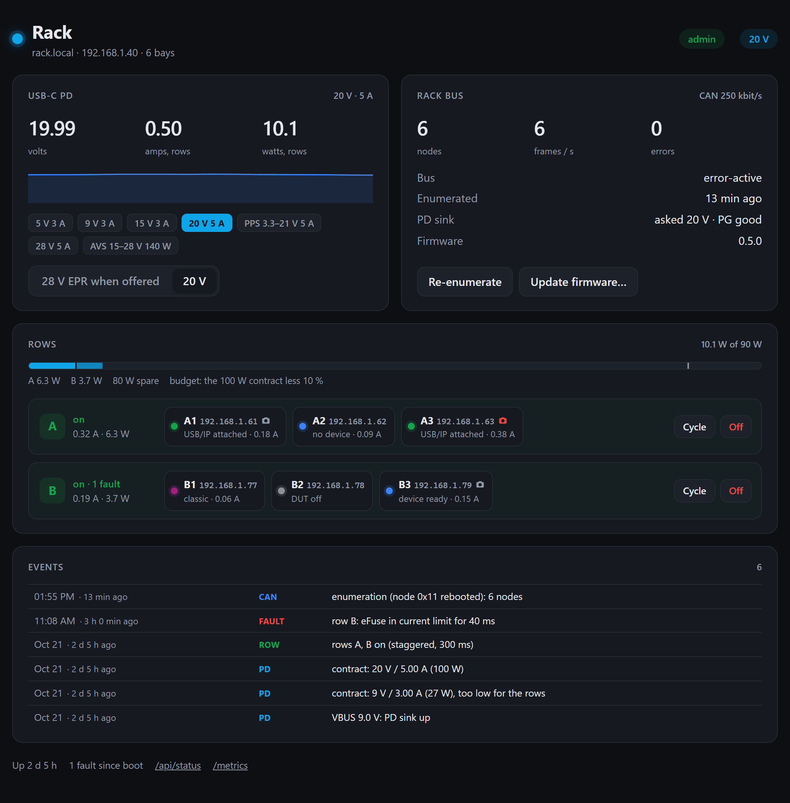
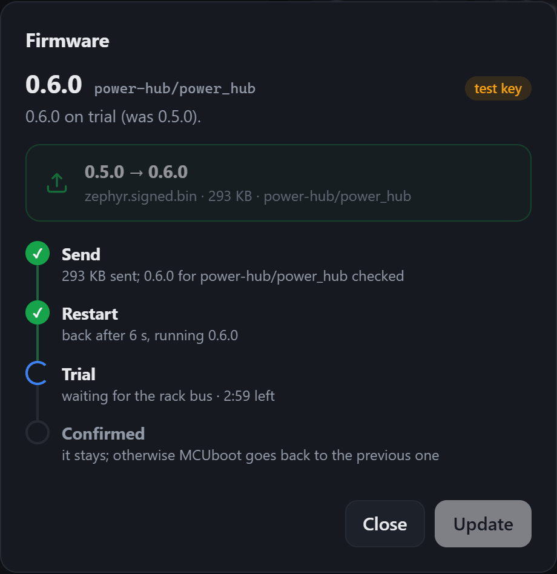

# Firmware

The bay nodes and the power hub run **Zephyr** — the shelf doubles as a
dogfooding rig for Zephyr's new USB host stack.  The firmware lives in
[`firmware/`](../firmware/): the bay node
([`firmware/README.md`](../firmware/README.md): build, flashing, shell, pin
map), the power hub ([`firmware/power-hub/README.md`](../firmware/power-hub/README.md)),
and what they share ([`firmware/common`](../firmware/common/)): the rack bus
protocol ([rack-protocol.md](rack-protocol.md)), the CH224A driver,
Wi-Fi, the web pages' CSS, helpers and tooling.

> **Status:** both boards and applications build against Zephyr main
> (pinned in `firmware/west.yml`); the rack bus protocol runs on a simulated
> rack (native_sim); hardware bring-up has not started.

## What Zephyr provides (main, Oct 2026)

* **USB/IP host service** — `subsys/usb/host/usbip.c`: exports a device
  attached to a host controller to a Linux `usbip` client.  Experimental,
  one device per controller (exactly our 1-board-per-node topology).  Docs:
  *Services → USB → USB/IP protocol support*.
* **DWC2 host controller driver** — `drivers/usb/uhc/uhc_dwc2.c` with the
  ESP32-S3 full-speed OTG quirk (`espressif,esp32-usb-otg-fs`), merged via
  zephyrproject-rtos/zephyr#102967 and follow-ups (tracking issue #102931).
  Control, bulk and interrupt IN transfers; interrupt OUT, isochronous and
  split transactions (hubs) are not implemented yet.
* Wi-Fi, mDNS, telnet shell, settings, HTTP server, Prometheus library,
  `ti,ina226` sensor driver, `worldsemi,ws2812-pulse-io` LED strip on the
  RMT: all used by the node application.  MCUboot + mcumgr OTA is available
  but not used yet.

## Board and application

| | |
|---|---|
| Board | `bay_node/esp32s3/procpu` in `firmware/boards/hwtr/bay_node/` (ESP32-S3-WROOM-1-N8R8: 8 MB of flash, two 3.75 MB image slots; 8 MB of octal PSRAM for the camera's frames and a few large buffers; the pin map of a DevKitC-1 v1.1), pin map from `electronics/bay-node/design.py` |
| Bindings | `hwtr,dut-port` (TPS2553 EN/FAULT, AUX RESET/BOOT, INA226, AUX UART), `hwtr,usb-mux` (MUX_FORCE_PC, PC_DET, SVC) |
| Stand-in | `esp32s3_devkitc/esp32s3/procpu` + `firmware/bay-node/boards/esp32s3_devkitc_procpu.overlay` (same GPIO map) |
| Bench node | `m5stack_stamps3/esp32s3/procpu` + `firmware/bay-node/boards/m5stack_stamps3_procpu.*`: serial console, network and web page on a StampS3, no USB host (its USB-C is the node's console) |
| Application | `firmware/bay-node/` |
| Power hub | `power_hub/esp32s3/procpu` in `firmware/boards/hwtr/power_hub/`, application `firmware/power-hub/`, bindings `hwtr,power-hub`, `hwtr,rack-rows`, `wch,ch224a` |
| Shared | `zephyr/module.yml` at the repository's root makes it a Zephyr module (the boards, bindings and `firmware/common/`): west finds it in the workspace made from `firmware/west.yml` (sysbuild too), and each application adds it for other workspaces |
| Host side | [`tools/bayctl.py`](../tools/bayctl.py): power, reset, USB/IP, consoles, twister hardware map, labgrid / PDUDaemon configs ([ci.md](ci.md)) |
| Build | `west build --sysbuild -b bay_node/esp32s3/procpu hw-testing-rack/firmware/bay-node` in a workspace made from `firmware/west.yml` (MCUboot, then the application signed for it) |

## Node application

| Feature | Status | How |
|---|---|---|
| USB/IP export of the DUT | written | `CONFIG_USBIP=y`, `zephyr_uhc0` → OTG controller; client: `usbip attach -r bay-<id>.local -b 1-1` |
| Power control | written | IO41 → TPS2553 EN, kept on at boot (pull-up: the board is on before the firmware runs); `bay power on/off/cycle` |
| Over-current | written | FAULT on IO40 (interrupt): logged, counted, VBUS cut and latched after 1 s in current limit |
| Telemetry | written | INA226 (0x40, 50 mΩ) through the sensor API → V, I, P in the shell, `GET /api/status` and Prometheus `/metrics` |
| Modes | written | reads PC_DET (IO13) and SVC (IO15); `bay mode classic\|usbip` drives MUX_FORCE_PC (IO14), persisted in settings |
| SERVICE mode | written | stops the USB host and gives the ESP32-S3's single PHY back to the USB-Serial-JTAG (flash/JTAG from the front port); restarts it afterwards |
| AUX console | written, host-tested | UART1 (IO47/IO21) shared by a web console in the status page (xterm.js over a WebSocket, 16 KB replayed to late clients), an RFC 2217 server on port 4001 (pyserial, labgrid, esptool) and raw TCP on port 4000; baud/format/Enter/echo saved per bay; BREAK; TX released while the DUT is off |
| AUX RESET/BOOT | written | pulses on IO12/IO48 (`bay reset`, `bay boot`, console buttons), optionally RFC 2217 DTR/RTS like an ESP auto-reset circuit |
| Status LED | written | WS2812B on IO38 (RMT): fault / service / classic / power off / no network / USB/IP idle / enumerated / attached |
| Identity | written | `bay id <id>` (settings) → hostname `bay-<id>.local` over mDNS; without an id, the rack position from the hub (`bay-c3.local`) |
| Rack bus | written, tested on a simulated rack | CAN (IO18/IO17) + POS (IO16 in, IO42 out): position from the hub (`C3` = node 0x23), STATUS every second, INFO, ALERT on DUT faults, the hub's commands (refused while the bay is reserved); [rack-protocol.md](rack-protocol.md) |
| Access control | written, tested on native_sim | per node: which address may use status, control, console, USB/IP, shell, camera (Zephyr packet filter for TCP, a check per HTTP request); a CI reservation (lease); kicks and a refusal log; admin key claimed with a press on BOOT, admin requests signed (HMAC).  See [`firmware/README.md`](../firmware/README.md#access-control) |
| Board targets | written, tested on native_sim | per slot, in NVS: the Zephyr board, west runner, probe id and console twister uses, saved for the USB device in the slot (another board is flagged); set on the page from suggestions by USB ID (`mechanical/boards/boards.yaml`), read by `bayctl hwmap`.  See [`firmware/README.md`](../firmware/README.md#board-targets) |
| Control interface | written | `bay …` shell on the UART test pads and over telnet; status page, serial console and JSON API on `http://bay-<id>.local/` (`/api/power`, `/api/reset`, `/api/boot`, `/api/mode`, `/api/aux`) |
| Updates | written, tested on native_sim, not on hardware | over Wi-Fi: MCUboot (sysbuild), signed images sent with the admin key, a test boot, the new firmware confirms itself once Wi-Fi and the rack bus are back, else MCUboot goes back; the page, `bayctl update`.  [Programming › Over the network](#over-the-network); USB through the front port in SERVICE mode |
| Camera | written, simulated, not on hardware | optional Arducam Mega on J6 (`arducam,mega` on SPI2, 4 MHz) and its light (`pwm-leds` on LEDC, 25 kHz): snapshots and an MJPEG stream on TCP 8081 for every client at once, frames in PSRAM cut at their JPEG end, the light only while someone watches; per-bay settings (resolution, quality, exposure and gain auto or manual, white balance, brightness, contrast, saturation, sharpness, display rotation) applied between frames; its own access right; STATUS tells the hub.  [`firmware/README.md`](../firmware/README.md#camera) |


*The status page at `http://bay-<id>.local/`, here with a USB/IP client
attached and the node not claimed yet (open).  More states and the API in
[`firmware/README.md`](../firmware/README.md#web-page-and-api), access
control in [its own section](../firmware/README.md#access-control).*


*The DUT's serial console in the same page, recorded on native_sim (the
node's real console code, Zephyr's shell sample as the DUT); details in
[`firmware/README.md`](../firmware/README.md#serial-console).*

## Power hub application

| Feature | Status | How |
|---|---|---|
| USB-C PD | written, compile-tested | the CH224A asks for 9 V by itself; VBUS on the ADC, I²C pull-ups on once VBUS is up, the CH224A driver initialized once the chip answers (`zephyr,deferred-init`); asks for 28 V EPR when offered, else 20 V (or 20 V first, 28 V once a row draws 1.2 A: `CONFIG_HUB_PD_ADAPTIVE`), and checks VBUS reaches it within 5 % (28 V falls back to 20 V); PG high sheds the rows; never above 28 V (`regulator-max-microvolt`) |
| Rows | written | eFuse enables held across a controller reset (pad hold); off until the contract has held 500 ms, then staggered (300 ms); `hub row <A–D> on\|off\|cycle`, the page, `POST /api/row` |
| Shedding | written | from the measured row currents (IMON): above 90 % of the contract for 1 s the next row in the shed order goes off, back when the contract has room again |
| Faults | written | each eFuse's FLT while its row is on, past the soft start; a contract lost (PG) as an event |
| Rack bus master | written, tested on a simulated rack | enumeration over the POS tokens, the node table, commands with retries, the RACK frame every second |
| Web, shell | written | status page (PD offers, rows and their bays, rack bus, events), JSON API, `/metrics`, `hub …` shell on the console USB-C (no telnet) |
| Access | written | reading is open; the page's actions (rows, contract, enumeration, node commands) are admin requests signed with the hub's key, claimed with a press on its BOOT button (`firmware/common/lib/admin.c`, as the bay nodes) |
| Updates | written, tested on native_sim, not on hardware | as the bay nodes (same code, `firmware/common/lib/update.c`): [Programming › Over the network](#over-the-network); the console USB-C otherwise |



*The hub's page at `http://rack-<id>.local/`; the rows and the bays link
to each bay's own page.  More in
[`firmware/power-hub/README.md`](../firmware/power-hub/README.md).*

## Programming

Both boards are flashed over USB through the ESP32-S3's own
**USB-Serial-JTAG**: it shows up as a serial port (`/dev/ttyACM*` on Linux,
`/dev/cu.usbmodem*` on macOS, `COMx` on Windows) and resets the chip into its
ROM loader by itself when esptool asks (DTR/RTS handled in silicon).  Neither
board needs an auto-reset circuit, nor a BOOT press in normal use.  Build in
the workspace made from `firmware/west.yml`, then:

```bash
west flash -d build                               # the port found by itself, or:
west flash -d build --esp-device /dev/ttyACM0
```

With `--sysbuild` (the default from here on) that writes MCUboot and the
signed application ([Over the network](#over-the-network)); without it, the
application alone at 0 (simple boot), with no update over the network.

`west flash --erase` once on a module that ran other firmware (settings).

### Bay node

The node runs from its row (VRACK), never from the USB port: its row must be
on (the hub turns rows on by itself; `hub row <A–D> on` otherwise).  On a
desk, feed 15–30 V on J1 (pin 1 +, pins 2 / 5 GND): the buck starts above 13.5 V.

| | How | Bay closed? |
|---|---|---|
| **First flash** (blank module) and **updates** | slide **SERVICE** on (fascia, LED yellow), laptop on the front **PC** USB-C, `west flash`, SERVICE off.  SERVICE routes the PC port to the ESP32's USB pins in hardware (MUX_PC); the running firmware then stops its USB host and gives the PHY to the USB-Serial-JTAG.  A blank module has no USB host: the port is there at once | yes: the PC port and SERVICE are on the fascia |
| **Wedged firmware** (it takes the PHY for its USB host and crashes before letting it go) | SERVICE on, laptop plugged, pull the drawer out (the tray is open above the node), **hold BOOT** and either tap **RESET** or power-cycle the row from the hub's page (the row's other bays restart too): the ROM loader starts with the PHY on the USB-Serial-JTAG; `west flash`, release | no: drawer out.  BOOT is clear; RESET sits partly under the drawer's left ledge (use BOOT and the row cycle) |
| **Last resort** | UART0 test pads TP1–TP4 (bottom side, under the module) with a 3.3 V USB-UART, BOOT held at reset | no: node off its standoffs |

After a flash the port drops for a second (reset), comes back, and the node
picks SERVICE up again; `bay status` and the LED show it.

### Power hub

| | How | Box closed? |
|---|---|---|
| **First flash and updates** | laptop on the hub's **console USB-C** (front wall, under A1, engraved "USB"), `west flash`.  That port also powers the controller (not the rows), so a hub with no PD charger, or on a desk, can be flashed too | yes |
| **Wedged firmware** | the console USB-C is wired straight to the ESP32's USB pins and the hub's firmware never takes the PHY: esptool resets it into the ROM loader whatever the firmware does, short of firmware that reconfigures IO19/IO20 | yes |
| **Last resort** | **BOOT** (SW2) and **RESET** (SW1), rear-left corner, top side: a pin through the lid's two holes (RST, BOOT, debossed beside them), down a guide tube onto each button; UART0 pads TP1–TP4 on the bottom side (lid off, 4 × M3×8, and the hub off its spacers) | yes, with a pin |

The row enables are held across the controller's resets (pad hold), so
flashing the hub should not power-cycle the rack: to be checked on the first
hub.

### Over the network

> **Status:** written; tested on native_sim (`firmware/common/tests/update`:
> the upload into slot 1, the test boot request, the trial, the rollback),
> against the simulated boards (the pages, `bayctl`), and built for every
> board.  **Not run on an ESP32-S3 yet**: MCUboot's swap, the rollback, the
> watchdog and a power loss during a swap are to be checked on the first
> boards.

Both boards boot through **MCUboot**, built in front of the application by
sysbuild: `west build --sysbuild`.  `west flash` then writes MCUboot at 0
and the signed application in slot 0 (`0x20000`); every board needs that
one USB flash before its first update over the network (a board flashed
before, with simple boot, too).

```bash
west build --sysbuild -b bay_node/esp32s3/procpu -d build-bay hw-testing-rack/firmware/bay-node
west flash -d build-bay                  # MCUboot, then the signed application
# without west: esptool ... write-flash 0x0 build-bay/mcuboot/zephyr/zephyr.bin \
#                                      0x20000 build-bay/bay-node/zephyr/zephyr.signed.bin
# what an update sends: build-bay/bay-node/zephyr/zephyr.signed.bin
```

| Step | What happens |
|---|---|
| Begin | an admin request, `POST /api/update/begin` with the image's size and SHA-256, signed with the device's admin key like every other admin action (`X-Bay-Auth`, [`firmware/common/lib/admin.c`](../firmware/common/lib/admin.c)), gets a single-use ticket (one minute, this address).  Refused while the running firmware is on trial; a reserved bay only with `force` |
| Upload | `POST /api/update?ticket=…` with the image: written to slot 1 as it streams in (no copy in RAM), hashed and read on the way.  Refused at the first bytes if it is not an MCUboot image, at the end if the size, the SHA-256 or the image id differ; nothing is written for anyone without the key |
| Test boot | MCUboot is asked for a test swap and the device restarts 1.5 s later.  MCUboot checks the signature (ECDSA P-256), swaps (swap using offset; ≈ 10–30 s for 1 MB, to be measured) and boots the new firmware |
| Trial | the new firmware must get back, for 5 s in a row and within 3 minutes (`CONFIG_HWTR_UPDATE_TRIAL_S`), what worked when the image arrived: Wi-Fi, and the rack bus (a node: an address from the hub and the hub heard; the hub: CAN error-active with at least one node).  An update on a desk, without a rack, only needs Wi-Fi.  The watchdog (`watchdog0`, 30 s) runs meanwhile |
| Confirmed, or rolled back | it confirms itself and stays; otherwise (not healthy in time, or hung) it restarts unconfirmed and MCUboot swaps the previous firmware back.  The page, `/api/update` and the hub's event log say which |

**Image id.**  The build writes `<application>/<board>` (`bay-node/bay_node`,
`power-hub/power_hub`, `bay-node/esp32s3_devkitc`) into the signed image, as
a protected TLV (0xa0) the signature covers ([`firmware/common/sysbuild.cmake`](../firmware/common/sysbuild.cmake));
the firmware refuses an image built for another application or board, so
a hub image cannot land on a bay.  An image flashed over USB has no trial:
it is confirmed as it is.

**From a browser.**  The hub's page: *Rack bus › Update firmware…*; a bay's
page: *Manage access › Firmware › Update…* (admin).  The page reads the
image before sending it (version, image id) and follows the four steps.



**From the command line** ([`tools/bayctl.py`](../tools/bayctl.py), with the
rack's admin key in `BAYCTL_KEY`):

```bash
python tools/bayctl.py update build-bay/bay-node/zephyr/zephyr.signed.bin B3
python tools/bayctl.py update build-bay/bay-node/zephyr/zephyr.signed.bin --all
python tools/bayctl.py update build-hub/power-hub/zephyr/zephyr.signed.bin --hub
```

`--all` takes the nodes the hub lists, one after the other, and stops at
the first one whose new firmware does not stay: a firmware that fails on
one node does not go to the next.  Reserved bays are skipped (`--force`
updates them anyway).  The hub is `rack.local` unless `BAYCTL_HUB` or `config/lab.yaml`
says `hub:`.

**Cost.**  MCUboot: 48 KB of its 64 KB partition.  The images: 1.07 MB (bay,
camera included), 0.79 MB (hub), in 3.75 MB slots.  RAM: MCUboot's layout
leaves the application 18 KB less DRAM; with the USB/IP buffer pool down
from 64 KB to 48 KB the bay was at 96.6 % (12.7 KB free).  The camera
costs DRAM too (its thread, the driver's fixed 4 KB work-queue stack, four
more sockets), paid back by moving CPU-only buffers to the PSRAM (the
16 KB AUX log, the 3 KB HTTP response buffer; `BAY_EXT_RAM` in `bay.h`):
96.8 % (11.8 KB free) on the bay node, 96.9 % on the DevKitC; the frames
take 1 MB of the 1.5 MB PSRAM heap.  Next lever if the node runs short:
`CONFIG_ESP32_WIFI_NET_ALLOC_SPIRAM` puts the network's buffers and TCP
connections (≈ 30 KB) in PSRAM, to be measured against USB/IP throughput
first.  The hub: 66.5 %.

#### Signing key

MCUboot boots only images signed with the key it was built with; the key
stays out of the repository.

* **By default, MCUboot's public test key** (`bootloader/mcuboot/root-ec-p256.pem`):
  the build warns, the page shows *test key*.  Anyone can sign an image
  these boards boot (sending it still needs the admin key).  Fine on a desk
  and in CI (the CI artifacts are named `firmware-<board>-test-key`), not
  for a rack.
* **Your own:** make one once, keep it (and a backup) outside the
  repository, and point the build at it:

  ```bash
  python bootloader/mcuboot/scripts/imgtool.py keygen -t ecdsa-p256 -k ~/keys/rack-signing.pem
  export HWTR_SIGNING_KEY=$HOME/keys/rack-signing.pem     # an absolute path
  west build --sysbuild -p -b bay_node/esp32s3/procpu -d build-bay hw-testing-rack/firmware/bay-node
  ```

  (or `-- -DSB_CONFIG_BOOT_SIGNATURE_KEY_FILE=\"/path/to/key.pem\"`).  Build
  pristine (`-p`) after changing it.  MCUboot gets the public half, the
  image its signature: every board takes one USB flash with that MCUboot,
  and from then on only images signed with that key.  Lose the key and
  every board needs a USB flash again; moving from the test key to your own
  is such a flash too.

### Later: over the rack bus, from the hub

Upload the image once to the hub, which broadcasts it on CAN to every node
at once (they all run the same firmware): ≈ 1–1.5 min for 1 MB at
250 kbit/s, for the whole rack, and it works for a node without Wi-Fi.  It
needs a transfer layer on top of [rack-protocol.md](rack-protocol.md)
(chunks, CRC, nodes asking for the chunks they missed): about a week, worth
it once the Wi-Fi updates have run on hardware.  The trial and the rollback
stay as they are.

### What the hardware gives, and what it could add

* **No auto-reset circuit is needed** on either board: the USB-Serial-JTAG
  does it.
* **Bay node:** fine for flashing with the bay closed.  Recovering a wedged
  node needs the drawer out; with BOOT clear of the ledge and the row cycle
  from the hub, RESET is not needed.  A firmware fix would avoid even that
  in most cases: read SERVICE before the USB host starts, and leave the PHY
  to the USB-Serial-JTAG when it is on.
* **Power hub:** the console USB-C is reachable with the box closed and
  covers flashing and recovery.  BOOT and RESET (top-actuated, rear-left
  corner, box (15.1, 127.1) and (15.1, 133.6)) are reached with a pin through
  two holes in the lid, each with a guide tube down to 1 mm above its button.

First boot (Wi-Fi credentials, bay or rack id): [`firmware/README.md`](../firmware/README.md#first-boot)
and [`firmware/power-hub/README.md`](../firmware/power-hub/README.md#first-boot).

## Open items

* **Hardware bring-up** — nothing has run on a bay node yet (board
  definition, INA226 calibration, LED timing, SERVICE PHY handover).
* **Interrupt OUT / isochronous transfers and hubs** in `uhc_dwc2`: needed
  for some debug probes, audio/video class DUTs and boards with an on-board
  hub.
* **Serial console on hardware**: the RFC 2217 server is tested on the host
  against pyserial and the web console against the simulated node; on a
  StampS3 the firmware boots with its listeners up and the UART path works
  in loopback, but the WebSocket and TCP paths have not run over Wi-Fi yet.
* Updates over the network on hardware (swap time, rollback, power loss during a swap), then over the rack bus ([Programming](#over-the-network)); DNS-SD (`_usbip._tcp`, `_http._tcp`, `_rfc2217._tcp`),
  shell on the USB-Serial-JTAG in SERVICE mode, INA226 alert.
* Upstream nits seen while dogfooding: the Prometheus library needs exactly
  one label per metric and rejects negative gauge values; the HTTP server
  shares one WebSocket data buffer per resource (one resource per console
  slot works around it).

## Bay camera

Each bay's own node runs its camera (an Arducam Mega SPI on J6, see
[`firmware/README.md`](../firmware/README.md#camera)); the XIAO ESP32S3
Sense pods are gone.  What has run: the build for the three boards, the
JPEG end finder on the host against real JPEGs cut every way, the page
against the simulated camera.  Not yet: a Mega on SPI (the DevKitC with
jumper wires first, then the 50 cm lead at 4 MHz), the frame rate, the
light's PWM, the upstream driver's behaviour under the work-queue plug
(`src/camera.c`).  Upstream items seen on the way: `video_stream_stop()`
does not stop the Mega's capture (its `set_stream(false)` returns early),
its work item resubmits itself in a loop while no buffer is queued, and its
work-queue stack is a fixed 4 KB in DRAM.
