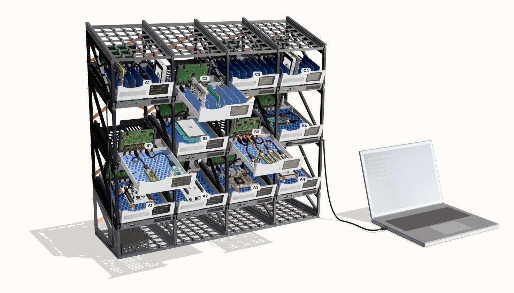

# BitBunk

:::::{div} bb-hero
::::{div} bb-hero-text
[A 3D-printed rack that puts your development boards on the network.]{.bb-lede}

Each board sits in a drawer. Its bay switches it on and off, shares its USB over the network and shows its
serial console in your browser.

Build one bay or many: you choose how many columns and rows your rack has, and you can add more later.
::::
::::{div} bb-hero-art


[The 3D model of a rack of 12 bays.]{.bb-cap}

```{div} bb-actions
[Open the 3D model](/viewer/)
```
::::
:::::

::::{div} bb-ways
[Build a rack](plan/stages.md)
: Order the PCBs, print the parts, assemble the bays.

[Use a rack](use/index.md)
: Power, USB, serial console, wires and camera, from your browser or the command line.

[Use it in CI](use/ci-host.md)
: Run Zephyr's twister, labgrid or LAVA on the boards in the rack.

[Try it without hardware](plan/try-it-without-hardware.md)
: Run a simulated bay on your computer and open its page.
::::

:::{div} bb-home-foot
[Licences and credits](engineering/licences-and-credits.md) · [Source on GitHub](../)
:::
