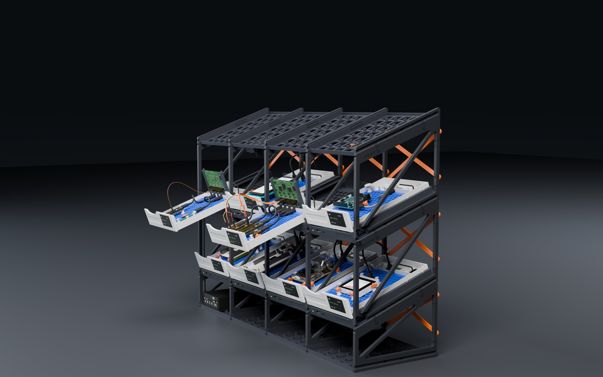
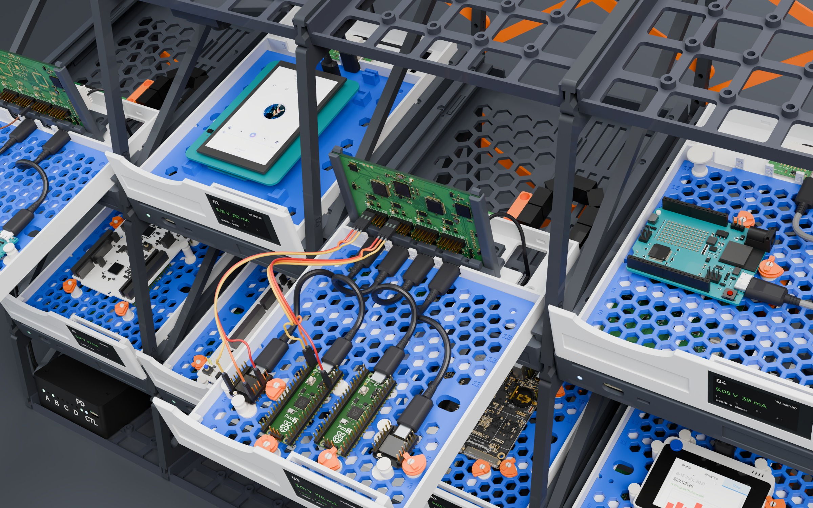
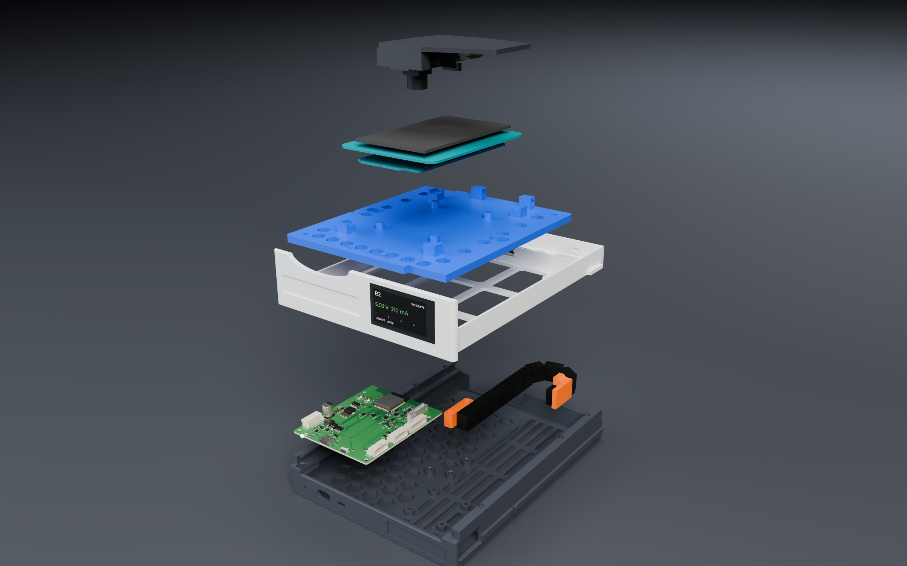
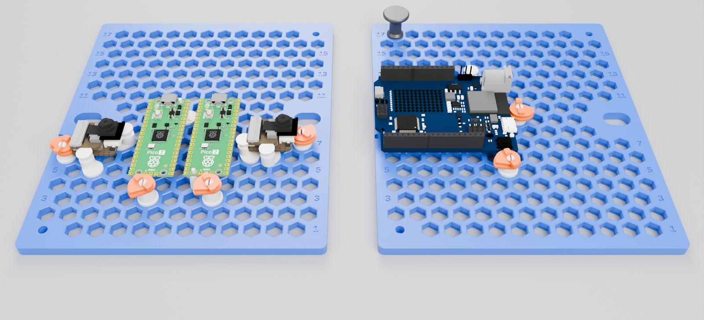
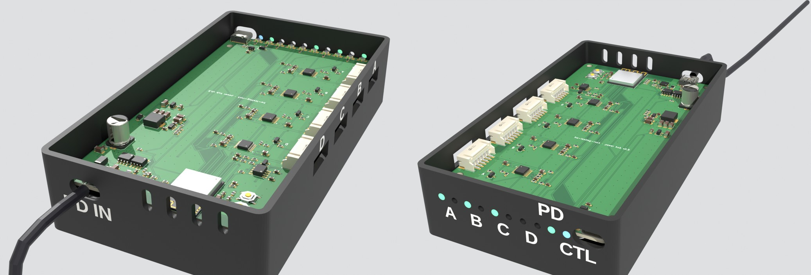

# Mechanical design

Everything is parametric OpenSCAD driven by
[`config/rack.yaml`](../config/rack.yaml) → `mechanical/generated/config.scad`
(`python tools/build.py config`).  Printable STLs: `python tools/build.py stl`
(OpenSCAD from `PATH`, or the `openscad/openscad` Docker image).  Every part
prints **without supports**; the row ladders (203 × 241 mm) need a 256 × 256 mm
bed (Bambu X1/P1/A1, H2D …), everything else fits 250 × 210.

## Frame: the panel frame

Every part is printed: no aluminium, no screws in the structure except the rear
braces', and the grid grows in both directions.  Side walls ("ladders") stand
between the bays and are shared by both neighbours; trays slide into their
grooves; an X brace behind every bay and row keeps the grid square.

| Part | File | Notes |
|---|---|---|
| Ladder | `ladder.scad` (`PART="row"`, `ROW=k`) | side wall between two bays, one per row: front and rear posts, a bottom band with the tray grooves (both faces), a top band, one brace; stacks on the ladder below with a ridge/notch joint and two in-plane snap hooks (release through the window); 4 heat-set inserts in the rear edge |
| Base ladder / cap strip | `ladder.scad` (`"base"`, `"cap"`) | floor → row A (holds a floor plate); the strip on top holds the cap plate |
| Floor / cap plate | `tray.scad` (`PART="floor_plate"`, `"cap_plate"`) | the tie between the base ladders and the top row's ceiling: a regular 30 mm grid (the camera pod's pitch) with an M3-insert boss at every crossing: the top row's pods take the same square as under a tray (x 94/124, y 30/60), anything else any square |
| Rear brace | `brace.scad` (`ROW=k`, `-1` for the base) | an X behind each bay and level, screwed (4 × M3×8 pan head, Phillips) into the inserts in the rear edges of its two ladders; left and right holes at different heights, so neighbouring braces share a ladder.  No slack: snug 3.1 mm holes, and each diagonal is 0.25 mm short, so the X is taut once the fourth screw is in |

The column pitch is 165.8 mm: a 158 mm tray, a 7.4 mm ladder and 0.2 mm of
clearance on each side (`frame.panel_thickness`, `frame.panel_clearance`).
Rows are stacked with `rows[].height` of vertical pitch and tilted by
`frame.tilt` (20°, a stadium: every board, LED and label faces you).  The
default 4 × 3 rack is 671 × 225 × 664 mm.



`python tools/panel_frame_fea.py` models the grid from the front (ladder
sections from the meshes, runner play as a dead band, tension-only braces with
pin slack).  Slack decides: a 4 × 4 sways ≈ 8 mm without braces, ≈ 2 mm with
braces on loose pins, and ≈ 0.16 mm under 2 N with taut braces, whatever the
runner play.  (`python tools/panel_proto.py` renders the parts and the
constants it reads.)

## Bay



| Part | File | Notes |
|---|---|---|
| Tray | `tray.scad` | the plenum under the drawer: node standoffs, chain anchor and rails, the row cable's two tie anchors at the front right (it crosses there, in front of the chain foot's reach) and its window in both walls from the plugs forward to the fascia, two pairs of lock-screw holes through the guide lips (a sled bay's port block and sled; in a drawer bay the first pair locks the drawer shut for carrying), fascia with the PC port / LED / SERVICE switch (the PC port is the USB-C stadium scaled up to 13.4 × 7.8 mm, so a plug's overmold passes: the node's receptacle sits 2.7 mm behind the fascia's face), camera inserts underneath; a notch in the left ledge over the node's RESET button (drawer pulled out, press it with a pin), and a Ø6.4 hole through the left ledge and lip over each of the node's two left screws (screw and screwdriver go through, drawer out; countersunk so the drawer's flange can't catch).  The drawer rides on two side ledges under C-channel lips; runners on both walls slide into the ladder grooves from the front, and a flex arm per wall clicks a barb into the groove's window (pull the drawer out, press both arms to remove the tray) |
| Drawer | `drawer.scad` | 142 × 208 mm; front panel with label recess (printed `bay_label`, or 12 mm tape) and finger pull; plate pocket with two 180°-symmetric pins; open floor under the plate; rear bay for either DATA board, so a bay converts by swapping the board: the port wall's four U's (the USB-C plug cut's 13.4 mm, open upwards, at drawer x 26 / 44 / 62 / 80: the DATA ×4's ports), each receptacle 8.5 mm above the drawer bottom and 1.7 mm behind the wall's front face, so a straight plug's overmold or a right-angle plug's body goes in until the plug seats.  Floor bosses for all, PT 2.6×8 from above: Ø6 under the DATA ×4's three shared holes (`pcb.data_port_x4`: v1, 100 × 37 mm, three holes, the PH 8 at the rear end of its right edge, its mouth at drawer x 115) and under v2's own fourth at the front right (v2: 108 × 37, its PH in a 7 mm rear-right notch), two Ø5 for our DATA port board (electronics/data-port), its USB-C on the fourth U; they stand under the DATA ×4's bare underside, 0.8 mm from its second USB-C's shell leg.  Ledges under the boards' front edge between the USB4105s' pegs (the single board's lands where the DATA ×4's fourth does).  The cable window at the rear right, up to 1 mm off the rear wall and the chain foot's boss: a rear strip under v2's notch, where the single board's lead also comes up and runs along the rear wall to its PH, and a side strip beside v1's right edge, under its PH's plug.  An AUX pigtail goes through a free U.  The foot groove; pin holes over the node's RESET and BOOT, as in every plate: press them with the drawer in |
| DATA ×4 v2 cradle | `x4_cradle.scad` | holds the standing DATA ×4 v2 (100 × 70 mm, `docs/data-x4-v2-layout-options.md`, option B) at the back of the rear bay, its four vertical USB-C through the port wall's U's: a base on the three DATA ×4 bosses (3 × PT 2.6×8, clear of the cable window), two uprights whose 1.9 mm slots take the board's ends (5.5 mm, no parts there), a latch finger at each upright's top that snaps over the board's top edge (press it back to lift the board out), and two T-heads through notches in the board's bottom edge.  Plugging in pushes the board onto the base's front edge, right behind the receptacles; unplugging pulls it onto the slots and the T-heads.  The board's PH 8 lead, on its rear face, goes over the base into the window.  Prints as installed, no supports, ≈ 15 g.  The same cradle fits a sled bay's port block |
| Sled / port block | `drawer.scad` (`PART="sled"`, `"block"`) | a bay without a drag chain (`population` › `mount: sled` or `fixed`, same tray): the drawer cut 1 mm in front of its port wall.  The **sled** (its front and two flange segments at its rear; its floor ends open under the plate) slides on the same ledges, the stop screw limiting it (≈ 110 mm); unplug the DUT cable, then pull it.  The **port block** (the drawer's rear bay: port wall, DATA board, cable window) stays behind it, locked by 2 × PT 2.3×8 through the guide lips and its flanges into the ledges; its DATA lead comes straight from J7 (≈ 22 cm).  A **fixed** bay is a sled bay with 2 × PT 2.3×8 more through the sled's flanges.  The block's rear bay is the drawer's: either DATA board.  No chain, foot, anchor or magnets: ≈ €2–3.5 and the chain steps saved per bay; back to a drawer at any time |
| Chain foot / anchor | `chain_parts.scad` | take the chain's end pieces (tab with 2 holes 8 mm apart, PT 2.6×8 + washers).  The anchor is a block outside the fixed run, on two M3 inserts in the tray; the foot carries the moving end on a fin outside the moving run and slides into the drawer's rear-open groove, locked by one PT 2.6×8 from inside the rear bay.  A printable link (and its removable bar, so the cable can be laid in) is included if you'd rather not buy chain |
| Board plate and pegs | `board_plate.scad`, `pegs.scad` | one honeycomb plate for every board, 5 mm thick, and the clip-in pegs that hold the boards on it (stops, cams on their bases, pins, a cable bobbin), placed by `tools/plate_layout.py`: [below](#the-board-plate-and-its-pegs) |
| Bay label | `label.scad` | 12 × 100 mm blank for the drawer front's recess |



### Drawer motion

The drawer slides 140 mm along the slope on the tray's two ledges (PETG on
PETG); its rear flange segments run under the lips, so it cannot tip at full
stroke.  A pair of 6 × 3 mm magnets (one in the drawer, one in the left ledge,
on a pad) holds it closed against the slope; pulled out, it rests on a PT 2.3
stop screw through the left lip, the flange still under the lips.  Want
smoother?  Print the trays in a POM-like "igus" filament.

The magnet pockets are a slip fit (Ø + 0.25 mm): **glue the magnets**, a drop
of CA gel in each pocket.  The other magnet pulls each one out through its
pocket's mouth, and the drawer's boss leaves a 0.9 mm wall around its pocket,
too thin to press-fit into.  **Check the polarity first**: stack the pair, mark both outer
faces, and glue the marked faces into the pockets, so the two bare faces
attract.

### Drag chain

The reference is Olimex's DRAG-CHAIN-7X7 (€4/m): 7 × 7 mm inside, links
that open on both sides, so the DATA lead can be laid in (its PH plugs,
12 mm wide, do not pass through).  Olimex publishes only the inner size;
the model takes the outer size (13.5 × 10.2 mm) and the end pieces (a tab
with 2 holes 8 mm apart) from Electrokit's listing of the same generic chain
(41017996).  The bend radius is not published anywhere: the model keeps
R18.  **Measure the chain on arrival** and set `config/rack.yaml › chain`:
`outer`, `radius`, `end_holes` and `end_length`, the rigid length of an end
piece from its mouth to its pivot on the chain.  Olimex sells it by the metre
and, like every seller of this generic chain, with one pair of end pieces per
metre; it does not sell them alone, so the other drawers' pairs come from
AliExpress (see the BOM).

The chain lies flat in the plenum, its side plates horizontal, so the end
pieces' tabs stand vertical on the outer faces of the U: the fixed one
against the anchor block, the moving one against the foot's fin (2 × PT 2.6×8
and washers each).  The runs are 36 mm apart (2 × R), 13.5 mm tall from 3 mm
above the tray floor, under the drawer with 6.5 mm to spare; low rails keep
them straight.  An end piece cannot bend, so it must stay in a straight run
over the whole stroke: the moving end with the drawer closed, the fixed end
with it open.  That sets the moving end's mouth 26 mm in front of the bend
(157 mm from the drawer front), and the U still clears the tray's rear wall
by 1.9 mm.  `lib/carrier.scad` asserts all three, so a measured chain that
does not fit stops the build instead of printing parts that clash.  Checked
in Blender over the 140 mm stroke: the chain, the anchor, the foot, the
drawer, the node and the DUT plug never overlap.

### The board plate and its pegs



One plate for every board: 137.4 × 159.4 mm (the drawer's inside), 5 mm thick,
a honeycomb of 197 hexagonal holes, 10 mm apart in rows along X (7.2 mm across
flats), odd rows numbered on both rims (row 1 at the front) so that a layout
reads "row 7, 4th hole" (`config/rack.yaml` › `plate_grid`).  Clip-in pegs hold
the boards on it, anywhere: no more plate per board.

**The clip stays inside the plate.**  A hole widens by 0.4 mm per side over
its bottom 1.4 mm, with a 45° ledge between the two; a peg's hexagonal plug
(0.1 mm clearance per side) has three spring skins, openGrid-style: each a
cantilever along one flat, freed by a slot, so that it bends in the print
plane and not across the layers.  Their 0.3 mm nubs go 0.2 mm past the waist
on the way in and snap under the ledge; there they rest unloaded, so a peg
does not loosen however often it moves.  Nothing comes out under the plate:
the drawer's floor, its magnet and the drag chain never see a peg.  The hex
keeps a peg from turning.

**The pegs** (`pegs.scad`; heights are the boards' standoffs, `boards.yaml` ›
`standoff`, one STL per height in use):

| Peg | STL | What it does |
|---|---|---|
| Stop | `peg_stop_h<H>` | an eccentric post: its ledge carries the PCB's edge, its neck (Ø 4.6) touches the edge, a 45° lip above it holds the edge down.  The post sits 3.55 mm off the plug's axis, so the 6 turns of the hex are 6 places in each hole: the layout gives the turn (the arrow on the flange points to the post).  The stops place a board |
| Cam on its base | `peg_base_h<H>` + `peg_cam` | the base's split pin carries a cam with a spiral band (3 mm of travel), undercut 20°: turned clockwise it pushes the board onto its stops and presses the PCB's top edge down; turned on, it falls open.  Self-locking: the spiral rises less than friction holds.  The cams clamp a board |
| Pin | `peg_pin_d<hole>_h<H>` | an eccentric pin through one of the board's mounting holes (Ø hole − 0.3), on a pad as wide as the hole's copper ring: for a board whose long edges are lined with headers (the Pico 2), with cams on the other edges |
| Bobbin | `peg_bobbin` | the DUT cable's spare length loops round it, under its 45° cap |

**Where they go: `tools/plate_layout.py`.**  A board is held the way a fixture
holds a part: per axis a datum edge (stops, or the drawer's wall) and a cam
edge opposite, whichever way round fits; `boards.yaml` › `pegs` › `keepout`
lists the edge spans no peg may touch (a header or a connector at the edge,
pins under it), and the debug USB's plug is kept clear by itself.  The tool
starts from the board's usual place (centred, its USB towards the port wall;
a converted bay's `at`) and moves it by a few mm until its stops touch it
exactly and its cams reach it within their travel; nothing may touch another
board, another peg, a plug's way or a keep-out.  A board up to 6.4 mm high
may lean on the drawer's side wall instead of stops (the UNO R4, whose
straight cable needs the room on its right), any board on the front panel.

```bash
python tools/plate_layout.py B3          # the pegs of a bay: row, hole, turn, edge
```

The viewer shows every peg in its hole, turned as the layout says (cams in
orange); the BOM counts them.  To mount a board: clip the stops and the cam
bases in, cams open; put the board in, against the stops; turn each cam
clockwise until it bites.  To take it out, turn the cams on until they fall
open.

**Not every board yet.**  The ESP32-S3/C6-DevKitC (headers along both long
edges, both USB on a short one, no holes) and the i.MX EVKs (wider than the
plate leaves room for pegs) get no layout: a bay with one of them says
`plate: boards` and keeps the former plates below.  The GIGA R1 + display
stack (B2) does too, the shield hiding the GIGA's edges.

**The former plates** (`board_plate.scad` with `BOARD=` or a converted bay's
`BAY=`, `population` › `plate: boards`): the board's own plate, heat-set
inserts (`MODE="insert"`), split snap pins (`MODE="snap"`) or, for hole-less
or unverified boards, corner fences and support pads.

**Printing.**  The plate flat, 2–3 walls, no support (its holes' ledges are 45°);
≈ 75 g of PETG (its 2.8 mm webs print solid).  The pegs upright, flange down; the cams
flange down.  Every overhang is 45° or less but the pegs' 1 mm flange rims.

**Checked in SolidCraft** (STEP from the SCAD through `tools/notice/csg2part.py`):
B3's four boards, B4's UNO R4 and A1's NUCLEO-64 on the real plate with every
peg of their layouts, and the PCBs with their mounting holes.
* No interference anywhere.
* Every stop, cam and pin touches its PCB (0.000 mm).
* Every plug sits in its hole, its flange on the plate.

## Cameras

`camera_pod.scad`: two printed parts under the ceiling (the bottom of the tray
above, or the cap plate) for an Arducam Mega 3MP SPI camera in its case (B0434,
a ~120° M12 lens) and the pod board right behind it
([electronics/camera-pod](../electronics/camera-pod/): the PH-8 lead's J1, the
Mega's header J2, four white LEDs along the edge beside the camera: nothing to
solder).  The **pod** (dark PETG, opaque) takes 4 × M3×6 into the camera
inserts (`bay.camera_mount`: a 30 mm square right of the node above, clear of
its drag chain, on the cap plate's grid, so one pod fits every row) and reaches
45 mm left to the lens spot (`bay.camera_lens`, bay (64, 84) below): a sleeve
the Mega's case snaps into from below (two lips, its XH side open), lens down,
the lens tip ≈ 30 mm under the ceiling (Z ≈ 125, well over the DUT cables'
≤ 105 mm arches).  The sleeve's rear wall goes on down as the baffle between the
LEDs and the lens; the pod board sits behind it, components down, its LED edge
against it (`pcb.camera_pod`).  The **diffuser** (white PETG) is a 1 mm floor
7 mm under the LEDs (glare on screens and glossy boards) on two posts that clamp
the board to its standoffs (2 × PT 2.6×14 through both), open round J2's Dupont
housing.  The Mega's case is a placeholder (`MEGA_*`: Arducam gives 33 × 33 mm,
35 mm with the stock M12, no drawing): measure the first one before printing.
The camera runs from the bay's **own** node (J6, JST-PH 8), its lead through
the tray's rear slot and up under the ceiling ([cabling.md](cabling.md)).  Print
the pod upside down, the diffuser floor down; no supports.

## Power box

The base cell under A1 is otherwise dead space: 154 mm between the floor
plate's walls, ≈ 196 mm deep, ≈ 70 mm high at the front, rising with the 20°
slope.  `power_box.scad` puts the power hub there, in a box against the
cell's left side; the rack's supply is a USB-C PD charger outside the rack.
Placement and sizes: `config/rack.yaml` › `power_box`; the charger, the
negotiation and the budget: [power.md](power.md).



*Lid off, labels inlaid in white.  Left: from the rear, the charger's USB-C cable (PD IN) and the row outputs' windows (A–D).  Right: from the front, the status LEDs (ON / FAULT per row, PD, CTL) and the console USB-C.*

| Part | File | Notes |
|---|---|---|
| Base | `power_box.scad` (`PART="base"`) | 84 × 148 × 33 mm, against the cell's left side. Under the floor are sockets that drop over the floor plate's insert bosses beneath it: it locates without screws, and an M3 through each socket screws it down if wanted. Lift it over the plate's front lip to put it in. **Left wall:** windows for the hub's four 6-pin JST PH row outputs, each with its row letter (A–D) above it, reached from the rack's left side through the base ladder's window. **Front wall:** holes for the hub's ON / FAULT LEDs per row (A–D under them), the PD LED (PD over it) and the controller's LED and console USB-C (CTL under them). **Rear wall:** the USB-C PD input (PD IN) and vents. Both USB-C openings take the plug's overmold (12.4 × 7 mm), as the receptacles sit 3.3 / 4.1 mm behind the walls' outer faces. Labels are engraved 0.8 mm deep, 5.25 mm capitals with 1.1 mm strokes. Inside: four standoffs (Ø8) with M3 inserts for the hub; nothing overhangs the hub, which drops straight in |
| Lid | `power_box.scad` (`PART="lid"`) | printed top face down. A rim locates it inside the walls, and 4 × M3×6 go into the M3×12 male-female hex spacers that hold the hub down (their tops are flush with the walls). Vents over the PD input and the buck, the name engraved in the top face. Two pin holes (RESET, BOOT, engraved beside them) with guide tubes down to 1 mm above the hub's buttons: recover the controller with the box closed |
| Label inlays (optional) | `power_box.scad` (`PART="labels"`, `"lid_labels"`) | exactly the engravings' volume: load each with its part as one object (two parts) and give it the second nozzle's filament. White letters flush in a black box read at a glance; engraved in one colour, the labels only show under grazing light |

Both print without supports (PETG, 3 walls).  Print the base at 0.12–0.16 mm layers: its
labels stand on vertical walls, where the layer height sets their vertical definition (a 5.25 mm
capital is 33–44 layers instead of 26 at 0.2 mm).  VRACK reaches the first node
of each row through one 6-pin JST PH feed ([cabling.md](cabling.md#row-power)); 6-pin
jumpers carry it, and the CAN bus, from node to node through the windows in
the tray walls and the shared ladder.

## Not designed yet

* Double-width bays for i.MX-class EVKs (the aluminium frame had them): a
  324 mm tray and drawer, no ladder in between.
* Rows taller than 165 mm: a 185 mm row makes a 261 mm ladder (an H2D-class bed).

## Checks

An interference check of one assembled bay (exact solids from the OpenSCAD
sources, SolidCraft's `inspect.interference`) finds no overlaps; it caught the
drawer's magnet boss hitting the tray's guide lip in the last 10 mm before the
fix.  Contacts between the ladders, plates, trays and braces are the designed
bearing faces.

## Printing

| | |
|---|---|
| Material | PETG |
| Layer | 0.2 mm, 3 walls, 15 % gyroid (braces: 100 %, they are mostly perimeter) |
| Inserts | Ruthex-type M3 × 5.7 (Ø4.0 holes), M2.5, M2 |
| Filament | see the BOM.  Sliced (Bambu Studio, H2D, 0.20 mm Standard, PETG): a bay on its own ≈ 480 g, each bay added beside it ≈ 375 g, each extra cell in a large grid ≈ 210 g (tray 100 g, drawer 56 g, ladder 44 g, brace 8 g) |

Orientation is baked into the exported STLs (`mechanical/stl/`).
