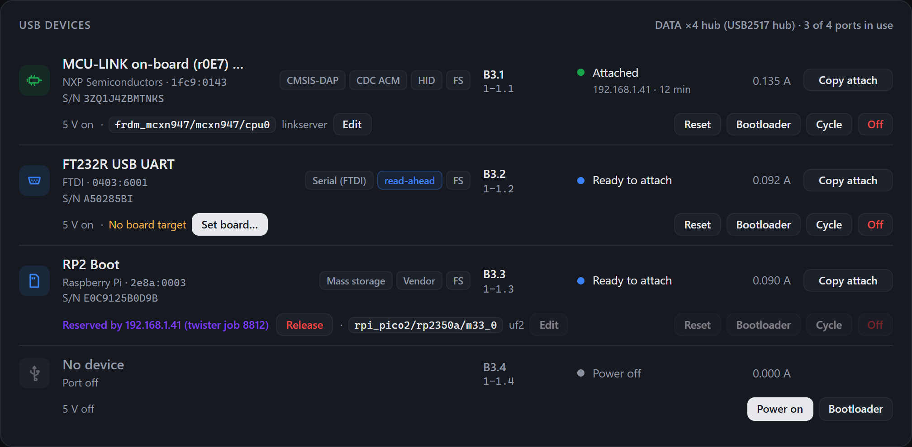

# One node, four boards: the firmware side

> **Status: the minimal firmware is written (`firmware/bay-node/src/ports.c`,
> tested on native_sim against an emulated board), not run on a DATA ×4 yet;
> the tools and the node's simulator follow it (see Tools and "In the
> firmware").**  Density epic, decision 3
> (2026-10-19): one node serves up to four small USB-native boards through a
> hub on a "DATA ×4" board in the drawer, sub-slots A1.1–A1.4.  What the
> firmware needs, and what Zephyr lacks for it.  The bench spike that checks
> the risky part (a hub behind the ESP32-S3, several USB/IP exports) is
> [`firmware/spikes/usb-hub`](../firmware/spikes/usb-hub/README.md); its results
> may change this note.

## What the firmware sees

| | Today (one DUT) | With DATA ×4 |
|---|---|---|
| USB | the DUT on the S3's OTG port, or the front PC port (classic mode) | a hub on the OTG port, 4 DUTs behind it; classic mode: the laptop sees the hub and the 4 DUTs at high speed |
| Power | TPS2553 + INA226 on the node | one switch and one current sense per port on DATA ×4 (≈ 0.5 A each), reached over I²C on J7 (PH-8: I²C, an interrupt) |
| RESET / BOOT | two node GPIOs | per port, through an I²C expander on DATA ×4 (two TCA6408A) |
| Console | the AUX UART | the boards' own USB (CDC): no AUX per sub-slot |

A node without DATA ×4 stays a one-port node: everything below keeps
working with N = 1, and today's API keeps its meaning.

**Devicetree.**  Today's `hwtr,dut-port`, one node per sub-slot, plus where
it sits; no `uart`.  The board's wiring stays data, not code:

```dts
/* ports_io0 / ports_io1: the two TCA6408A on DATA ×4 (0x20: ports 1–2, 0x21: ports 3–4), register-
 * compatible with the TCA9538 (ti,tca9538, ngpios = 8) */
dut_port1: dut-port-1 {
	compatible = "hwtr,dut-port";
	sub-slot = <1>;                 /* A1.1 */
	hub-port = <1>;                 /* the hub's downstream port wired to it (n on DATA ×4) */
	enable-gpios = <&ports_io0 2 GPIO_ACTIVE_HIGH>;
	fault-gpios = <&ports_io0 3 GPIO_ACTIVE_LOW>;
	reset-gpios = <&ports_io0 0 GPIO_ACTIVE_LOW>;   /* open drain, emulated (below) */
	boot-gpios = <&ports_io0 1 GPIO_ACTIVE_LOW>;
	power-monitor = <&port1_sense>;
};
/* dut-port-2: EN 4, FAULT 5, BOOT 6, RESET 7 on ports_io0; ports 3 and 4 the same on ports_io1 */
```

The expanders' pins come up as inputs.  On DATA ×4 each EN is pulled down
(the owner's decision after the PCBA review, 2026-10-19): four ports at
0.50–0.62 A each would trip the node's 1.34–1.52 A switch, so every port
stays off until the firmware switches it on within the bay's budget
([Power budget](#power-budget)).  That is the one exception to the
binding's rule that a board is powered before (and without) any firmware.
RESET and BOOT have 100k pull-ups (the TCA6408A has none, and a floating
input would raise INT); they go straight to the board's pins through 1k:
Zephyr's driver refuses `GPIO_OPEN_DRAIN`, so the dut-port code asserts a
line by configuring it as an output low and releases it by configuring it
as an input.  A port that is off holds both asserted, so the pull-ups never
feed an unpowered board ([Power budget](#power-budget), safety rules).

Power goes through the board's switches (current limit, fault, measured),
not the hub's own port power: it does not depend on the USB link, and works
for a board that hangs its USB.  On DATA ×4 the hub's PRTPWR pins are not
wired: `SetPortFeature(PORT_POWER)` does nothing there (on a bench hub it stays
a fallback; the spike checks which hubs really switch).

## Names and USB/IP

- A sub-slot is the bay's position plus its port: `A1.2`.  The node knows
  its position from the rack bus (`bay_rack_position()`), its ports from the
  devicetree.
- **busid.**  Zephyr's USB/IP names a device `1-<address>`, the address the
  host gave at enumeration: it changes when a board re-enumerates, and two
  boards that reset together can swap.  The node names it by where it is
  plugged instead, as Linux does: `1-1.<hub port>` (root port 1, then the hub's
  port), so `A1.2` is always the same busid.  A one-board node keeps `1-1`.
- **The hub is hidden** from `usbip list`; only the boards are exported.
- **A board that disconnects** ends its USB/IP session (the client sees a
  detach); when it comes back, it is listed again under the same busid, and
  `bayctl attach --follow` re-attaches it.
- **Sessions.**  `CONFIG_USBIP_DEVICES_COUNT=4`: one thread and a 2 KB stack
  each.

The busid, the hidden hub and the session that ends with its board are
done: a patch to Zephyr's `subsys/usb/host/usbip.c` that the workspace
applies (`west patch apply`, [`zephyr/patches.yml`](../zephyr/patches.yml)),
tested on native_sim with Zephyr's virtual USB bus
([`firmware/common/tests/usbip`](../firmware/common/tests/usbip/test_usbip.py)),
not yet on a node or behind a real hub.

## Per-port state

Each sub-slot gets what the single DUT has today: power on / off / cycle, a
latched fault, its current (V, mA, mW), RESET and BOOT pulses, its USB
device (VID:PID, product, serial, busid) and the USB/IP client attached.
`dut.c` stays the bay's DUT_5V; `ports.c` adds the DATA ×4's ports, and a
one-port node answers `/api/ports` with its one DUT as port 1.



## Power budget

> The DATA ×4 board as designed (v1.0, `electronics/data-port-x4`,
> [electronics.md](electronics.md#data-4-v10--4-layers-108--24-mm)), not built yet.

- **Per port**, a TPS2553-1: limit ≈ 0.48–0.58 A, 7.5 ms deglitch, then
  latched off until EN toggles.  The firmware reports the port's fault and
  toggles EN on the next `on`.
- **The node's own TPS2553** (≈ 1.34–1.52 A) feeds the whole board through
  J7: the four ports and the board itself (the hub, 220 mA at full speed to
  330 mA at high speed, the co-processor, the matrix's 5 V, the LEDs:
  ≈ 0.3–0.46 A).  The node cuts DUT_5V after 1 s in current limit
  (`CONFIG_BAY_DUT_FAULT_OFF_MS`): the whole bay goes.
- **Admission.**  A port is switched on only if what the bay draws, read on
  the node's INA226 (0x40, on DUT_5V: the board counts), plus 100 mA for its
  start stays at or under 1150 mA (`CONFIG_BAY_PORTS_BUDGET_MA`,
  `CONFIG_BAY_PORTS_RESERVE_MA`); otherwise 409.  Without the node's meter (a
  stand-in, or it does not answer) the bay's draw is the ports' INA226 (0x41,
  0x43, 0x44, 0x45) plus 500 mA for the board (`CONFIG_BAY_PORTS_BOARD_MA`).
- **Shedding.**  The node's INA226 holds its ALERT (IO39) low while its
  shunt reads over 1250 mA (`CONFIG_BAY_PORTS_SHED_MA`: Alert Limit 25000,
  2.5 µV each across 50 mΩ; SOL, not latched), each reading averaged over 4
  conversions (8.8 ms).  The interrupt turns off the port switched on last,
  and the bay is read again 20 ms later until it is under; the 100 ms poll
  does the same without the interrupt (the stand-ins have no ALERT line).
  All well before the node's 1.34 A and its 1 s cut of the whole bay.  A shed
  port stays wanted: it comes back once the budget has room for what it drew.
- **What that guarantees**, with the board at its 0.46 A worst case: **one
  port at its full 500 mA**, always (0.46 + 0.1 A to start it, 0.96 A
  running); **four ports only at ≲ 190 mA each** (the fourth starts at
  0.46 + 3 × 0.19 + 0.1 = 1.13 A, and 1.22 A running stays under the shed).
  More, and the last port waits, or is shed.  Without the node's meter, four
  ports at ≲ 180 mA.
- **Expanders** (two TCA6408A, 0x20 for ports 1–2 and 0x21 for ports
  3–4): EN, FAULT_N, RESET and BOOT per port, nothing else (no UART per
  port; the hub resets with the bay's power or a USB bus reset).  RESET and
  BOOT reach a 1 × 3 header per port through 1k, the header not fitted on
  the first boards: until then those lines do nothing.
- **Ports come up off** (EN pulled down): the firmware switches them on one
  by one through the admission rule, so four boards booting together never
  meet the node's limit before the firmware runs.
- **Safety rules** for the boards on the ports:
  - RESET and BOOT are held asserted (outputs, low) while a port is off: the
    100k pull-ups would otherwise put 3.3 V on an unpowered board's pins.
    After EN, 5 ms, BOOT is released, then RESET (BOOT stays held for a boot
    into the bootloader).  RESET or BOOT asked of a port that is off: 503.
  - The ports are sink-only, with no CC detection: a port whose VBUS (its
    INA226's bus input, on the shunt's load side) reads over 3.5 V while off
    (`CONFIG_BAY_PORTS_VBUS_FOREIGN_MV`) is not switched on (409), since a
    board powered from elsewhere (4.4 V or more) would meet the port's 5 V.
    A wanted port comes on by itself once its VBUS has gone.
  - A power cycle keeps the port off (for the `ms` asked, none by default)
    until its VBUS reads under 1 V (`CONFIG_BAY_PORTS_VBUS_OFF_MV`: the
    board is well below any brown-out), 2 s at most
    (`CONFIG_BAY_PORTS_DISCHARGE_MS`), instead of a fixed 1 s.  The
    TPS2553-1 does not discharge its output; a board on the port does.  A
    port with nothing on it keeps ≈ 1.5–2 V for tens of seconds (22 µF
    against the INA226's ≈ 830 kΩ bus input, once its LED, before the
    shunt, stops conducting): its cycle waits the 2 s and it goes back on,
    that charge being well under 3.5 V.
  - v2: the matrix expander's MARK (TCA9534A P7) an output, low, at each
    set-up; the rest of that expander belongs to the co-processor's rules
    below.
- **DUT_5V off.**  The board's I²C and INT reach the node through three
  2N7002s, gate on the board's +3V3: with DUT_5V off they open, the node's
  pull-ups cannot feed the dead board through its chips' clamps, and the
  node's own INA226 (0x40) keeps its bus.  The expanders and the four INA226
  lose their registers with DUT_5V: the firmware leaves 0x20, 0x21 and
  0x41–0x45 alone while it is off (they NACK; 0x40 answers), and sets them
  up again after each DUT_5V on (every port then off again):
  1. wait ≈ 5 ms for the board's +3V3 and the FETs;
  2. each TCA6408A: output register 0, then the directions with every EN,
     RESET and BOOT an output, low (every port off, its lines held);
  3. each port's INA226: its averaging; on the v2, MARK low; the node's
     INA226: its ALERT limit;
  4. the wanted ports back on, one by one, through the admission rule.

### Rules for the co-processor (not code yet)

The DATA ×4 v2's RP2354B drives the pin matrix (two CH446Q) and its
pull-ups; its firmware is not written yet.  When it is, it keeps the same
rule as the node: nothing drives an unpowered board.

- The matrix switches stay open while their port is off (MX_RST high, the
  default until the node writes the TCA9534A), and open when it goes off.
- Break-before-make: a route opens its old crosspoint before closing the new
  one; two sources never share a line.
- Open-drain drive: a line is pulled low or let go (to its pull-up), never
  driven high into a board's pin.
- The RP2354B's internal pull-downs are cleared on GPIO10–13 and 16–19 (the
  2.2k pull-up enables A–H) before anything else.

## REST API

| Endpoint | |
|---|---|
| `GET /api/ports` | `[{"slot": "A1.2", "port": 2, "hub_port": 2, "power": {...}, "fault": ..., "usb": {"vid": ..., "pid": ..., "product": ..., "busid": "1-1.2"} \| null, "usbip": {"client": "10.0.4.17"} \| null, "lease": ...}]` (hub port n is USB-C n) |
| `POST /api/ports/<n>/power` | `{"action": "on" \| "off" \| "cycle", "ms": 1000}`; 409 when the bay's budget has no room for it ([Power budget](#power-budget)) |
| `POST /api/ports/<n>/reset`, `/boot` | as today, for one port; `/boot` with `{"power_cycle": true}`: BOOT held across a power cycle of the port instead of a RESET pulse (a board whose RESET is not wired: [the analyzer](#a-logic-analyzer-in-a-sub-slot)) |
| `GET /api/status` | adds `ports` (the same objects, shorter) |
| `/api/power`, `/api/reset`, `/api/boot` | unchanged on a one-port node; on a multi-port node they need `"port": n` (409 without) |
| `GET /api/boards`, `GET` / `PUT /api/ports/<n>/board` | each sub-slot's Zephyr board target (board, runner, probe id, console), saved on the node for the board in it ([firmware/README.md › Board targets](../firmware/README.md#board-targets)) |
| `/metrics` | the DUT metrics labelled `port="A1.2"` |

## Access control and leases

- The services stay (status, control, console, usbip, shell, camera).
- **A lease takes sub-slots**: `{"ttl_s": 3600, "ports": ["A1.2"]}` (no
  `ports`: the whole bay, as today).  Control of a leased port, and its
  USB/IP import, belong to the holder; the other ports stay free.
- USB/IP shares one TCP port (3240) for every board, so the per-port check
  cannot be the packet filter: the node checks at **import** time (the busid
  names the port).  That needs a policy hook in Zephyr's USB/IP service.

## Rack bus (CAN)

- **STATUS** keeps the node's totals (the sum of the currents, flags ORed),
  so a hub that does not know ports still shows the bay; a new byte 6 bit,
  `RACK_ST2_PORTS`, says the node has several.
- A new **PORTS** frame (function 0x7, `0x380 + id`, unused today; every
  second, multi-port nodes only), 8 bytes: bytes 0–1 four 4-bit port flags
  (powered, fault, USB device, USB/IP attached: STATUS's own bits), bytes
  2–7 four 12-bit currents in mA (4095: more).
- **CMD** POWER, RESET and BOOTLOADER take the port in `arg[5]` (`nargs` 6;
  absent or 0: every port).  **ALERT** adds the port in byte 3.
- `RACK_PROTO_VERSION` 2 (HELLO and INFO carry it): a v1 hub ignores PORTS,
  a v2 hub treats a v1 node as one port.  The hub's page shows four dots on
  a multi-port tile.

## Tools

- Each sub-slot's board target lives on its node (`GET /api/boards`, set
  on the page), and the node says how many ports it has; `config/lab.yaml`
  only overrides, by sub-slot (`bays: {A1.2: {runner: openocd}}`).
- `bayctl attach A1.2` asks `bay-a1.local/api/ports` for port 2's busid and
  runs `usbip attach -r bay-a1.local -b 1-1.2`; a new `--follow` re-attaches
  after a reset.  `bayctl power A1.2 cycle`, `bayctl reset A1.2`; a bare
  `A1` still means the whole bay.
- `bayctl hwmap` and the labgrid / twister exports: one target per sub-slot
  (the twister map leaves [the analyzer](#a-logic-analyzer-in-a-sub-slot) out).

Done on the tools side (2026-10-19), against the simulated node: a bay's
`boards:` in `config/rack.yaml` (`tools/rackcfg.py` › `dut_slots`,
`bay_boards`), the boards on the bay's honeycomb plate (its pegs placed by
`tools/plate_layout.py` from each board's `at`, [mechanical.md](mechanical.md#the-board-plate-and-its-pegs);
`plate: boards` for the former shared plate, `board_plate.scad` `BAY="<id>"`,
`plate_bay_<id>.stl`, checked clear of the RESET/BOOT pin holes), `bayctl ports`, per-port power, reset,
leases and `attach --follow`, and `firmware/bay-node/web/dev_server.py
--ports 4` serving this API: its ports come up off and are admitted one by
one, a power on (or `boot --power-cycle`) gets 409 when the other ports
leave no room, and `/dev/draw?port=n&ma=…` makes a board draw more.

### In the firmware

Done (minimal version, `src/ports.c`, 2026-10-20):

- The DATA ×4 in `firmware/bay-node/data-x4.dtsi` (`dut_port1`–`4` on
  `ports_io0`/`1`, `port1`–`4_sense`), which the application adds
  (`app.overlay`): an option on the lead, not in the board files, so MCUboot
  never pulls in its drivers.  The board is probed after each DUT_5V on: no answer
  at 0x20, a one-port node.  One image serves both.
- The chips are driven over I²C with shadow registers, not through the GPIO
  and sensor drivers, whose cached state would not match a chip that has just
  been powered up (their nodes are `zephyr,deferred-init`, never
  initialized).
- DUT_5V: every EN low before it goes off, no I²C while it is off, the set-up
  above after it is on.  A board that stops answering (three polls) turns its
  ports off and is probed again every 2 s.
- Ports come up off and are switched on one by one (300 ms apart) through the
  admission rule; a port's current is its INA226's shunt voltage over the
  100 mΩ shunt (no calibration needed).
- ~FAULT polled every 100 ms: the port is marked latched and its EN goes low;
  `on` again restarts the TPS2553-1.
- The budget on the node's INA226 and the shedding on its ALERT, the safety
  rules above (2026-10-23).
- `GET /api/ports`, `POST /api/ports/<n>/power|reset|boot` (boot takes
  `power_cycle`), `"port": n` on `/api/power|reset|boot` (409 without on a
  DATA ×4 node), `ports` in `/api/status`, `bay port` in the shell.
- `firmware/bay-node/tests/ports`: the start one port at a time, the
  admission, a latched fault, a DUT_5V cycle with no I²C while off, RESET and
  BOOT (held while off), a board that goes and comes back, the shedding (on
  the ALERT and by the poll), the budget without a node meter, a port's VBUS
  while off and its power cycle.

Not yet: leases per port, the USB/IP
client per port, `/metrics` by port, the CAN PORTS frame, the product
string of a port's USB device.

## A logic analyzer in a sub-slot

> Decided 2026-10-19 ([data-x4-v2-research.md](data-x4-v2-research.md), "Decided"): until the
> DATA ×4 v2's RP2354B, one of B3's Pico 2, **B3.3**, runs gusmanb's LogicAnalyzer, stock.  No
> firmware of ours; ≈ €7 with its jumpers (BOM, "Analyzer").

**Config.**

- `config/rack.yaml`: `role: analyzer` on B3.3's entry, and `analyzer:` pins the release.  The firmware
  is release v6.0.0.0's `logic-analyzer-firmware_v6.0.0_BOARD_PICO_2.zip`, a zip holding the UF2
  (6.0.0.1 changed only the apps).  Not the `_Turbo` build: an overclock.  The desktop app is 6.0.0.1,
  sigrok decoders included.
- `config/lab.yaml`: its serial path, or `role: analyzer` for your own rack's sub-slot.
- `bayctl list` shows it as `analyzer: gusmanb 6.0.0.1`.  With `--probe` it also says what the port
  holds: LogicAnalyzer, BOOTSEL or another device.
- `bayctl hwmap` leaves it out.  A whole bay's reset, boot, attach and detach pass it by; the whole
  bay's power does not.
- It enumerates as `1209:3020` "Dr. Gusman LogicAnalyzer": one CDC ACM port.

**Wiring**, with Dupont jumpers:

- The Pico 2 gets male headers, pins up, so it still lies on its pegs.
- Channels: GP2–GP22 then GP26–GP28 are CH1–CH24.  In 8- and 16-channel mode the capture takes
  the first ones (CH1–8, CH1–16), so the signals that matter go on GP2–GP9 first.
- Put a GND jumper beside each group, to the board it watches.
- Complex and fast triggers need **GP0 jumpered to GP1** (trigger out to trigger in; gusmanb's own
  boards wire it).  GP0 is an output: keep it off the neighbours.
- For BOOTSEL: a wire soldered to the Pico 2's **TP6** (BOOTSEL, on its underside) goes to the port's
  BOOT pin, plus GND.  This is the port's 1 × 3 header, fitted for this port.  RESET is not needed.

**Flash and reflash.**

1. A blank Pico 2 comes up in BOOTSEL by itself: `2e8a:000f`, a drive plus PICOBOOT.  Otherwise
   run `bayctl boot B3.3 --power-cycle`: the node holds BOOT, cycles the port's power, then
   releases BOOT.  `bayctl list --probe` then says BOOTSEL.
2. On a Linux host, run `bayctl attach B3.3 --show`.  Then `picotool load -x` the UF2 from the
   pinned zip, or copy it onto the RP2350 drive.
3. It reboots into the analyzer under the same busid: `bayctl attach B3.3` again.

**Use it from a PC.**

- Linux: `bayctl lease B3.3 --for 2h`, then `bayctl attach B3.3 --show` (vhci-hcd, root).  It
  appears as `/dev/serial/by-id/usb-Dr._Gusman_LogicAnalyzer_<serial>-if00`.  gusmanb's app finds it
  by its USB id.
- Windows: usbip-win2, `usbip attach -r bay-b3.local -b <busid>` (`bayctl ports B3` gives the busid).
  Untested.
- One client at a time: the node refuses a second import.
- Captures are buffered on the Pico 2, so nothing moves on USB while it samples.  Then the samples
  cross the bay's 12 Mbit/s USB and the Wi-Fi: a full 393 KB capture takes seconds (to measure).

**Limits.**

- It takes a sub-slot: three boards under test in B3, not four.
- Wiring is by hand: a jumper per signal.  It reaches only the pins a board breaks out, not the
  buses on the DATA ×4.
- 3.3 V logic, no level shifting: a 1.8 V board's highs sit below the Pico 2's input threshold
  (≈ 2 V).  5 V signals go on GP2–GP22 only, and only while the Pico 2 is powered (the RP2350's
  5 V-tolerant pads); GP26–GP28 are ADC pins and are not 5 V-tolerant.
- No series resistor and no ESD protection between its pins and the board's.  A loose jumper on a
  supply pin hurts both boards.
- Buy an RP2350 **A4**: on A2, erratum E9 can hold an input that was driven high at ≈ 2.1 V once
  released, so a floating line reads high.  Without gusmanb's front end, its Pico 2 notes on input
  glitches apply.
- Sampling: 100 MS/s at most; 393 k samples on 8 channels, 196 k on 16, 98 k on 24.  10 cm jumpers
  are fine for UART, I²C and SPI up to a few MHz.

**USB host channels**, the node side (checked in the code, not on hardware):

- B3 holds the hub and four CDC ACM devices.  Opened over USB/IP, each device keeps two IN
  endpoints pending (notification, bulk IN), and the hub's status IN is one more: 9 transfers for
  the S3's 8 channels.
- Upstream, one of them waits for good.  With `uhc-dwc2-channels.patch` (["What Zephyr
  needs"](#what-zephyr-needs-upstream)):
  - an interrupt IN holds a channel only for its poll;
  - a bulk IN holds one while it waits, and gives it up on a NAK when another transfer waits.
  So at most four bulk INs are held, and the polls, control and OUT transfers share the rest.
- While the analyzer streams a capture, its bulk IN never NAKs: it keeps its channel and most of the
  12 Mbit/s.  The consoles slow down but keep theirs.
- Endpoint slots: the hub ≈ 2, plus ≤ 5 per device, ≈ 22 of 32.  A BOOTSEL trip takes the lowest
  free address, usually its own, and SET_ADDRESS frees the old slots.
- `CONFIG_USBH_USB_DEVICE_MAX=8` covers the hub plus four.
- So the patch is enough on paper.  No bench now.

**Bring-up**, also in [the spike's step 8](../firmware/spikes/usb-hub/README.md):

1. Three consoles and the app attached: a full 8-channel capture downloads, timed.  A command to a
   quiet board during the download answers.  The app does not time out over Wi-Fi.
2. 20 BOOTSEL round trips of the analyzer (`boot --power-cycle`, `picotool load -x`), the consoles
   open: no "No channel data slot", the other boards keep answering.
3. BOOT on TP6 through the port's 1k enters BOOTSEL.  The pegs clear the header strips.
4. The chip is an A4.  The zip's sha256 goes into `config/rack.yaml` › `analyzer`.

**Next, not started** (v2's RP2354B reuses all of it):

1. The simulated analyzer and `/api/la/…` in `dev_server.py`: the contract.
2. `bayctl capture`, against it: `.sr` and sigrok-cli decoding, the decoders' CI oracle.
3. The web UI's "Analyzer" card: a canvas viewer and JS decoders.
4. The node's USB host class and gusmanb client, written from a protocol description (no GPL code
   copied).  A mode switch between that client and the USB/IP export.

## Resources

The bay node has about 12 KB of DRAM left.  Three more USB/IP sessions (≈ 6 KB of
stacks), the hub class (2 KB work queue stack, its data), more host devices
and transfers: about 10–12 KB, to measure in the spike (`kernel stacks`).
`CONFIG_ESP32_WIFI_NET_ALLOC_SPIRAM` (network buffers and TCP connections to
PSRAM, ≈ 30 KB) is the likely way, once USB/IP throughput through PSRAM is
measured.  USB stays 12 Mbit/s for the four boards: parallel flashing shares
it (measured in the spike).

## What Zephyr needs (upstream)

| Where | What | |
|---|---|---|
| `usbip.c` | busid by port path (`1-1.3`), not by address | in `zephyr/patches.yml`, not proposed upstream yet |
| `usbip.c` | hubs left out of the device list | same patch |
| `usbip.c` | a session ends when its device disconnects (upstream keeps a pointer to the freed device) | same patch |
| `usbip.c` | an import policy callback (busid, client address) | for per-port leases |
| host core | a device's removal that waits for its cancelled transfers before freeing it (`usbh_device_disconnect()` frees at once; the controller cancels in its own thread) | a narrow window, for every class, not only USB/IP |
| hub class | a public API for port power and status, and port events for the application | the spike uses the stack's private requests |
| `uhc_dwc2.c` | low-speed devices behind a full-speed hub (`HCCHAR.LSPDDEV`) | only if a low-speed DUT is wanted |
| `uhc_dwc2.c` | #120848, #120961, #121688 (data toggles, bulk retries; seen behind a hub on the P4) | carried in `zephyr/patches.yml` (`uhc-dwc2-channels.patch`) until they land |
| `uhc_dwc2.c` | channel sharing: a pending IN keeps one of the S3's 8 channels (bulk IN retried on NAK by the core, interrupt IN claimed between polls), and control/OUT transfers queue behind them; the hub's status IN + 2 per open CDC console = 9 with 4 consoles open | in the same patch: an interrupt IN gives its channel back between polls, a bulk IN that NAKs gives it to the transfers waiting; built, not tested on hardware (bench: [the spike's step 8](../firmware/spikes/usb-hub/README.md); [data-x4-v2-research.md](data-x4-v2-research.md), "USB host channels") |
| `uhc_dwc2.c` | per-endpoint state (32 `ch_data` slots) freed when a device behind the hub goes; upstream only a root-port reset clears it, so slots leak and a re-enumerated board can inherit stale toggles | in the same patch: kept by device address, freed when SET_ADDRESS gives the address to a device again |

## Open

- ~~Which hub chip on DATA ×4~~: a USB2514B (one transaction translator per
  port) on its straps, off the I²C bus (2026-10-19).
- One node failing takes four boards: the hub page should say so.
- ~~The AUX UART~~: none on DATA ×4 (2026-10-19); the node's own AUX can
  still go to one of the four boards by hand.
- The camera sees four boards on one plate (decision 7, open).
