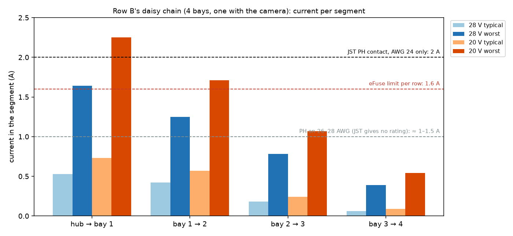
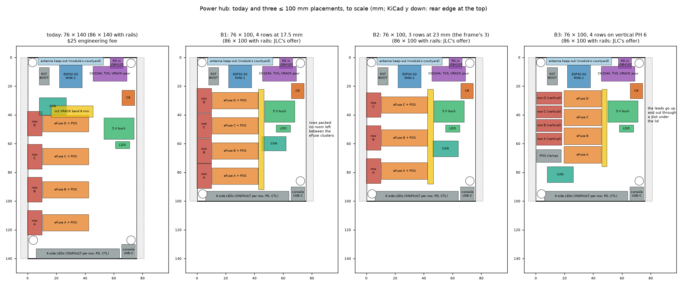

# Power distribution review: the row wiring, and the hub in 100 mm (2026-10-20/21)

The user's question: can the power hub fit in 100 mm, maybe with other connectors, and do the row
cables carry enough current?  VRACK is 20 V or 28 V (the CH224A's contract), not 24 V.

**Decided on 2026-10-20: option B1.**  The user adopted it after its routing trial: the hub is
76 × 100 mm with its four rows, the power box 84 × 108 ([the result](#result-b1-routed)).

**Decided on 2026-10-21: fix 1, real AWG 24 leads** ([the decision](#decision-real-awg-24-leads)).  The
hub B1 and the nodes keep their PH 6 rows; no PH 8, no VH, no PA for now.

## A. The row wiring

### Loads

What a bay draws from the node's +5V (5.24 V).  A bay's buck (LMR51635) runs at ≈ 87 % from 28 V
and ≈ 89 % from 20 V.

| Load | Typical | Worst |
|---|---|---|
| The node (ESP32-S3 on Wi-Fi, LED, INA226, LDO) | 0.20 A | 0.30 A |
| Its DUT side (a DATA port, or a DATA ×4 with its 4 ports and its hub) | per board, below | 1.52 A: the node's TPS2553D (R_ILIM 18k) caps it, whatever the DATA board asks (4 × 0.62 A on a DATA ×4) |
| The camera and its light | 0.36 A | 0.36 A |

A bay at its limits takes 11.0 W from VRACK, 13.1 W with a camera.  That is 0.39 / 0.47 A at
28 V and 0.54 / 0.64 A at 20 V.

The rack's real population (`config/rack.yaml`), typical draw of the boards (estimates, debug
probes on):
- **Row A:** Nucleo-64 0.12 A, Nucleo-144 0.30 A, nRF52840-DK 0.08 A, nRF54L15-DK 0.08 A.
- **Row B:**
  - B1: DATA-4x base with a Pico 2 and an FRDM-MCXN947, 0.33 A;
  - B2: GIGA R1 with its display, plus the camera, 0.55 A + 0.36 A;
  - B3: DATA ×4 v2 with 2 XIAO and 2 Pico 2, 0.33 A;
  - B4: Uno R4, 0.10 A.

### Current per segment of the daisy chain

The first segment (hub → first bay) carries the whole row, the last one a single bay.

| Row, VRACK | Typical (A) | Worst (A) |
|---|---|---|
| A, 28 V | 0.30 / 0.23 / 0.12 / 0.06 | **1.57** / 1.17 / 0.78 / 0.39 |
| B, 28 V | 0.53 / 0.42 / 0.18 / 0.06 | **1.64** / 1.25 / 0.78 / 0.39 |
| A, 20 V | 0.41 / 0.31 / 0.16 / 0.08 | **2.14** / 1.61 / 1.07 / 0.54 |
| B, 20 V | 0.73 / 0.57 / 0.24 / 0.09 | **2.25** / 1.71 / 1.07 / 0.54 |

A full row of four camera bays at their limits would draw 1.88 A at 28 V and 2.57 A at 20 V.  The
whole rack typically draws ≈ 25 W.

### What the chain allows

| Link | Limit |
|---|---|
| The hub's eFuse (TPS26600, R_ILIM 7.5k) | 1.6 A per row (1.52–1.68 A): it holds the row there, whatever the bays ask |
| JST PH contact, VRACK on one pin, GND on two | 2 A per contact **with AWG 24 only**; JST gives no figure for thinner wire, ≈ 1–1.5 A on the usual 26–28 AWG |
| The BOM's leads until 2026-10-21 (AliExpress 1005008045292937; JST's 24 AWG leads since) | gauge not stated, in the text or the photos: red-white flat cable at 2 mm pitch, "bare copper", usually 26 AWG, sometimes 28 |
| The node's J1/J2 | SMD PH on solid islands, 2 vias (0.3 mm) each into a 3.8 mm VRACK strip on In2 (0.5 oz): ≈ 24 A/mm² and 30 mV across the board at 1.6 A |
| The hub's row outputs | 0.8 mm tracks on 1 oz with 3 vias at each layer change: ≈ 2.4 A for a 10 °C rise |

Voltage drop to a row's last node, with 1.6 A in the first segment: 0.35–0.42 V on AWG 24, 0.42–0.53 V
on AWG 26, 0.52–0.70 V on AWG 28 (VRACK on one conductor, GND on two, 20 mΩ per mated contact).  The
nodes run from 13.5 V: **the drop doesn't matter, the contacts and the wire's heating do.**  At
1.6 A, the VRACK conductor of a 26 AWG lead dissipates 0.34 W/m, warm (≈ +10–15 °C in the flat
cable); 28 AWG 0.55 W/m.  Each contact dissipates ≈ 50 mW.

### Verdict

- **Typical loads: OK.**  ≤ 0.6 A per row at 28 V (0.8 A at 20 V), a third of a PH contact's rating.
- **Worst case: marginal.**  At 28 V a full row reaches the eFuse's 1.6 A.  That is 80 % of a PH
  contact, but only on AWG 24, and the leads we buy are probably 26 AWG.  It works, warm, outside
  JST's rated conditions; the eFuse caps it, nothing burns.
- **At 20 V the worst case (2.1–2.25 A) doesn't fit:** the eFuse limits the row.  28 V stays the
  default; 20 V is only for light rows.

### Fixes

| Fix | What it gives | Cost and effort | Board change |
|---|---|---|---|
| **1. AWG 24 row leads**, crimped (PHR-6 + SPH-002T-P0.5S, 24 AWG; ≈ 100 crimps for 2 rows) or from a listing that states 24 AWG; measure a conductor on arrival (24 AWG ≈ 0.51 mm, 26 ≈ 0.40, 28 ≈ 0.32) | PH's 2 A rating: 1.6 A is 80 % of it | a few euros; a crimp tool and an evening | none |
| 2. **PH 8 rows**: VRACK on 2 pins, GND on 3 (S8B-PH-SM4-TB, the node's J7 type, C265121; the same 8P "Same direction" leads as the DATA leads) | 0.8 A per contact at 1.6 A, on any gauge; the eFuse could go to 2.2 A (TPS26600's maximum, R_ILIM 5.36k) for 20 V's worst case | +$0.06 a connector; a new row pinout (docs/can.md), 4 mm more per connector | node J1/J2, hub rows, the tray windows (+4 mm) |
| 3. JST XH 6 (S6B-XH-SM4-TB, C191914, 6 811 in stock, $0.68), 2.5 mm pitch | 3 A per contact, with AWG 22 leads (XH leads are common, mostly 26 AWG: 22 AWG to find) | +$0.29 a connector; 20 × 10 mm footprints | node J1/J2, hub rows, windows |
| 4. Molex Micro-Fit 3.0, or power on its own 2-pin (XH or VH) plus CAN on a small PH | 5 A per contact; or separate power | ≈ $1+ a connector, two cables per hop | everything; over-sized for ≤ 2 A |

**Recommended:** fix 1 now (no board change), and keep the eFuse at 1.6 A as the cap.  Fix 2 only
if a row ever has to carry four heavy bays at 20 V.

### Decision: real AWG 24 leads

The user's pick on 2026-10-21, after VH was weighed against PH 8 and AWG 24:
- **VH:** 10 A a contact, but 23.7–25.6 mm wide.  The hub at 100 mm takes 2 such rows, not 4.
- **PH 8:** 3 rows at most on the hub.

The decision:
- **The rows stay JST PH 6** on the hub B1 and the nodes.  The eFuse stays at 1.6 A: 80 % of a PH
  contact's 2 A, which JST gives on 24 AWG.
- **No ready-made cable fits.**  The AliExpress PH 6 cables are 26 AWG or don't say.  Pololu's 24 AWG
  ones are 1:1, and the rows need pin n ↔ pin 7−n.
- **So each row cable is six single leads in two PHR-6 housings,** red at the IN end and black at the
  OUT end.  How to make and check them is in [cabling.md](cabling.md#row-power), and the BOM carries the
  parts (`_row_cables()` in `tools/bom.py`).
  - **Leads:** JST's own pre-crimped leads, SPH-002T-P0.5S at both ends on UL1007 24 AWG.
    ASPHSPH24K152 (152 mm) makes the jumpers and ASPHSPH24K305 (305 mm) row A's feed.  Digi-Key FR
    has 32 406 and 12 167 in stock, at €0.25 and €0.32 a lead by the 100; Mouser FR has them too.
    Clicking them into the housings needs no tool.
  - **Feeds beyond 305 mm (rows B and C):** JST makes no longer lead, so these are crimped.  That is
    SPH-002T-P0.5S on UL1007 24 AWG with a cheap ratchet crimper (IWISS SN-28B), 12 contacts a feed.
    Check that wire's gauge on arrival: count the strands and measure one.  24 AWG is 7 × 0.20 mm,
    11 × 0.16 or 19 × 0.12 (≈ 0.21 mm²); 7 × 0.16 is 26 AWG.
  - **Cost for this rack:** ≈ €40 (6 jumpers and 2 feeds, the crimper €20 of it), against ≈ €51 for
    crimping every cable (wire kit and an Engineer PA-09).  Digi-Key FR delivers free from €75.
- **JST PA stays the documented fallback** if 20 V operation ever matters (its worst case is
  2.1–2.25 A a row).  It has a 2.0 mm pitch and 3 A a contact, and is ≈ 14 mm wide in 6 pins, under
  the PH 6's 17.2 mm.  So the hub's 17.5 mm pitch should hold; confirm that on its footprint before any
  change.

## B. The hub in ≤ 100 mm

It was 76 × 140 mm, 86 × 140 with JLC's rails, so the $25 engineering fee applied.  At
86 × 100 with rails it gets JLC's 4-layer offer: −$24.60 an order (`JLC_LEVERS`).  What has to fit:
- the CH224A input on the GCT USB4105;
- the eFuse rows, the CAN and the MINI-1 with its antenna band (its courtyard wing spans ±22.7 mm
  across the rear edge: the module can't move sideways);
- the 6 front LEDs and the console USB-C.

A PH 6 side-entry header takes 17.2 mm along the edge, an eFuse row's parts ≈ 32 × 11.5 mm.

| Option | Rows | Layout | Risk | The power box |
|---|---|---|---|---|
| **B1** | 4, side entry at 17.5 mm | the rows packed down the left edge from y ≈ 22 to 91 | no room between the eFuse clusters for the rows' 0.8 mm outputs and their signals; re-route is hard | 40 mm shorter; 4 windows at new heights |
| **B2** | **3, side entry at 23 mm, as today**: rows A–C, the plan since 2026-10-17 (row D dropped "for now"); the frame itself can grow, a 4th row then needs another hub output | the rows at y ≈ 33 / 56 / 79, the rest as today, moved up | the least: today's row geometry; one eFuse row fewer (≈ $2 a board) | 40 mm shorter; 3 windows |
| **B3** | 4, on vertical PH 6 (B6B-PH-SM4-TB, the node's vertical type) stacked 9.5 mm apart at the left | the leads go up and out through a slot in the box's left wall, under the lid | the leads bend inside the box (≈ 14 mm above the board) | 40 mm shorter; a slot under the lid instead of the windows |

In every option:
- the rear edge stays (PD input at x 62, the module and its antenna band), and so does the front
  (LEDs, console);
- the front-left screw moves to y ≈ 95;
- `config/rack.yaml` › `pcb.power_hub` (size, holes, rows) and `power_box` (84 × 148 → 84 × 108)
  follow.

With the PH 8 rows of fix 2, B1 no longer fits (4 × 21 mm); B2 and B3 (B8B vertical) do.

**Recommended: B2**, if three rows stay the plan.  The frame grows in both directions, so it doesn't stop a
4th row; but three rows is what was planned, and the 140 W charger covers 12 bays' worst case (≈ 130 W),
not 16 (≈ 175 W).  B2 keeps today's row layout.  Keeping a 4th output means B1 or B3.  Then
re-place, re-route and re-check the hub (ERC/DRC, the CPL audit, Fabio's rules, the power pads),
and Mechanics shortens the power box.

### Result: B1, routed

The routing trial closed, so the 4th output stays at no cost:
- **Placement:** the rows at y 28.5–81 (17.5 mm apart), the buck 12 mm higher than at 140 mm, the LDO
  under it, the CAN block in the right column, C8 and its decoupling beside the input.  The front
  screws at (4, 93.5) and (72, 86).
- **In2:** the VRACK band runs right under the module, with a notch where row D's FLT pull-up takes
  +3V3; each VRACK pour is one piece.
- **USB pair:** east under the module, then down the free column: 87 mm each, F.Cu over In1, no via.
- **Checks:** ERC 0, DRC 0, unconnected 0, parity 0; no inner track; the CPL audit agrees with JLC's
  footprints on 139 of 139 parts.
- **The power box:** 84 × 108 × 35 mm.  SolidCraft, the hub's STEP against the box rebuilt as solids:
  no overlap.  The row connectors are 1.55 mm from the left wall, centred in their 16 mm windows.  The
  LEDs are 1.5 mm from the front wall, the console USB-C 2.06 mm, the module 2.25 mm from the rear wall,
  C8 2.0 mm under the lid.  The buttons are 1.0 mm under their guide tubes.  The front-left spacer is
  1.3 mm from row A's connector.
- **JLC:** 86 × 100 with the rails gets the 4-layer offer.  5 PCBs cost $13.20 instead of $37.80
  (`tools/bom.py`): −$24.60 an order.
