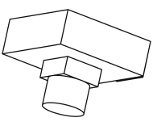

# Print the parts

Every printed part of a BitBunk rack prints in PETG, without supports, on a bed of 250 × 210 mm or larger.
Print one tray and one ladder first to check your settings. Measure the drag chain and the camera before you
print the parts that hold them.

## Print one tray and one ladder first

The ladders are the printed side walls of the rack. Each bay has a tray that slides into grooves in two
ladders and carries the drawer. The tray fits those grooves closely and has a long bridge. These two parts
show whether your printer and settings are right.

Print a `tray` and a `ladder_a` with the [slicer settings](printer-and-settings.md#slicer-settings)
([Get the STL files](stl-files.md)). The last two checks also need a `ladder_base` and a `drawer`. To see
where each feature is before you print, turn the parts in [the 3D model](/viewer/?bay=A1&openbay=1&view=bay).

Then check them:

- [ ] Neither part needed supports. Nothing has drooped under the tray's runners, the rails along the
      outside of its side walls.
- [ ] The runners slide into the ladder's grooves from the front, all the way to the closed end. They have
      0.15 mm of play above and below.
- [ ] Near the middle of each side wall, an arm cut between two slots carries a barb. The barb clicks into
      the window in the ladder's groove. When you press the arm inwards, the tray slides out.
- [ ] The left ledge is the shelf inside the tray's left wall that the drawer rides on. Where it crosses the
      window for the row cable, it bridges 38 mm. That bridge sags less than 1.5 mm, so it clears capacitor
      C1 on the bay node (the bay's PCB). The top of the ledge is flat.
- [ ] An M3 heat-set insert goes into one of the bay node's four standoffs on the tray without splitting it.
- [ ] An M3 square nut pushed into a pocket by the ladder's rear edge stays there when the ladder stands up.
- [ ] Stand the `ladder_a` on the `ladder_base`. The ridge along the top of the base ladder goes into the
      notch along the bottom of the row ladder, and the row ladder's two hooks click. A hook lets go when
      you push its barb back through its window.
- [ ] Put the `drawer` on the tray and close it. It stays closed: a bump on a spring tab in the left ledge,
      near the back, drops into a notch under the drawer.

```{figure} ../img/notice/hook.svg
:class: bb-lineart
:alt: A hook at the bottom edge of a row ladder going down into its slot in the base ladder below
:width: 240px

Each hook at the bottom of the row ladder clicks into a window in the ladder below.
```

If the runners bind or an insert splits its boss, check the elephant-foot and hole compensation in
[Slicer settings](printer-and-settings.md#slicer-settings).

If the spring tab does not hold the drawer closed, use magnets instead. Set `drawer.detent: magnet` in
`config/rack.yaml` and rebuild the tray and the drawer. Each then takes a 6 × 3 mm magnet, glued in.

If your drag chain has the sizes the files assume (see below), keep the test tray: it is one of your trays.

## Parts to measure before you print

A few printed parts fit closely around a part you buy. The files assume a size for that bought part.
Measure yours when it arrives, and rebuild the printed parts if it differs. Every other part prints from the
files as they are.

| Bought part | Printed parts that fit around it |
|---|---|
| {.bb-lineart width=48px}<br>Drag chain, 7 × 7 mm inside (Olimex DRAG-CHAIN-7X7) | `tray`, `chain_anchor`, `chain_foot` |
| {.bb-lineart width=48px}<br>Camera, Arducam Mega 3MP with an M12 lens (B0434) | `camera_pod` |
| USB-C PD trigger module, for [one bay on a desk](../build/one-bay-on-a-desk.md) only | `standalone_quad_base` |

`standalone_quad_base` takes a PD module of up to 30 × 21 × 1.6 mm. For a larger one, see
[Set up the PD trigger module](../build/one-bay-on-a-desk.md#set-up-the-pd-trigger-module).

## Enter your measurements

You rebuild the files with `tools/build.py`. [Rebuild them](stl-files.md#rebuild-them) says what it needs.

1. Measure the drag chain and one of its end pieces. An end piece is the rigid link with a two-hole tab at
   each end of the chain. Its mouth is the open end, away from the chain.

   | Key | What to measure | Assumed |
   |---|---|---|
   | `outer` | the outside of a link: across its two side plates, then the other way, in the plane the chain bends in | 13.5, 10.2 mm |
   | `radius` | bend the chain into its tightest U. Measure across the outside of the two runs, subtract the second `outer` figure, then halve the result | 18 mm |
   | `end_holes` | on the tab of an end piece: from one hole's centre to the other's, then from the mouth to the nearer hole's centre | 8, 4 mm |
   | `end_length` | an end piece, from its mouth to its pivot on the chain | 26 mm |

2. Write your figures over the assumed ones, under `chain:` in `config/rack.yaml`. Leave the other keys of
   `chain` as they are: they place the chain in the tray.

3. Rebuild the three parts that use them:

   ```console
   $ python tools/build.py stl --only tray chain_anchor chain_foot
   ```

4. The command prints `ok` or `FAIL` for each part. If all three say `ok`, the files in `mechanical/stl/`
   now fit your chain: print them.

   A `FAIL` means the chain does not fit in the tray. The old file stays in the folder: do not print it.
   The message says what is wrong:

   - An end piece reaches the bend: `end_length` is too long.
   - The U bend reaches the rear wall: `radius` or `outer` is too large.

   The assumed chain already uses all the room. An end piece longer than 26 mm fails, and so does a bend
   radius of 19 mm. If your chain fails, [report it](../reference/known-limitations.md#report-a-problem)
   with your measurements.

5. Measure the camera. Write your figures over `MEGA_CASE`, `MEGA_HOLDER` and `MEGA_XH` at the top of
   [mechanical/parts/camera_pod.scad](../../mechanical/parts/camera_pod.scad):

   | Value | What to measure | Assumed, mm |
   |---|---|---|
   | `MEGA_CASE` | the case: width, depth, height | 34, 34, 12 |
   | `MEGA_HOLDER` | the lens holder under the case: its side, its height | 14, 6 |
   | `MEGA_XH` | the white XH connector on the side of the case: its length along the side, how far it stands out, its height | 15, 6, 7 |

   Then rebuild the pod:

   ```console
   $ python tools/build.py stl --only camera_pod
   ```

## Print the rest in this order

1. The frame: the ladders, the floor and cap plates, the braces. They do not depend on any bought part.
2. The parts of each bay, once you have measured the drag chain.
3. The power box.
4. The board plates and the pegs for your boards. The layout tool tells you which pegs each bay takes
   ([Put a board in a bay](../use/mount-a-board.md)).
5. The camera pod and its diffuser, once you have measured the camera.
6. The rear-bay covers (`cover_box4`), if you want them. Print each one once its bay works.

How many of each part you print depends on the size you chose for your rack:
[Parts to print](parts-list.md) gives the counts. Fit the inserts into each part before you assemble
anything onto it ([Fit the inserts and nuts](inserts-and-nuts.md)).
