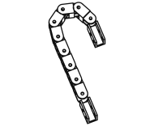

# Measure before you print

Of the default rack's 243 printed parts, 207 print from the committed files today. The other 36 (the trays,
the two printed ends of each drag chain and the camera pods) are drawn round a bought part whose size the
model only assumes: they wait until that part is in your hands.

:::{status} designed
The drag chain's outer size, bend radius and end pieces, the camera's case, the display's depth and the PD
module's size are assumed values: no bought part has been measured. Nothing has been printed.
[What exists today](../plan/status.md#status-bay).
:::

## What you can print today

Everything whose source reads no bought part's size:

- the frame: the ladders, the braces, the floor plates and the cap plates;
- the drawers (`drawer`, and a sled bay's `drawer_sled` and `drawer_block`), the DATA board's cradle
  and its strip (`x4_cradle`, `x4_strip`). The drawer's groove for the chain foot follows `chain.moving_x`
  and `chain.foot_y`, the model's own placement and not measurements;
- the board plates and the slot bins, and the pegs once the layout tool has said which ones your boards
  take ([Put a board in a bay](../use/mount-a-board.md));
- the bay labels, the power box, the camera's diffuser.

Print the [test tray and the test ladder](#what-to-check-on-a-test-tray-and-a-test-ladder) first; the order
of the rest of the run is on [Parts and quantities](parts-list.md#in-what-order-to-print).

## What waits, and for which bought part

| Bought part | Where its size is entered | Prints that wait |
|---|---|---|
| {.bb-lineart width=48px}<br>Drag chain, 7 × 7 mm inside (Olimex DRAG-CHAIN-7X7) | [`config/rack.yaml`](../reference/rack-yaml.md) › `chain`: `outer`, `radius`, `end_holes`, `end_length` | `tray` (12 in the default rack), `chain_anchor` (11), `chain_foot` (11) |
| {.bb-lineart width=48px}<br>Camera, Arducam Mega 3MP with an M12 lens (B0434) | `MEGA_CASE`, `MEGA_HOLDER` and `MEGA_XH` at the top of [mechanical/parts/camera_pod.scad](../../mechanical/parts/camera_pod.scad); they are not keys of `rack.yaml` | `camera_pod` (2) |

Two more bought parts have an assumed size; neither holds up the default rack.

The display in the drawer front, a Waveshare 1.9inch Touch LCD (31122): its depth (`drawer.display.seat`,
8.6 mm) and its holes (`drawer.display.screw`, for M2) are assumed. The bay node v1.0 has no connector for a
display, and the bill lists the display's screws but not the module: do not buy one, and print
`drawer_front` as committed, its window empty.

The PD trigger module of [one bay on a desk](../build/one-bay-on-a-desk.md): `standalone.pd_module` holds
the largest board the seller's photos allow, 30 × 21 × 1.6 mm; a smaller one fits the committed
`standalone_solo_base` and `standalone_quad_base` as they are.

The leads' pinout, the wire's gauge and the camera's header are checked when the parcels are opened:
[Shopping list and tools](../plan/shopping-list.md).

## Enter your measurements

This sequence is worked out from `config/rack.yaml`, `tools/build.py` and the three `assert` lines of
`mechanical/lib/carrier.scad`; nobody has done it yet. It needs a checkout and OpenSCAD:
[Get a checkout and install what they need](../reference/tools.md#get-a-checkout-and-install-what-they-need).

1. Measure four things on the chain and its end pieces (the rigid link with a two-hole tab at each end of
   the chain), and write them over the assumed values:

   | Key | What to measure | Assumed |
   |---|---|---|
   | `outer` | the link's outside: across its two side plates, then the other way, in the plane the chain bends in | 13.5, 10.2 mm |
   | `radius` | lay the chain on a side plate and bend it into its tightest U; measure across the outside of the two runs, subtract the second `outer` figure and halve | 18 mm |
   | `end_holes` | on an end piece's tab: from one hole's centre to the other's, then from the mouth to the nearer hole's centre | 8, 4 mm |
   | `end_length` | an end piece, from its mouth to its pivot on the chain | 26 mm |

   ```{literalinclude} ../../config/rack.yaml
   :language: yaml
   :caption: config/rack.yaml
   :start-at: "chain:"
   :end-before: "  fixed:"
   ```

   Leave `inner` and `pitch` as they are, and the keys after `end_length` in the file, `fixed` to `bend_y`:
   they place the chain in the tray.

2. Render the three parts that read those keys:

   ```console
   $ python tools/build.py stl --only tray chain_anchor chain_foot
   ```

3. If the three lines read `ok`, the three files in `mechanical/stl/` now fit your chain: print them. A
   line `FAIL` carries one of three messages, and OpenSCAD then writes no file: the one in the folder is
   still drawn for the assumed chain.

   | Message | The model requires | With the assumed values |
   |---|---|---|
   | `chain: the moving end piece reaches the bend (drawer closed)` | `bend_y` − `moving_y` ≥ `end_length` | 183 − 157 = 26: no margin |
   | `chain: the fixed end piece reaches the bend (drawer open)` | `bend_y` − half of `drawer.travel` − `fixed[1]` ≥ `end_length` | 183 − 70 − 87 = 26: no margin |
   | `chain: the U bend reaches the tray's rear wall` | `bend_y` + `radius` + half of `outer[1]` ≤ `bay.depth` − `bay.carrier.wall` − 1 | 206.1 against 207: 0.9 mm |

   An end piece longer than 26 mm, or a bend radius of 19 mm, therefore stops the build before a part that
   would clash is printed. No source says what to move then. `fixed`, `moving_x`, `moving_y`, `foot_y` and
   `bend_y` place the chain; the two runs stay 36 mm apart (`fixed` at x 100, `moving_x` 136) whatever
   `radius` says; `moving_x` and `foot_y` also place the foot's groove under the drawer. A chain that fails
   is a finding to [report](../reference/known-limitations.md#report-a-finding).

4. For the camera, measure its case, the lens holder under it and the white XH connector on its side
   (how long, how far out, how high), write them over `MEGA_CASE`, `MEGA_HOLDER` and `MEGA_XH`, each marked
   `PLACEHOLDER` in the source, and render the pod:

   ```console
   $ python tools/build.py stl --only camera_pod
   ```

   The model's case is 34 × 34 × 12 mm; Arducam gives 33 × 33 mm, 35 mm overall with the stock lens, and
   no drawing.

## What to check on a test tray and a test ladder

Print one `tray` and one `ladder_a` before the rest. The slicer review of 2026-10-21 asks for it twice: the
tray's runner has 0.15 mm in the ladder's groove, "the tight end of what FDM holds in plane", and the tray
carries a 38 mm bridge that the review accepts with a test print to follow. The values below are the
design's; nobody has measured a print.

- [ ] Neither part needed a support, and nothing under the tray's runners or lips has drooped.
- [ ] The tray's runners slide into the ladder's grooves from the front, to the closed end of the groove:
      0.15 mm of play above and below each runner.
- [ ] The latch arm in the tray's wall (32 mm long, a 1.2 mm barb) clicks into the groove's window. Pressed
      inwards, it lets the tray slide out.
- [ ] The tray's left ledge bridges 38 mm from the fascia to its first gusset, over the row cable's window.
      The review expects 0.3 to 0.8 mm of sag at mid-span on the first bridged layer; the bay node's
      capacitor C1 stands 1.5 mm under that ledge. The ledge's top, which the drawer rides on, is flat.
- [ ] An M3 × 5.7 insert seats in the Ø4.0 hole of a node standoff without splitting its boss. The four
      insert holes under the tray open towards the bed: they show whether the slicer's hole and
      elephant-foot compensations are right.
- [ ] An M3 square nut pushed into a pocket of the ladder's rear edge passes the 0.4 mm rib and stays
      there when the ladder stands up.
- [ ] With a `ladder_base` under the `ladder_a`: ridge into notch, and both hooks click (a 1.0 mm barb
      each). A hook lets go when its barb is pushed back through the window.
- [ ] With a `drawer` on the tray: the detent, a 0.6 mm bump on a spring tab of the left ledge, holds the
      closed drawer (about 3 N by calculation).

If the detent's tab does not suit, `drawer.detent: magnet` in `config/rack.yaml` brings back a pair of
6 × 3 mm magnets, and changes the tray and the drawer. The runner's 0.15 mm has no such key: it is
`GROOVE_Z` in [mechanical/lib/panels.scad](../../mechanical/lib/panels.scad).

The test tray carries the assumed chain. Nothing in this list depends on it, and if your chain measures as
assumed, the test tray is the first of the twelve.
