# Parts to print

These tables list the printed parts of a rack: how many of each, and how much filament each takes. Each part's
name links to its STL file. The counts depend on the size of your rack. This page gives them for the 4 × 3
example, for two smaller racks, and as a rule for any size.

The grams are estimated from the volume of each file. [Filament and print time](printer-and-settings.md#filament-and-print-time)
says how much PETG to buy for each size, and how long it takes to print.

## The 4 × 3 example rack

The example in `config/rack.yaml`: 12 bays in four columns and three rows, with the example's boards in them.

```{printed-parts}
```

The pegs, the slot bins and `plate_giga-r1-display` hold the example's boards. Your boards will take others
([Plates, pegs and slot bins](#plates-pegs-and-slot-bins)). `drawer_sled` and `drawer_block` are for bay A3,
the only bay of the example without a drag chain.

## Plain racks of other sizes

A plain rack has no board and no camera in any bay. Each bay is a drawer on a drag chain, with a bare plate.
A bay with a camera also takes a `camera_pod` and a `camera_diffuser`.

### A plain 2 × 2 rack

```{printed-parts}
:size: 2x2
:plain:
:exclude: camera
```

### One bay in its frame

One column and one row, with its power box: the bay you build first
([Build the first bay](../build/first-bay.md)). You can add columns and rows to it later.

```{printed-parts}
:size: 1x1
:plain:
:exclude: camera
```

A single bay can also stand on a desk, without the frame: [One bay on a desk](../build/one-bay-on-a-desk.md).

## Counts for any size

A rack of *c* columns has *c* + 1 stacks of ladders: one at each side, and one between each pair of columns.

| Part | How many |
|---|---|
| `ladder_base`, `ladder_cap` | *c* + 1 |
| `ladder_a`, `ladder_b`, … | *c* + 1 for each row |
| `floor_plate`, `cap_plate`, `brace_base` | *c* |
| `brace_a`, `brace_b`, … | *c* for each row |
| `tray`, `drawer_front`, `x4_cradle`, `x4_strip`, the two label files | one per bay |
| `drawer`, `chain_anchor`, `chain_foot` | one per bay on a drag chain (`mount: drawer`, the default) |
| `drawer_sled`, `drawer_block` | one per bay without a drag chain (`mount: sled` or `fixed`) |
| `plate` | one per bay with pegs, or with no board |
| `slot_bin` | one per bay with `plate: slots` |
| `plate_<board>` or `plate_bay_<bay>` | one per bay with `plate: boards` |
| Pegs | as the layout tool places them for your boards |
| `camera_pod`, `camera_diffuser` | one per camera |
| `power_box_base`, `power_box_lid`, `power_box_labels` | one of each |

In a rack of three rows, one more column adds five ladders, a floor plate, a cap plate, four braces and three
bays. The counts come from `printed()` in [tools/bom.py](../../tools/bom.py).

To get the list for your own rack, describe it in `config/rack.yaml` and run `python tools/bom.py`. The
parts are then under "Printed parts" in `bom/README.md`
([Build scripts](../reference/tools.md#bompy) says more about `bom.py`).

## What each part is

The pictures are stills of the 3D model. The print times are Bambu Studio's for a Bambu Lab H2D, with the
[slicer settings](printer-and-settings.md#slicer-settings). A slower printer takes longer.

### Frame

| Part | Print time |
|---|---|
| 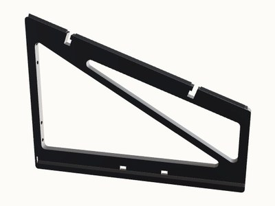{width=96px}<br>`ladder_base`: the base ladder, from the floor to row A | 1 h 23 |
| {width=96px}<br>`ladder_a`, `ladder_b`, `ladder_c`: the row ladders, one file per row | 1 h 34 for a 165 mm row, 1 h 27 for a 120 mm row |
| 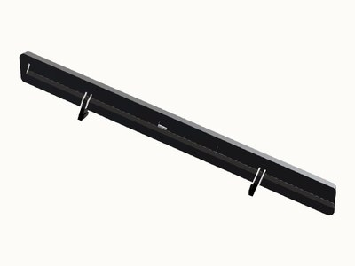{width=96px}<br>`ladder_cap`: the cap strip on top | 0 h 34 |
| {width=96px}<br>`floor_plate` | 1 h 58 |
| {width=96px}<br>`cap_plate` | 2 h 01 |
| 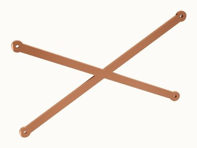{width=96px}<br>`brace_base`, `brace_a`, `brace_b`, `brace_c`: the X brace behind each bay, one file per level | 0 h 19 |

`ladder_a` and `ladder_b` have the same outline, but they are two files. Print the ladders and braces of
each row from the files named for that row. `ladder_c` is shorter because the top row of the example is
120 mm high.

### Each bay

| Part | Print time |
|---|---|
| {width=96px}<br>`tray`. Measure the drag chain first ([Parts to measure before you print](index.md#parts-to-measure-before-you-print)) | 3 h 37 |
| 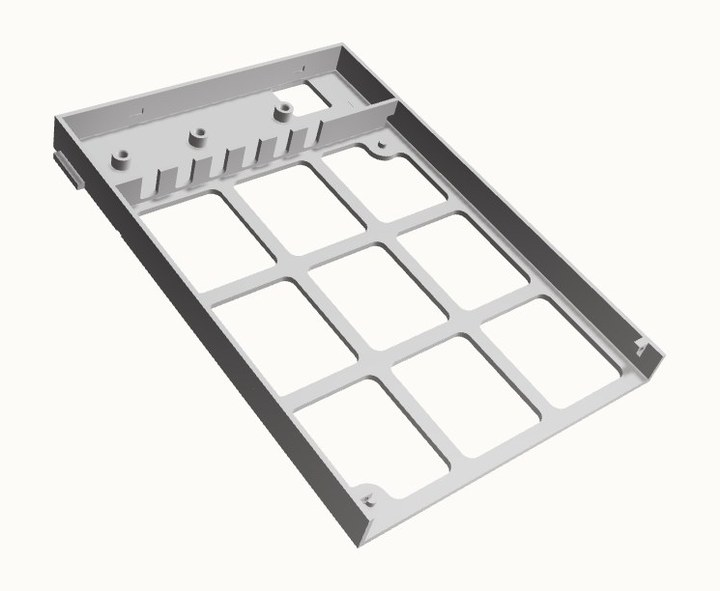{width=96px}<br>`drawer` | 1 h 26 |
| 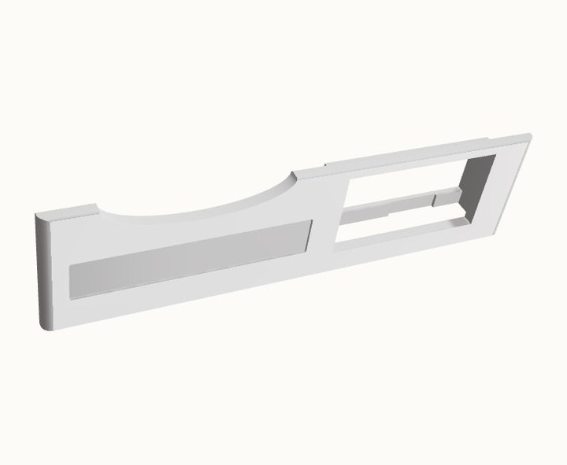{width=96px}<br>`drawer_front`, on a drawer or a sled | 0 h 35 |
| {width=96px}<br>`x4_cradle`: holds the DATA board upright in the drawer | 1 h 42 |
| {width=96px}<br>`x4_strip`: closes the cradle over the DATA board's USB connectors | 0 h 08 |
| 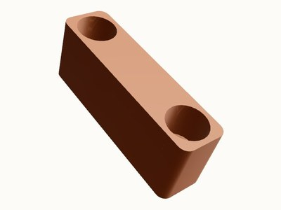{width=96px}<br>`chain_anchor`. Measure the drag chain first | 0 h 15 |
| {width=96px}<br>`chain_foot`. Measure the drag chain first | 0 h 13 |
| `bay_label_<bay>` and `bay_label_<bay>_inlay`: the bay's label, in two colours ([Colours and two-colour parts](printer-and-settings.md#colours-and-two-colour-parts)) | 0 h 04 |

A bay without a drag chain takes these instead of the drawer, the chain anchor and the chain foot:

| Part | Print time |
|---|---|
| 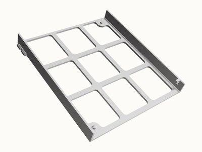{width=96px}<br>`drawer_sled`: the sled | 0 h 54 |
| 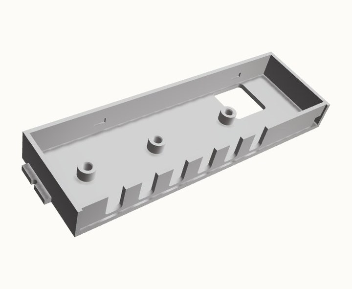{width=96px}<br>`drawer_block`: the port block | 0 h 42 |

### Plates, pegs and slot bins

Which of these you print depends on your boards. Run the layout tool first: it says which pegs each bay
takes ([Put a board in a bay](../use/mount-a-board.md)). A bay with no board takes a bare `plate` and no
peg.

| Part | Print time |
|---|---|
| 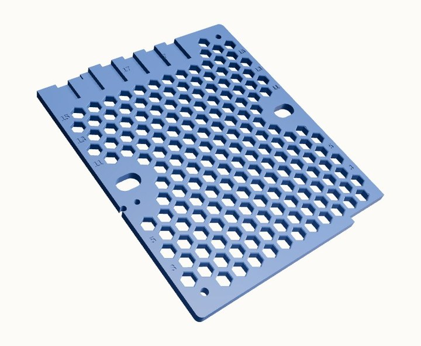{width=96px}<br>`plate`: the honeycomb board plate | 2 h 52 |
| {width=96px}<br>`peg_stop_h<H>`: a stop | 0 h 11 |
| {width=96px}<br>`peg_base_h<H>` and `peg_cam`: a cam on its base | 0 h 09; the cam 0 h 04 |
| 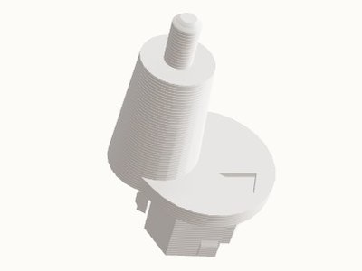{width=96px}<br>`peg_pin_d<hole>_h<H>`: a pin through a mounting hole | 0 h 10 |
| 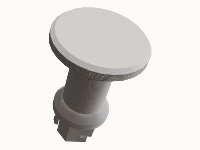{width=96px}<br>`peg_bobbin`: a post for the cable's spare length | 0 h 17 |
| {width=96px}<br>`slot_bin`: holds up to six boards on edge, in place of the plate | 1 h 49 |
| `plate_giga-r1-display`: the example's bay B2, a GIGA R1 under its display shield | 1 h 55 |

In the file names, `<H>` is the board's `standoff` in [the board library](../reference/board-library.md),
in millimetres. In a pin's name, `d21` means a 2.1 mm hole. The folder has 17 peg files. If your board needs
another one, `build.py` renders it once the board is in the library
([Add a board to the library](../use/add-a-board.md)).

### Power box and camera

| Part | Print time |
|---|---|
| 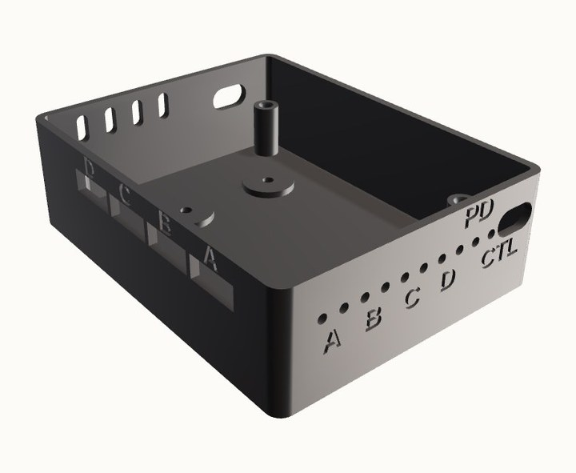{width=96px}<br>`power_box_base`, and `power_box_labels`, the inlay of its lettering | 1 h 22 |
| {width=96px}<br>`power_box_lid` | 0 h 39 |
| 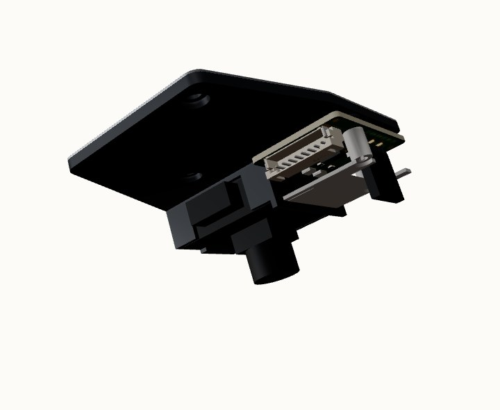{width=96px}<br>`camera_pod`, dark and opaque. Measure the camera first | 0 h 35 |
| 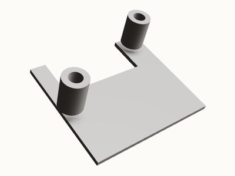{width=96px}<br>`camera_diffuser`, white | 0 h 08 |

### Optional parts

| Part | Print time |
|---|---|
| `cover_box4`: a cover over the drawer's rear bay, one per bay | 1 h 39 |
| `chain_link` and `chain_bar`: a drag chain you print link by link, instead of buying one. Its end pieces are still bought | 0 h 11 a link, 0 h 02 a bar |

### One bay on a desk

These parts are for [one bay on a desk](../build/one-bay-on-a-desk.md), without a rack.

| Part | Print time |
|---|---|
| `standalone_quad_base`, `standalone_quad_shelf` and `standalone_quad_lid`: the Quad, the box that holds the PCBs | 5 h 05 for the three |
| `standalone_desk_frame`: the frame that holds a `plate` in front of the box | 1 h 11, and 2 h 52 for its plate |
