# Parts and quantities

The default rack, 12 bays in 4 × 3 with the example's boards in them, takes 243 printed parts; a plain
2 × 2 rack takes 69, and one bay in a frame of its own 23. Every part has its own STL file, already lying the
way it prints.

:::{status} designed
Counted by `tools/bom.py` from `config/rack.yaml`. The 30 parts that existed on 2026-10-21 went through the
slicer that day; the drawer, its front, the cradle and its strip, changed or drawn later, have the design
document's figures.
No part has been printed. [What exists today](../plan/status.md#status-frame).
:::

## The default rack

```{printed-parts}
```

The grams are the bill's estimate, from the volume of each STL file (PETG at 1.27 g/cm³, 55 % of the solid
volume). The slicer's figures, where they exist, are in the tables further down; how much filament to buy is
under [Filament](printer-and-settings.md#filament). Each name links to its file; the whole folder is on
[Get the STL files](stl-files.md).

Two groups of lines are the example's and will not be yours: the pegs, the slot bins and `plate_giga-r1-display`
follow the boards that `config/rack.yaml` puts in each bay ([below](#plates-pegs-and-slot-bins-follow-your-boards)),
and `drawer_sled` and `drawer_block` are bay A3's, the one sled bay of the example.

(plain-2x2)=
## A plain 2 × 2 rack

Two columns, rows A and B, no board in any bay: every bay a drawer on a drag chain with a bare plate.

```{printed-parts}
:size: 2x2
:plain:
```

## One bay in the frame

One drawer bay in a frame of one column and one row, no board on its plate: the first bay of a larger rack,
built the same way ([The frame and the first bay](../build/first-bay.md)).

```{printed-parts}
:size: 1x1
:plain:
:exclude: camera
```

`tools/bom.py` counts two camera pods whatever the size, and the table leaves them out: a camera over this
bay takes one `camera_pod` and one `camera_diffuser`, hung under the cap plate. By the slicer's figures in the
tables below, these parts weigh 653 g, and one 1 kg spool covers them. They take 25 h 56 of printing, the
drawer and its front counted at the 2 h 03 of the review's drawer, which had its front in one piece. Nobody
has printed them.

A bay in the frame does not run on its own. It takes its power and the rack bus from the power hub, in the
power box printed with it, which a USB-C PD charger feeds, and row A's feed is a row cable from the box to the
bay node ([Power box and charger](../build/power-box.md), [Make the row cables](../build/row-cables.md)). A
bay on a desk, without the frame, the hub or the power box, is [One bay on a desk](../build/one-bay-on-a-desk.md).

Each table on this page is computed when the site is built: after a change of `config/rack.yaml`, it shows
that rack.

## How the counts follow the size

A column boundary is the line between two columns, or an outer side: a rack of *n* columns has *n* + 1 of
them, and a stack of ladders stands on each.

| Part | How many |
|---|---|
| `ladder_base`, `ladder_cap` | one per column boundary |
| `ladder_a`, `ladder_b`, `ladder_c` | one per column boundary, in each row |
| `floor_plate`, `cap_plate`, `brace_base` | one per column |
| `brace_a`, `brace_b`, `brace_c` | one per column, in each row |
| `tray`, `x4_cradle`, `x4_strip`, the two label files | one per bay |
| `drawer`, `chain_anchor`, `chain_foot` | one per bay that says `mount: drawer` (the default) |
| `drawer_sled`, `drawer_block` | one per bay that says `mount: sled` or `fixed` |
| `drawer_front` | one per bay, on a drawer or a sled |
| `plate` | one per bay on pegs, and one per empty bay |
| `slot_bin` | one per bay that says `plate: slots` |
| `plate_<board>`, `plate_bay_<bay>` | one per bay that says `plate: boards` |
| Pegs | as `tools/plate_layout.py` places them for the boards of each bay |
| `camera_pod`, `camera_diffuser` | two, whatever the size: a constant of `tools/bom.py` |
| `power_box_base`, `_lid`, `_labels` | one each per rack |

Read from `printed()` in [tools/bom.py](../../tools/bom.py). One column more is five ladders, a floor plate,
a cap plate, four braces and three bays. A fourth row is a `ladder_d` and a `brace_d`, new files that
`build.py` renders once the row is in `config/rack.yaml` ([Get the STL files](stl-files.md#when-you-must-rebuild-them)).

## Frame

The pictures in this table and those below are stills of the 3D model, not photographs. The slicer's figures are of
2026-10-21 (Bambu Studio for an H2D, 3 walls, 15 % gyroid) unless a line says *design document*: those are
the figures of [the mechanical design document](../mechanical.md), which carries no date.

| Part | Which way up | Sliced |
|---|---|---|
| {width=96px}<br>`ladder_base`: the base ladder, from the floor to row A | flat | 1 h 29, 42 g |
| 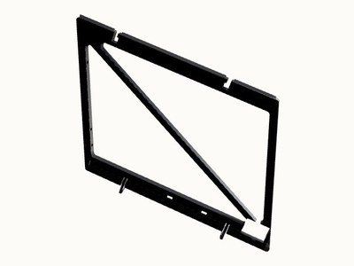{width=96px}<br>`ladder_a`, `ladder_b`, `ladder_c`: the row ladders, one file per row | flat | a 165 mm row's: 1 h 40, 46 g; `ladder_c` not sliced |
| {width=96px}<br>`ladder_cap`: the cap strip on top | flat | 0 h 37, 17 g |
| 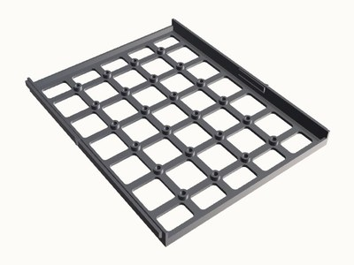{width=96px}<br>`floor_plate` | flat | 2 h 08, 54 g |
| 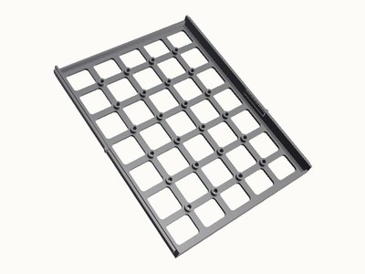{width=96px}<br>`cap_plate` | flat | 2 h 11, 56 g |
| {width=96px}<br>`brace_base`, `brace_a`, `brace_b`, `brace_c`: the X behind each bay, one file per level | flat, 100 % infill | 0 h 18, 8 g |

`ladder_a` and `ladder_b` have the same outline and are two files: print each row's ladders and braces from
the files named for the row. `ladder_c` is shorter, 193.8 mm against 238.8 mm, because the default's top row
is 120 mm high.

## Each bay

| Part | Which way up | Sliced |
|---|---|---|
| 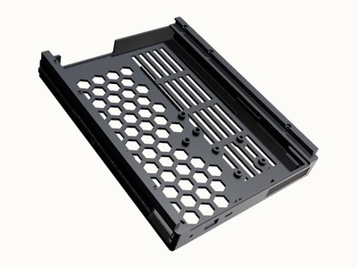{width=96px}<br>`tray`. Waits for the drag chain ([Measure before you print](index.md)) | bottom down | 3 h 55, 108 g |
| {width=96px}<br>`drawer` | bottom down | *design document*: 49 g |
| {width=96px}<br>`drawer_front`, on a drawer or a sled | face down: the face that shows prints on the bed | *design document*: 0 h 33, 14.0 g |
| 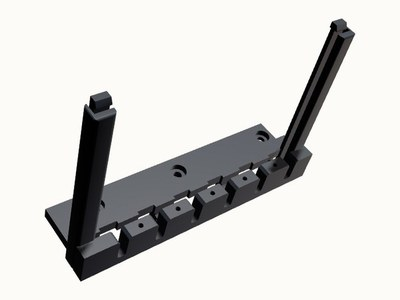{width=96px}<br>`x4_cradle`: holds either DATA board | as installed, bottom down. Keep the slicer's automatic brim | *design document*: 1 h 40, 14.9 g |
| 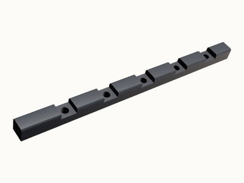{width=96px}<br>`x4_strip`, over the DATA board's receptacles | top face down | *design document*: 0 h 07, 1.3 g |
| {width=96px}<br>`chain_anchor`. Waits for the drag chain | as the file lies | 0 h 13, 1.7 g |
| 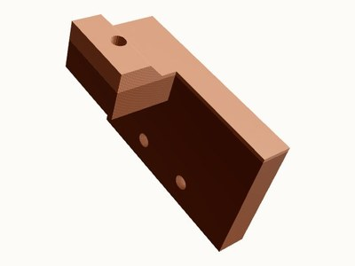{width=96px}<br>`chain_foot`. Waits for the drag chain | on its fin | 0 h 12, 1.7 g |
| `bay_label_<bay>` and `bay_label_<bay>_inlay`: the bay's label, one object in two colours | the face that shows on the bed: the text is mirrored in the file | 0 h 03, 1.4 g (B3's) |

A bay without a drag chain (`mount: sled` or `fixed`, bay A3 in the example) takes these in place of the
drawer, the chain anchor and the chain foot; the rest is a drawer bay's:

| Part | Which way up | Sliced |
|---|---|---|
| {width=96px}<br>`drawer_sled` | bottom down | 1 h 21, 41 g |
| {width=96px}<br>`drawer_block`, the port block | bottom down | 0 h 47, 24 g |

A label in one colour, and the two-colour objects in general:
[Colours and two-colour parts](printer-and-settings.md#colours-and-two-colour-parts).

## Plates, pegs and slot bins follow your boards

The default rack's counts are those of its example population: 68 pegs of the heights its boards need, a
slot bin in each of row C's four bays, and `plate_giga-r1-display`, bay B2's own plate for a GIGA R1 under
its display shield (sliced: 2 h 11, 57 g). For your boards, run the layout tool first: it says which pegs each bay takes
([Put a board in a bay](../use/mount-a-board.md)). A plain rack takes one `plate` per bay and no peg.

| Part | Which way up | Sliced |
|---|---|---|
| {width=96px}<br>`plate`: the honeycomb plate | flat, 2 or 3 walls | 3 h 09, 56 g |
| 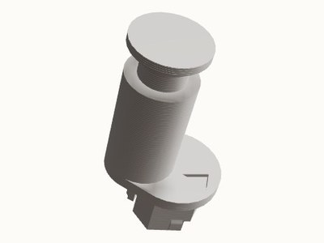{width=96px}<br>`peg_stop_h<H>`: a stop | upright, flange down | 0 h 13, 0.8 g |
| 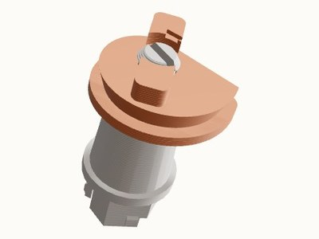{width=96px}<br>`peg_base_h<H>` and `peg_cam`: a cam on its base | both flange down | 0 h 11, 0.7 g; the cam 0 h 04, 0.3 g |
| {width=96px}<br>`peg_pin_d<hole>_h<H>`: a pin through a mounting hole | upright, flange down | 0 h 13, 0.7 g |
| {width=96px}<br>`peg_bobbin`: a post for the cable's spare length | upright, flange down | 0 h 16, 1.1 g |
| 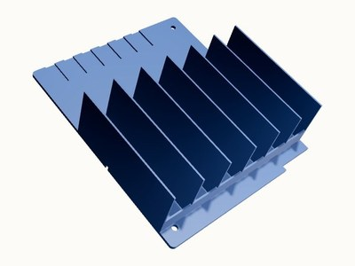{width=96px}<br>`slot_bin`, in the plate's place in a dense bay | as it stands, 2 walls | not sliced |

`<H>` is the board's `standoff` in [the board library](../reference/board-library.md), in millimetres;
`d21` in a pin's name is a 2.1 mm hole (the pin itself is 0.3 mm thinner). The folder holds 17 peg files: one
stop and one cam base for each standoff height of the library, and a pin for each pair of hole size and
standoff among its boards with holes. The example uses 12 of them. A peg the folder lacks is rendered by
`build.py` once its board is in the library ([A board that is not in the library](../use/add-a-board.md)).

## Power box and camera

| Part | Which way up | Sliced |
|---|---|---|
| {width=96px}<br>`power_box_base`, and `power_box_labels`, the inlay of its lettering | upright | 1 h 26, 50 g |
| 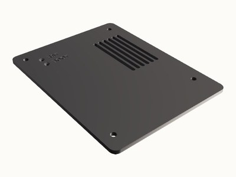{width=96px}<br>`power_box_lid` | top face down | 0 h 41, 19 g |
| {width=96px}<br>`camera_pod`, dark and opaque. Waits for the camera ([Measure before you print](index.md)) | upside down: the face that meets the ceiling on the bed | 0 h 35, 14 g |
| {width=96px}<br>`camera_diffuser`, white | floor down | 0 h 07, 1 g |

The pod's still shows the camera and the pod's PCB in it.

## Optional parts

| Part | What for | Which way up | Sliced |
|---|---|---|---|
| `cover_box4` | a box over the drawer's rear bay, once the bay works; one per bay, 0.6 kg for the default rack's twelve | top face down | 1 h 44, 52 g |
| `chain_link`, `chain_bar` | a printed drag chain, link by link, in place of a bought one | the link on its fixed bar, the bar as the file lies | 0 h 10, 1.2 g; 0 h 01, 0.1 g |
| `standalone_solo_base`, `_solo_lid`, `_quad_base`, `_quad_shelf`, `_quad_lid`, `_desk_frame` | [one bay on a desk](../build/one-bay-on-a-desk.md), outside the rack | bases upright, lids top face down, the shelf and the frame flat | Solo 2 h 21, 64 g; Quad 5 h 14, 135 g; desk frame with a plate 4 h 01, 85 g |

No source says how many links a drawer's chain takes, and none gives a printed end piece: the chain's end
pieces are bought ([Shopping list and tools](../plan/shopping-list.md)). The standalone figures are the
standalone design's, undated, for a whole box on one plate.

## In what order to print

Worked out from what each part waits for and from the order of the build pages; nobody has done it yet.

1. One `tray` and one `ladder_a`, and the checks of
   [Measure before you print](index.md#what-to-check-on-a-test-tray-and-a-test-ladder).
2. The frame: the ladders, the floor and cap plates, the braces. They wait for nothing, and the frame goes
   up from the base ladders ([The frame and the first bay](../build/first-bay.md)).
3. Each bay's parts, once the drag chain is measured and the three chain parts rendered again if it
   differs: the trays, the chain anchors and feet, the drawers and their fronts, the cradles and their
   strips, the labels. A tray is fitted out at the bench before it goes into the frame
   ([Fit out a tray](../build/fit-out-a-tray.md)).
4. The power box.
5. The plates and the pegs that the layout tool names for your boards: the boards wait on the shelf
   until the rack answers on the network.
6. The camera pod and its diffuser, once the camera is measured.
7. The covers, a bay at a time, once that bay works.

A part takes its inserts before it is assembled: [Fit the inserts and the square nuts](inserts-and-nuts.md).
The length of the whole run, multiplied out from the slicer's figures:
[Cost and time](../plan/cost-and-time.md#time-what-is-known).
