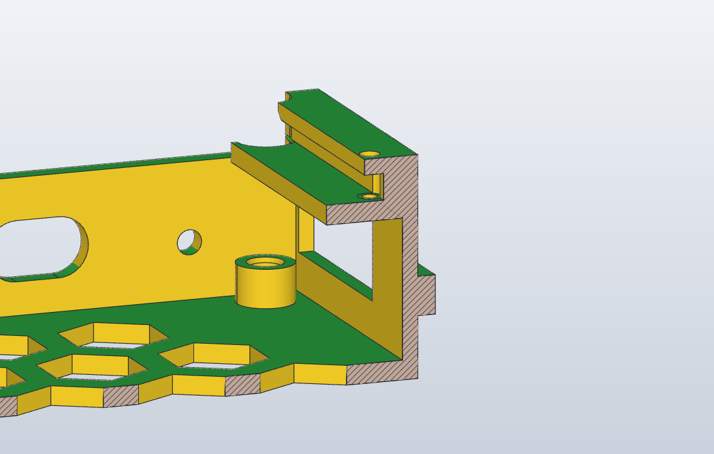

# Printed parts: design review

**Status (2026-10-21): review and proposals only; nothing in `mechanical/parts/` changed.**  The user
asked for a complete review of every 3D-printed part: simple, not over-engineered, good-looking where
it can be (rounded edges, elegant and useful markings), with assembly systems that are strong and state
of the art for FDM PETG, checked by simulation; heat-set inserts where they belong, captive square nuts
in a slot (nut traps) where they are simpler.  Mechanics owns the parts and implements what the user
picks.

How this was checked:
- every part as an exact solid from its OpenSCAD source (`tools/notice/csg2part.py`), in its print
  orientation: `mechanical/review/overhang.json` lists every face that faces down steeper than 45°
  off the bed (`review/proto/overhang.py`, FreeCAD);
- every snap feature by the cantilever formulas of the snap-fit design guides (`review/proto/snaps.py`)
  and by a CalculiX FEM of the beam pushed by the deflection the joint needs (`review/proto/fem_snaps.py`,
  `review/fem_snaps.json`); PETG printed: E 1800 MPa (as `tools/panel_frame_fea.py`), ν 0.38;
- the proposals in SolidCraft (the nut trap's fit) and as prototypes in `mechanical/review/proto/*.scad`,
  rendered to `mechanical/review/*.png` (`proto/render.sh`).

Allowable strain used for the verdicts, PETG on the H2D at 0.2 mm: **3 % one-off / 1.5 % repeated when
the beam bends in the print plane** (PETG's own short-term figure is about 4 %); **1 % / 0.5 % when it
bends across the layers** (a vertical finger on a part printed standing: the root is a layer joint, 50–70 %
of the in-plane strength, and the first to fatigue).  Grams and times come from the BOM and the tray
session's print plan (H2D, 0.20 mm Standard, PETG).

## Ranked findings

| # | Part | Finding | Change | Effort | Risk | Call |
|---|---|---|---|---|---|---|
| 1 | Tray | The guide lips' undersides are 2.5 mm flat shelves in the air (2 × 473 mm²) and each ledge's first 48 mm have no gusset: both print as droop, right where the drawer's flange needs 0.4 mm | 45° underside on the lips (the tip keeps 3.4 mm over the ledge), a gusset at y 10, the fascia raised under the ledge | ½ day | low | obvious |
| 2 | Cradle | The latch finger bends across the layers at 0.72 % (FEM peak 2 %) on every board swap; allowable 0.5 % | finger 40 mm free, hook 0.8, R0.8 root, slit 1.0: 0.25 % | 1 h | low | obvious |
| 3 | Ladder | 60 heat-set inserts in a 7.4 mm edge: 1.7 mm walls on the faces that keep 0.2 mm to the trays, horizontal holes that print oval | a DIN 562 M3 square nut in a pocket open to the top face, a plain Ø3.4 hole (SolidCraft: 0.2 mm all round); −60 inserts, no iron, nothing to ream | ½ day | low | **user** (recommended) |
| 4 | Pegs | The cam base's split pivot bends 0.25 mm per half across the layers: 2.4 % (FEM 2.5 %), allowable 1 % | Ø4.4 × 2 relief in the column's top, slit 6.5, head Ø3.7: 0.7 % | 1 h | low | obvious |
| 5 | Camera pod | The sleeve's snap lips bend 1.6 mm vertical walls across the layers: 1.3 % (FEM 3.3 %) every time the camera comes out | two side-hinged tabs (slits on three sides, hinge vertical): 0.75 % in the print plane | 2 h | low | obvious (the case is still a placeholder) |
| 6 | Ladder | The stacking hooks: 2.0 % in the print plane, fine for a one-off, but the FEM shows 56 MPa at the square root (1.55 × the beam figure) | root 10 mm (was 7), R0.6 at the relief's ends: 1.3 %, the peak ≈ 1.2 × | 1 h | low | obvious |
| 7 | Tray | The latch arms: 1.1 %, fine (1.5 % allowed for repeated use), square slot ends | round the three slots' ends R0.5; arm 32 mm: 0.75 % | 1 h | low | obvious |
| 8 | Pegs | The plug's spring skins: 2.3 % in the print plane, pegs are moved at every re-layout (1.5 % allowed) | SKIN_H 3.4, the slot run to the skin's end: 1.5 % | 1 h | low | obvious |
| 9 | Chain anchor | Its insert pockets go 0.2 mm through the tray's floor (bosses 5.5 tall, inserts 5.7 deep): a hole in the first layer | bosses 7.5 tall (or M3 × 4 inserts) | 10 min | none | obvious |
| 10 | Chain anchor | A separate 1.4 g block on 2 inserts and 2 M3 × 8, 7 per rack | print it as part of the tray once the chain is measured: −7 parts, −14 inserts, −14 screws | 2 h | the chain's end piece must be known | **user** |
| 11 | All | No common visual language: vertical edges r 1.2 / 1.5 / 2 / 3 / 4 or none (the tray), no bed chamfers, 5 label sizes | the family below: R3 outer verticals on big parts, R1.5 on small, 0.5 × 45° on every bed edge, text debossed 0.6 mm ≥ 4.5 mm high, arrows and screw callouts | 1 day | cosmetic | obvious |
| 12 | Label | `bay_label` is a blank 100 × 12 strip | the bay ID debossed 0.8 mm and filled by the H2D's second nozzle: one object, two colours, readable at a glance | 1 h | needs a second filament loaded | **user** |
| 13 | BOM | 6 screw types | M3 × 8 everywhere M3 × 6 is used (node, lid, pods: the inserts and spacers take 8); PT 2.3 × 8 everywhere PT 2.6 × 8 is used (pilots 1.9): 4 types | ½ day | none | **user** |
| 14 | Drawer | The magnet detent: 2 magnets, CA glue, a polarity check, a pad and two pockets per bay, for a 0.7 N job | a printed spring tab in the left ledge (20 × 2.5, bump 0.6: 0.56 % in-plane, ≈ 3 N hold) and a notch under the drawer: no parts, no glue | ½ day | wears; weaker than the magnets' ≈ 10 N | **user** |
| 15 | Drawer, plate, ladders | Dead geometry: the drawer's four front ledges (DATA ×4 v1, not ordered), `board_plate.scad`'s snap and universal modes, `ladder_a` = `ladder_b` and `brace_a` = `brace_b` as separate STLs while the rows are equal | remove; one `ladder_row` and one `brace_row` STL | 2 h | none | obvious |
| 16 | Camera pod | 4 × M3 × 6 and 4 inserts for a 12 g pod | 2 screws (a diagonal) and a locating rib; the grid stays | 1 h | none | **user** |
| 17 | Covers (concept) | V3 + the 1× lid as the tray session proposes; their detent tabs must flex in the print plane | side-hinged tabs, as the camera sleeve | — | — | **user** (open) |

Findings 1, 2, 4, 5, 6, 7, 8, 9 are print-and-break risks: none of the parts has been printed yet, and
these would show on the first bay.  The rest is simplicity and looks.

## The visual language

One set of rules for every part, each with its reason in FDM terms:

| Edge or mark | Rule | Why |
|---|---|---|
| Outer vertical edges | R 3 on parts over 50 mm (drawer, tray fascia, ladders' outline, plates, power box — its R 4 can stay), R 1.5 on small parts (cradle, anchor, foot, pod) | prints perfectly at any radius (the profile is in the layer); one radius reads as one family |
| Bed-facing edges | 0.5 mm × 45° chamfer on every visible bottom edge | the elephant's foot: the first layer squeezes 0.1–0.3 mm outwards; a chamfer hides it and keeps mating faces true (the drawer's running face, the ladders' faces).  Enable the slicer's compensation (0.15 mm) too |
| Top edges, free faces | 0.8 mm fillet (a hull of two offsets in OpenSCAD) where nothing mates: the drawer front's top, the fascia's top, the cradle's uprights | the touch surfaces |
| Text, horizontal face | debossed 0.6 mm (3 layers), Liberation Sans Bold, cap height ≥ 4.5 mm (strokes ≥ 0.9 mm = two 0.42 mm lines) | below 0.8 mm strokes the slicer fills the letter; the plate's 3.4 mm row numbers are at the limit |
| Text, vertical face | debossed 0.6 mm, cap height ≥ 5.5 mm | the layer height sets the vertical definition; at 0.2 mm a 5.5 mm capital is 28 layers (the power box prints at 0.12–0.16 for that, no longer needed with an inlay) |
| Text on the bed face | debossed 0.4 mm, mirrored in the source | the crispest text there is: the first two layers draw the letter's negative |
| Two colours | wherever the H2D's second nozzle is loaded: the engraving filled flush (the power box already does it) | contrast without grazing light |
| Marks | a `FRONT ▲` arrow on every part that fits one way (ladders, plates, cradle), the screw's size next to its hole (`M3×8` by the brace holes, `PT2.6` on the cradle's base), the row letter on each ladder's front post, port numbers `1–4` on the drawer's rear-bay floor in front of each U | the notice says it; the part should too |

What stays as it is: the drawer front's scoop, the power box (already the reference), the honeycomb plate.

## Fasteners: inserts or nut traps

| Joint | Today | Verdict |
|---|---|---|
| Ladder rear edge → brace, 4 per ladder (60) | M3 insert in a Ø4.0 hole along the 7.4 mm edge | **Nut trap.**  The hole leaves 1.7 mm of wall on each face; a heat-set insert swells its hole, and those faces keep 0.2 mm to the trays.  The hole lies in the layer plane, so it prints oval and wants reaming.  A square nut in a pocket cut from the top face (5.9 × 5.9 × 2.2: SolidCraft gives 0.2 mm all round the nut and the screw) needs no tool, drops in, and the brace's preload pulls it onto 2.2 mm of in-plane wall.  Render: `review/ladder_nut_trap.png` |
| Tray → node, 4 per tray | M3 insert in a Ø7.5 boss | keep: a boss, a vertical hole, screws from above.  (Thread-forming M3 into a Ø2.5 pilot would also do: 7.5 mm of engagement, ~10 cycles) |
| Tray underside → camera pod | 4 inserts from below | keep the insert, use 2 (finding 16) |
| Tray → chain anchor | 2 inserts, 5.5 mm bosses | fix the depth (9); then integrate the anchor (10) |
| Floor / cap plates, 24 bosses each | insert at any crossing | keep (only where used) |
| Power box standoffs, lid | 4 inserts + 4 male-female spacers, 4 × M3 × 6 | keep: one spacer holds the hub and takes the lid's screw |
| Cradle, DATA boards, chain tabs, foot | PT 2.6 × 8 into pilots | keep thread-forming; one size (13) |
| Guide-lip stop and locks | PT 2.3 × 8 | keep (the Ø4.5 head is what fits beside the drawer's wall) |

Screws: 6 types today (M3 inserts aside: M3 × 8, M3 × 6, spacers, PT 2.6 × 8, PT 2.3 × 8, M2.5 washers).
M3 × 6 → M3 × 8: the node's bosses are 7.5 mm tall over a 5.7 mm insert (a screw reaches 6.4 mm past
the PCB: inside), the pod's inserts take 5 mm, the spacers' threads 6 mm.  PT 2.6 → PT 2.3: nothing a PT
2.6 holds here sees more than a few newtons.  Result: 4 types, and 142 → 68 inserts with findings 3
and 10.

## Simulation numbers

### Snap features

Beam formulas (ε = 1.5 y h / L², P = b h² E ε / 6 L) and FEM (CalculiX, the barb's face pushed by y; the
peak sits at the beam's square root, so it carries the corner's stress concentration).

| Feature | y (mm) | h × L (mm) | bends | use | ε formula | FEM peak | allowed | verdict → proposal |
|---|---|---|---|---|---|---|---|---|
| Ladder hook (`HOOK_W` 2.6, root 7 + drop 9, barb 1.0 against 0.2 of clearance) | 0.8 | 2.6 × 12.5 | in plane | once | 2.0 % | 56 MPa vm (3.1 %) | 3 % | ok, hot root → root 10: 1.3 %, 40 MPa |
| Tray latch arm (wall 2 + runner 2.3, arm 26, barb 1.2) | 1.2 | 4.3 × 26 | in plane | repeated | 1.1 % | 52 MPa (2.9 %, the slot's corner) | 1.5 % | ok → R0.5 slot ends, arm 32: 0.75 % |
| Cradle latch finger (`UW` 2.4, `LATCH` 24, hook 1.0 + gap 0.15) | 1.15 | 2.4 × 24 | **across** | repeated | 0.72 % | 29 MPa (2.0 %) | 0.5 % | **too high** → L 40, hook 0.8, R0.8: 0.25 % |
| Peg plug skin (`SKIN` 0.7, free ≈ 3.0, nub 0.3 − clearance 0.1) | 0.2 | 0.7 × 3.0 | in plane | repeated | 2.3 % | — | 1.5 % | **too high** → `SKIN_H` 3.4, slot to the end: 1.5 % |
| Cam pivot half-pin (Ø3.4, slit 0.8 × 4.5, head Ø3.9) | 0.25 | 1.3 × 4.5 | **across** | once | 2.4 % | 64 MPa (2.5 %) | 1 % | **too high** → relief Ø4.4 × 2, slit 6.5, head Ø3.7: 0.7 %, 20 MPa |
| Camera sleeve wall (`SW` 1.6, 12 tall, `LIP` 0.8) | 0.8 | 1.6 × 12 | **across** | repeated | 1.3 % | 42 MPa (3.3 %) | 0.5 % | **too high** → side-hinged tabs 16 × 10: 0.75 % in plane |
| Drawer detent tab (proposed: 2.5 × 20, bump 0.6) | 0.6 | 2.5 × 20 | in plane | repeated | 0.56 % | — | 1.5 % | ok; hold ≈ 3 N |

Insertion forces (μ 0.35): a ladder's two hooks ≈ 40 N together (push the ladder down with the palm),
the tray's arm ≈ 14 N per side (a thumb), the cradle's finger ≈ 6 N, a peg ≈ 3.5 N.

### Printability (exact solids, print orientation)

Down-facing faces steeper than 45° off the bed, above the first layer:

| Part | mm² | What it is | Verdict |
|---|---|---|---|
| tray | 6,034 | the ledges' undersides between gussets (10 × 22 mm bridges: fine) and their **first 48 mm (no gusset: the window at y 3.5–29.5 skips the ones at 5 and 29)**; the two **lips' undersides, 2.5 × 189 mm each, 2 mm thick, nothing below** | finding 1: the only real support case in the rack |
| ladders | 917–1,052 | the grooves' ceilings in the bed face: 5.3 mm bridges over 200 mm | fine |
| floor / cap plate | 1,117 | the same grooves | fine |
| drawer | 390 | the foot groove's ceiling (6.4 mm bridge), the label recess's top edge (0.9 mm), the magnet pocket's ceiling (Ø6) | fine |
| power box base | 413 | the sockets' ceilings (Ø8.3) and the row windows' tops (16 mm bridges) | fine |
| pegs | 40–52 | the flange's 1.3 mm rim | fine; mind the elephant's foot on the plug's bottom (printed on the bed, 0.1 mm clearance in its hole): the slicer's compensation, or a 0.3 chamfer |
| chain foot, camera pod, cam | ≤ 45 | the bridge over the chain, the sleeve's lips | fine |
| brace, cap strip, plate, port block, lid | 0 | | |

SolidCraft (`inspect.draft`, pull Z, 45°, section at y 40): `review/sc-tray-section-y40.png` shows the
guide's C-channel with the lip's flat underside.

### Loads that are not a worry

- The tray under a 400 g drawer (board, plate, cables): 2 N per ledge, a 2.5 mm ledge on a 2 mm wall and
  45° gussets every 24 mm: under 0.05 mm of deflection.
- The brace X at 0.25 mm of preload: ≈ 2 MPa in the straps (`brace.scad`), relaxing to half.
- The power box's Ø8 × 19 mm standoffs with 2 mm round the insert: fine.
- The chain's pull on the anchor (a few newtons): the two M3 are not the limit; the block's 3 mm under
  the screw heads is.

## Per part

### Ladder (`ladder.scad`: row, base, cap)

49 g, 1 h 25 each, 15 per 2 × 4 rack.  A clean part: one profile extruded, printed flat, every spring in the
print plane.
- **Simplicity.** `ladder_a` and `ladder_b` are the same solid (equal `ROW_HEIGHTS`), so are `brace_a` and
  `brace_b`: one `ladder_row` STL and one `brace_row` STL until a row differs (finding 15).  Nothing else to
  take out.
- **Looks.** The row ladders' outer corners are square; the cap strip already rounds its outline (r 3): do
  the same on the rows (`offset(r = 3) offset(delta = -3)` on the band quad, the posts' corners included).
  A 0.5 chamfer on the bed edge of the outline.  The row letter (`A`, `B`) debossed 0.6 mm, 6 mm high,
  on the front post's face; `M3×8` beside the four brace holes on the top face; `FRONT ▲` on the band.
- **Assembly.** Hooks: finding 6 (root 10, R0.6 relief ends; the barb and its 0.2 mm side clearance stay).
  Ridge/notch: fine.  Brace fixings: finding 3 (nut traps).  Grooves: fine; the tray's runner has
  0.15 mm per side.

### Brace (`brace.scad`)

6.6 g, 100 %.  The simplest part and the best-judged one (slack-free by preload).  Keep; `brace_row`
(finding 15); with nut traps the holes stay 3.1 mm (the nut's thread takes the preload).

### Tray (`tray.scad`)

78 g, ≈ 3 h 50 alone, 8 per rack: the biggest and the densest part (696 faces).
- **Simplicity.** Everything has a job (the lightening was costed and declined on 10-18, not re-proposed).
  Two label recesses per bay (the fascia's and the drawer's): the fascia's stays visible with the drawer
  out, so both earn their place.  The `NODE_ACCESS` holes, the RESET notch, the tie anchors: keep.
- **Printability: finding 1**, the one part that would not print right as drawn: the lips (2 mm thick,
  2.5 mm beyond the guide wall, flat underneath, 189 mm long) and the ledges' first 48 mm (the gussets
  at y 5 and 29 are skipped for the row cable's window, and the fascia stops 0.5 mm under the ledge).
  Proposed: the lip's underside at 45° from its tip (its edge still 3.4 mm over the ledge, the flange's
  0.4 mm kept: a line contact is all an anti-tip lip needs), the fascia raised to the ledge over the ledge's
  width, a gusset at y 10 on both walls (behind the tie strap at y 7.25, in front of the plug at
  y 13–27).  `review/tray_guide.png`.
- **Assembly.** Latch arms: finding 7.  Node inserts: keep.  Anchor: findings 9 and 10.
- **Looks.** The fascia is the tray's only visible face: R3 on its vertical corners, 0.5 chamfer at the
  bed, 0.8 fillet on its top edge (the drawer front sits 2.5 mm above it).

### Drawer, sled, port block (`drawer.scad`)

47 g, 2 h 10.  The user's face of the rack.
- **Simplicity.** The four front ledges under a DATA ×4 v1's edge (`X4_LEDGES`) serve a board that is not
  ordered; the v2 stands in its cradle on the three bosses (finding 15).  The single board's two bosses stay.
- **Looks.** The front panel: R3 on its vertical corners (1.2 today; the only rounded part of the drawer),
  0.5 chamfer at the bed (the panel's bottom edge is the first thing the eye meets), 0.8 fillet on its top
  edge round the scoop.  Port numbers `1 2 3 4` debossed in the bed face of the rear bay in front of each U.
  `review/drawer_front.png`.
- **Assembly.** The flange, the two plate pins, the foot groove and lock screw: fine.  The detent:
  finding 14 (the user's call; the magnets work, they just cost five assembly steps per bay).  The elephant's
  foot on the running face: the slicer's compensation does it; a 0.4 chamfer on the bottom outline makes
  it certain.

### DATA ×4 v2 cradle (`x4_cradle.scad`)

8.4 g.  Right idea (slots, T-heads, plug-in pushes the board onto the base), one wrong spring.
- **Assembly: finding 2.**  The finger is the one snap in the rack that bends across its layers on
  every use.  40 mm free (the upright is 73 tall), hook 0.8, the slit 1.0 wide, R0.8 at the slit's foot:
  0.25 %.  `review/cradle_finger.png`.  Alternative if the covers come: the V1 tower's ribs already block
  the latch; with a cover, a plain upright and no finger at all is the simplest.
- **Looks.** R1.5 on the uprights' outer corners, 0.8 fillet on their tops (the hands go there), `PT2.6`
  beside the three holes, `UP ▲` on an upright (it fits one way, but a glance helps).

### Board plate and pegs (`board_plate.scad`, `hexgrid.scad`, `pegs.scad`)

42 g / 0.2–0.9 g.  The best-looking system in the rack; keep it as it is bar two springs.
- **Pegs.** Finding 8 (the skins) and finding 4 (the cam pivot).  The stop's engraved arrow (2.6 × 1.8,
  0.4 deep) is readable; the cam's `close` arrow too.  `review/cam_pin.png`.
- **Plate.** The row numbers at 3.4 mm are at the slicer's limit: 4.5 mm, or leave them (they read in
  the renders, they may not on the print).  Finding 15: `MODE = "snap"` and `BOARD = "universal"` are
  dead code (90 lines); the fenced per-board plate stays for the GIGA stack.
- **Printing.** The pegs stand on their plug: the plug's bottom edge gets the elephant's foot while it
  has 0.1 mm per side in the hole.  The slicer's compensation (0.15 mm default) covers it; a 0.3 chamfer on
  the plug's bottom makes it certain.

### Camera pod and diffuser (`camera_pod.scad`)

12 g + 0.6 g.  The Mega's case is a placeholder, so the part will change anyway.
- **Assembly: finding 5.**  A rigid 1.6 mm sleeve with 0.8 mm lips, printed upside down, is a vertical
  wall bent across its layers each time the camera is clipped in or out.  Side-hinged tabs (a tab 16 wide ×
  10 tall cut on three sides in the sleeve's wall, hinged on a vertical edge, the lip on its free end):
  0.75 % in the print plane, printable (the horizontal slit is a 0.6 mm bridge).  Finding 16: 2 screws.
- **Looks.** R3 on the plate's outline (it has it), 0.5 chamfer on its bed edge; `LENS` arrow on the sleeve.

### Chain foot, anchor, link (`chain_parts.scad`)

1.4 g each.  Finding 9 (the pockets through the floor) and 10 (the anchor into the tray: an 8 × 30 × 11
block with two horizontal Ø2.2 pilots, which print fine at that size; the screwdriver comes from the
chain's side with the tray out).  The foot cannot be integrated (its fin hangs below the drawer).  The
printable link is an extra for people without a chain: fine.

### Label (`label.scad`)

0.8 g blank.  Finding 12: `label.scad -D 'ID="B3"'` with the ID debossed 0.8 mm (7 mm capitals) and an
inlay part for the second nozzle, as the power box's labels: elegant and functional.  Without a second
filament, tape wins.

### Floor and cap plates (`tray.scad`)

38–39 g, 2 h 12–15.  Fine: the 30 mm boss grid is what makes one pod fit every row and the power box
locate without screws.  Finding 15 does not touch them.  0.5 chamfer on the bed edges of the lips.

### Power box (`power_box.scad`)

35 + 15 g.  The reference for looks: R4, engraved labels with inlays, vents.  Keep.  Two notes: with the
inlays the base no longer needs 0.12–0.16 mm layers (the inlay's edge is what reads, not the engraving's
shadow): 0.2 mm, about 30 % faster; a 0.5 chamfer on the base's bed edge and the lid's (printed face
down: its top edge).

### Drawer covers (concept, tray session)

V3 + the 1× lid: one family, one fixing, the most protection, no cradle change: agreed.  Two checks
before they are drawn: the detent tabs must bend in the print plane (printed top face down, a tab
standing from the lid's edge bends across its layers: hinge it on a vertical edge, as finding 5), and the
header slots 8 mm in front of the pins are what a Dupont housing needs (12 mm long): fine.

## If the user picks the obvious set

For Mechanics, in one pass (about 2 days), each a small change in the SCAD:
1. `tray.scad`: the lip's 45° underside, the fascia under the ledge, a gusset at y 10; R0.5 slot ends,
   `LATCH_ARM` 32; anchor bosses 7.5.
2. `x4_cradle.scad`: `LATCH` [40, 0.8], the slit 1.0, R0.8 at its foot.
3. `pegs.scad`: the pivot's relief and 6.5 slit, head 3.7; `hexgrid.scad`: `SKIN_H` 3.4, the slot to the
   skin's end.
4. `camera_pod.scad`: side-hinged tabs instead of lips.
5. `ladder.scad`: `HOOK_ROOT` 10, R0.6 relief ends, r 3 outline; one row STL (`build.py`).
6. The visual language: `lib/common.scad` gets `chamfer_foot()` and `deboss()` helpers, each part its
   edges and marks; `drawer.scad` loses the v1 ledges.
Then the STLs, `bom/README.md`, the notice (when the design freezes) and `docs/mechanical.md`.

The user's calls: nut traps on the ladders (3), the anchor in the tray (10), the ID inlay (12), four
screw types (13), a printed detent (14), 2 pod screws (16), the covers (17).
