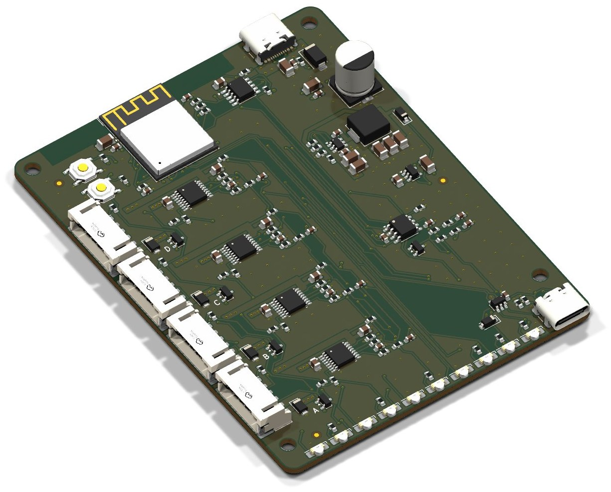
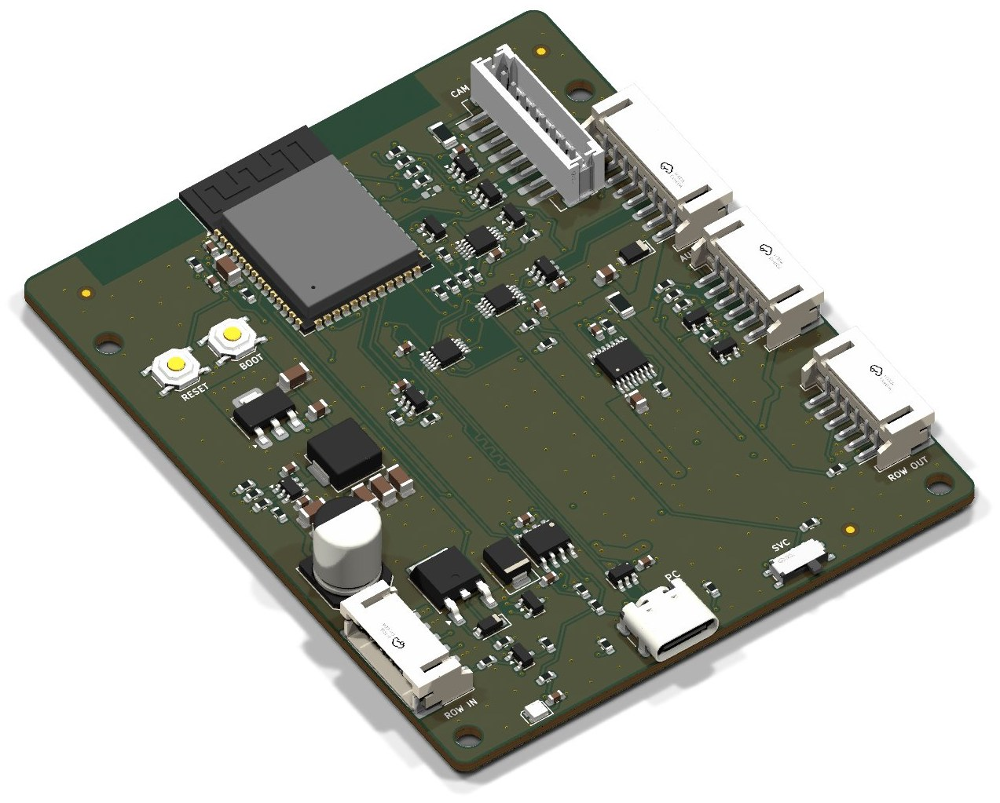

# The five PCBs

A rack uses five kinds of PCB. This page says what each one does and where to find its design files.

::::{grid} 3 3 5 5
:gutter: 2

:::{grid-item}

:::
:::{grid-item}

:::
:::{grid-item}

:::
:::{grid-item}

:::
:::{grid-item}

:::
::::

KiCad renders, in the order of the table below. Not to scale.

| PCB | Size | What it does |
|---|---|---|
| [Power hub](power-hub.md) | 76 × 100 mm, 4 layers | feeds up to four rows of bays from one USB-C PD charger, and runs the [rack bus](../glossary.md) |
| [Bay node](bay-node.md) | 74 × 90 mm, 4 layers | runs one bay: powers its DATA board, shares the boards' USB, drives the camera and the AUX UART |
| [Camera pod](camera-pod.md) | 40 × 27 mm, 2 layers | connects the bay's camera and four white LEDs to the bay node |
| [DATA ×6](data-x6.md) | 100 × 70 mm, 4 layers | six USB-C ports behind a hub, each one switched and measured |
| [DATA ×4](data-x4.md) | 100 × 70 mm, 4 layers | four such ports, each with a pin header, plus a switch matrix and a logic analyzer |

The DATA ×6 and the DATA ×4 are the two DATA boards. A DATA board stands at the back of the drawer, and
your boards plug into it.

Each bay takes a bay node and a DATA board. Each camera takes a camera pod. A rack takes one power hub, and
a single bay on a desk takes none. How many of each you order depends on the size of your rack:
[Order the PCBs](../../plan/order-the-pcbs.md#how-many-of-each) counts them. The leads between the PCBs are
on [Cables and pinouts](../cables.md).

Each PCB's page describes v1.0, the revision printed on the PCB.

## Schematics and design files

Each PCB's schematic, layout and fabrication files are generated from its `design.py`. The schematic is also
a PDF, which you can read without KiCad.

| PCB | Schematic | KiCad project and `design.py` |
|---|---|---|
| Power hub | [power-hub-schematic.pdf](../../../electronics/power-hub/docs/power-hub-schematic.pdf) | [electronics/power-hub/](../../../electronics/power-hub/) |
| Bay node | [bay-node-schematic.pdf](../../../electronics/bay-node/docs/bay-node-schematic.pdf) | [electronics/bay-node/](../../../electronics/bay-node/) |
| Camera pod | [camera-pod-schematic.pdf](../../../electronics/camera-pod/docs/camera-pod-schematic.pdf) | [electronics/camera-pod/](../../../electronics/camera-pod/) |
| DATA ×6 | [data-port-x6-schematic.pdf](../../../electronics/data-port-x6/docs/data-port-x6-schematic.pdf) | [electronics/data-port-x6/](../../../electronics/data-port-x6/) |
| DATA ×4 | [data-port-x4-schematic.pdf](../../../electronics/data-port-x4/docs/data-port-x4-schematic.pdf) | [electronics/data-port-x4/](../../../electronics/data-port-x4/) |

The same `docs/` folder holds three KiCad renders of each PCB: top, bottom and three-quarter view.
The fabrication files come as one archive per PCB:
[Download the fabrication files](../../plan/order-the-pcbs.md#download-the-fabrication-files).
