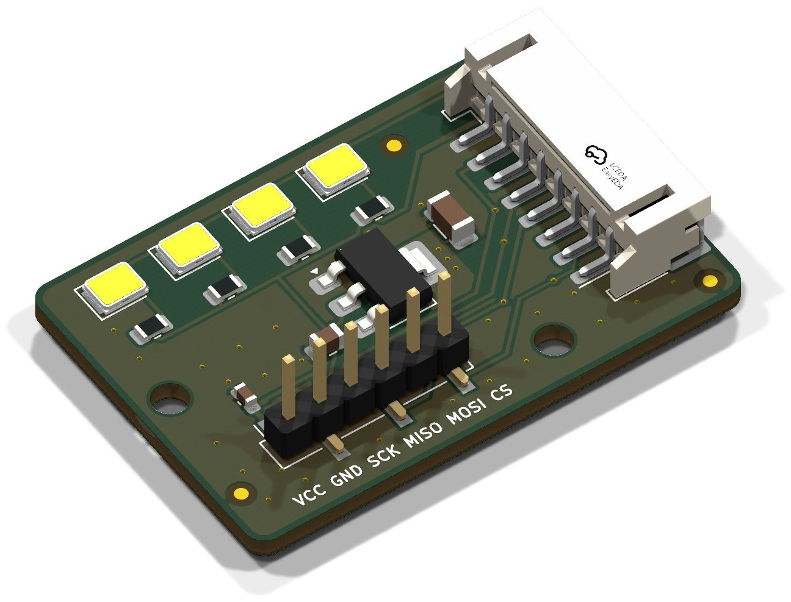
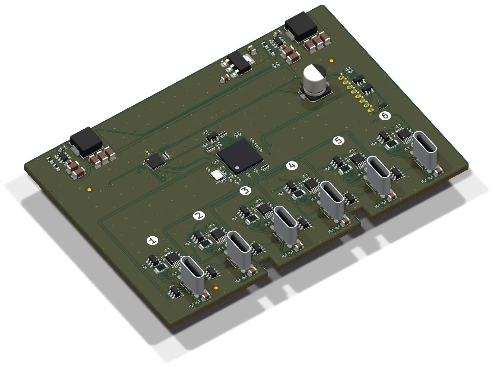
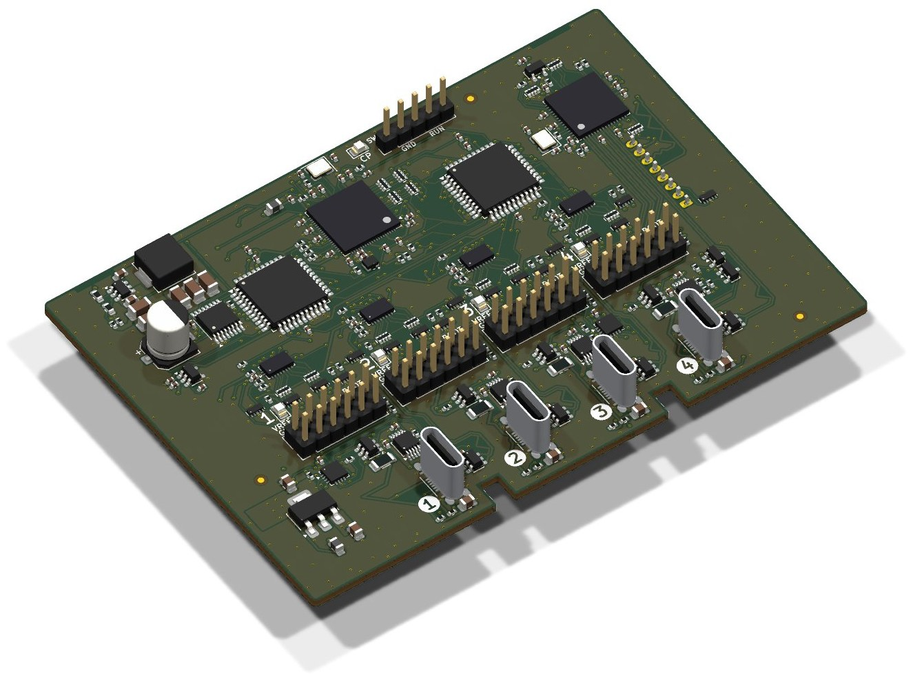

# The five PCBs

A rack takes five PCB designs: one power hub, a bay node on every tray, a DATA board in every drawer (a
DATA ×6, or a DATA ×4 where the bay needs wires and a logic analyzer) and a camera pod for each camera.

:::{status} designed
v1.0 of all five went to the fab on 2026-11-11 and none is on a bench. Their pages give the design's
values, read from each PCB's `design.py`, its bill of materials and `config/rack.yaml`; nothing has been
measured. [What exists today](../../plan/status.md#the-five-pcbs).
:::

::::{grid} 3 3 5 5
:gutter: 2

:::{grid-item}
[](power-hub.md)
:::
:::{grid-item}
[](bay-node.md)
:::
:::{grid-item}
[](camera-pod.md)
:::
:::{grid-item}
[](data-x6.md)
:::
:::{grid-item}
[](data-x4.md)
:::
::::

| PCB | Size | Does |
|---|---|---|
| [Power hub](power-hub.md) | 76 × 100 mm, 4 layers | turns a USB-C PD charger into the rack's supply, switches it to four rows through eFuses, runs the rack's CAN bus |
| [Bay node](bay-node.md) | 74 × 90 mm, 4 layers | one bay: the DATA lead's supply and meter, the boards' USB to the network or the front port, the camera, the AUX UART |
| [Camera pod](camera-pod.md) | 40 × 27 mm, 2 layers | the camera's 3.3 V and four white LEDs, on a lead from the node |
| [DATA ×6](data-x6.md) | 100 × 70 mm, 4 layers | six switched and measured USB-C ports behind a hub |
| [DATA ×4](data-x4.md) | 100 × 70 mm, 4 layers | four such ports, a pin header for each, a switch matrix and a logic analyzer |

KiCad renders, not to one scale. The order is that of first power and of
[the bench checks](../../build/check-the-pcbs/index.md): the hub needs nothing else, the node meets the hub
next, and the three others hang off a node that works. The leads between them are on
[Cables and pinouts](../cables.md).

## How many a rack takes

From [Order the PCBs](../../plan/order-the-pcbs.md), which also says what to send to the fab and what it
leaves for you to solder:

```{include} ../../plan/order-the-pcbs.md
:start-after: <!-- site:pcbs-per-size -->
:end-before: <!-- /site:pcbs-per-size -->
```

## Revisions at the fab

v1.0 of the five went to NextPCB on 2026-11-11, from commit `125c4ece`: 5 PCBs and 2 assembled of each.

```{include} ../../electronics.md
:start-after: <!-- site:revisions-at-the-fab -->
:end-before: <!-- /site:revisions-at-the-fab -->
```

A revision that went to a fab is frozen: its Gerbers, its bill of materials and its placement file stay
as they were sent, so that the repository shows the PCBs that are on the bench.
[electronics/released.json](../../../electronics/released.json) holds the SHA-256 of each file, and
`python tools/released.py` compares them with the tree. Any change, a silkscreen text or one track, goes
into a new revision ([Change a PCB](../../engineering/change-a-pcb.md)). What a bench finds wrong on v1.0
is written down and fixed in the next one, not in v1.0.

## Schematics and sources

Each PCB's schematic, layout and fabrication files are generated from its `design.py`. The schematic is
also a PDF, readable without KiCad.

| PCB | Schematic | KiCad project and `design.py` |
|---|---|---|
| Power hub | [power-hub-schematic.pdf](../../../electronics/power-hub/docs/power-hub-schematic.pdf) | [electronics/power-hub/](../../../electronics/power-hub/) |
| Bay node | [bay-node-schematic.pdf](../../../electronics/bay-node/docs/bay-node-schematic.pdf) | [electronics/bay-node/](../../../electronics/bay-node/) |
| Camera pod | [camera-pod-schematic.pdf](../../../electronics/camera-pod/docs/camera-pod-schematic.pdf) | [electronics/camera-pod/](../../../electronics/camera-pod/) |
| DATA ×6 | [data-port-x6-schematic.pdf](../../../electronics/data-port-x6/docs/data-port-x6-schematic.pdf) | [electronics/data-port-x6/](../../../electronics/data-port-x6/) |
| DATA ×4 | [data-port-x4-schematic.pdf](../../../electronics/data-port-x4/docs/data-port-x4-schematic.pdf) | [electronics/data-port-x4/](../../../electronics/data-port-x4/) |

Beside each PDF, in the project's `docs/` folder, are three KiCad renders: top, bottom and a three-quarter
view. The fabrication files are one archive per PCB, linked from its page and listed, with what an archive
holds, under [Where the fab files are](../../plan/order-the-pcbs.md#where-the-fab-files-are). The reasons
behind the designs are in the design log, [electronics.md](../../electronics.md).

## One page per PCB, one revision per page

Each PCB's page describes the revision printed on it: "BAY NODE v1.0", "POWER HUB v1.0", "CAM POD v1.0",
"DATA ×6 v1.0", "DATA ×4 v1.0", each dated 2026-11. A later revision adds a section "What changed in v1.1"
to the same page, which keeps its address. Each page ends on the known issues of its revision, and
[Known issues, and what will not work](../known-limitations.md) gathers them.

Where the design log disagrees with a PCB's `design.py` or its bill of materials, these pages follow the
`design.py` and the bill. Two traps in older text: "DATA ×4 v2" is this DATA ×4 v1.0, named after a first
design that was never built; and a DATA lead that carries 5 V belongs to the designs before v1.0, whose
lead carries the row's 20 V.

## A sixth design that was not ordered

The repository holds one more PCB, the single DATA port: one USB-C on 40 × 17 mm, for a drawer that
holds one board. It was retired from the rack on 2026-10-31, when every drawer took a DATA ×6 or a
DATA ×4, and it was never ordered. Its files stay in
[electronics/data-port/](../../../electronics/data-port/) for the standalone Solo box, with a trap: its
lead's supply wire goes straight to the USB-C's VBUS, and a bay node v1.0 puts 20 to 28 V on that wire.
Do not plug one into a node v1.0 ([One bay on a desk](../../build/one-bay-on-a-desk.md)).
