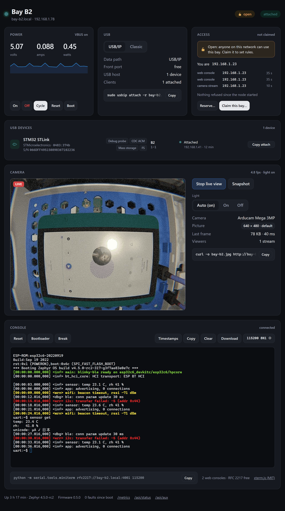
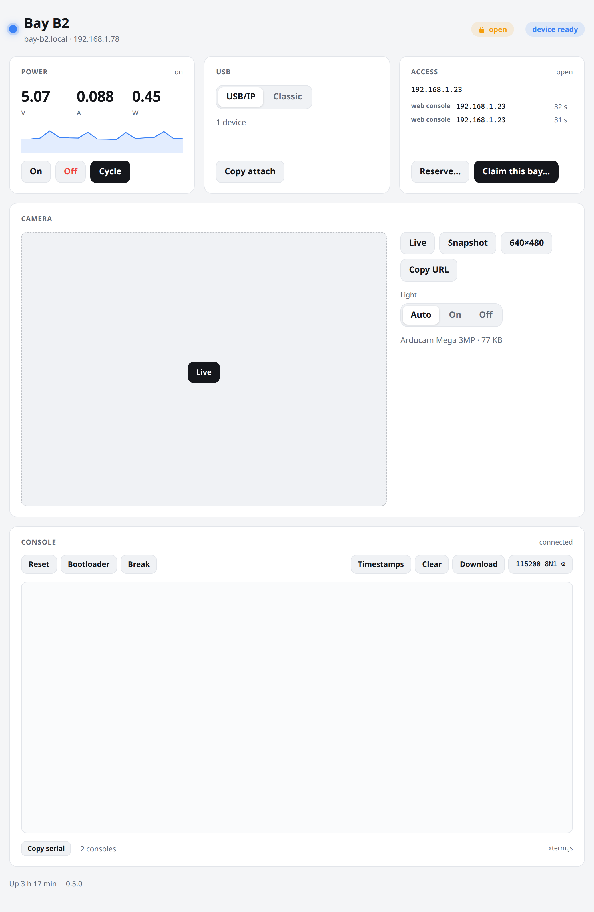
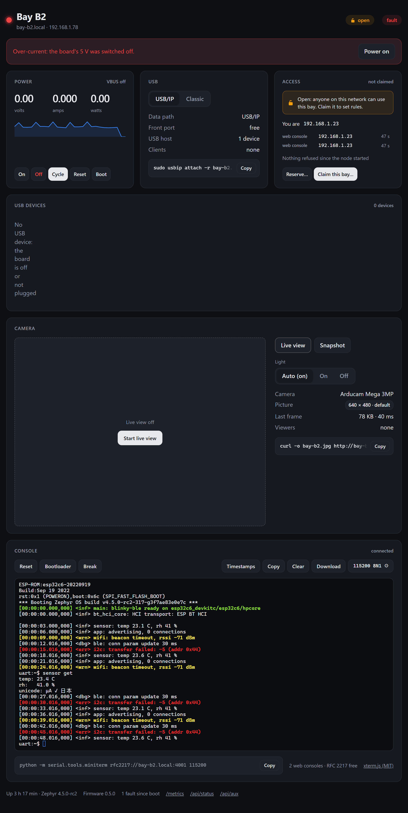
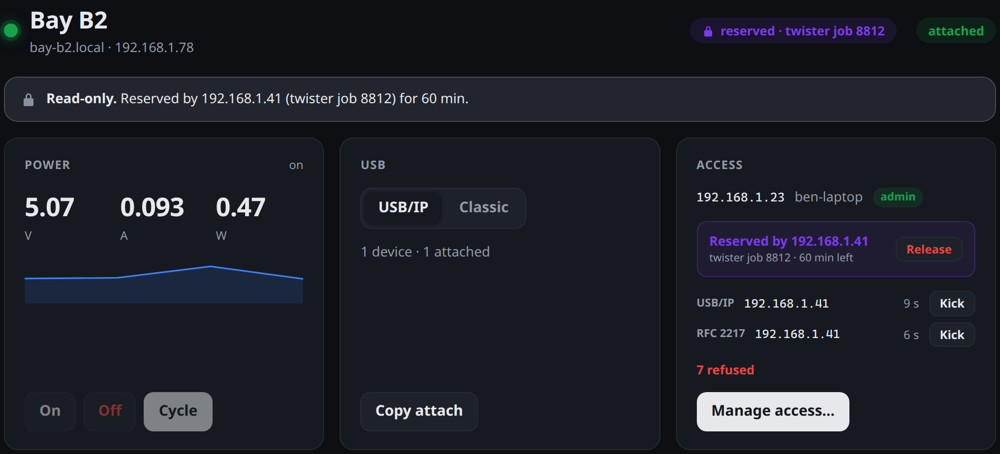
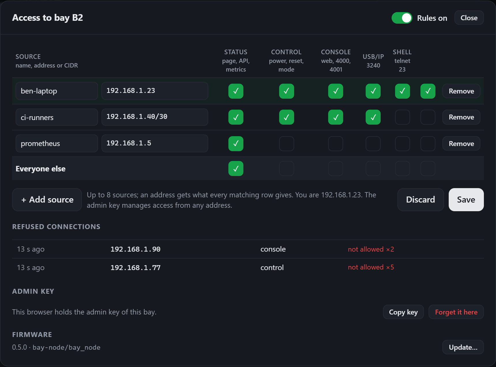
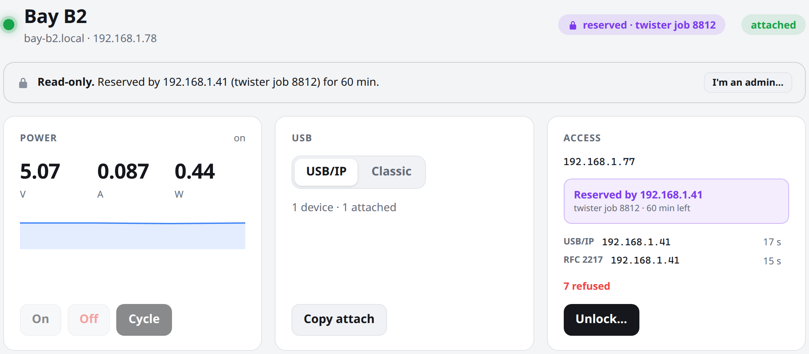
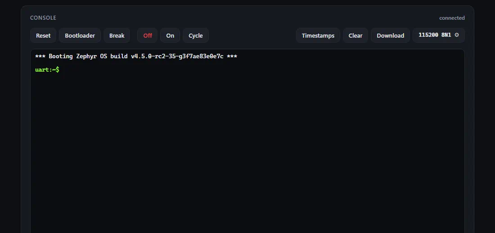

# Firmware (Zephyr)

Two applications, both on an ESP32-S3, share this tree:

| | |
|---|---|
| **Bay node** (this page) | one per bay: the board under test over USB/IP, its 5 V, its console |
| **[Power hub](power-hub/README.md)** | one per rack: USB-C PD in, rows A–D, the rack bus (CAN) master |

They speak the rack bus protocol ([docs/rack-protocol.md](../docs/rack-protocol.md))
and share [`common/`](common/): the protocol, the AP33772S drivers, Wi-Fi and
hostname, the web pages' CSS and helpers, xterm.js, the development server
and the screenshot tooling.

Firmware for the ESP32-S3 on each [bay node](../electronics/bay-node/design.py):
it exports the board under test (DUT) over the network with Zephyr's
**USB/IP host service**, switches and meters its 5 V, and gives remote access
to its console and RESET/BOOT lines.  It dogfoods Zephyr's new USB host stack
(`uhc_dwc2` on the ESP32-S3 OTG controller + `subsys/usb/host/usbip.c`).

> **Status:** builds against Zephyr main (4.5.0-rc2, pinned in
> [`west.yml`](west.yml)); **not yet run on hardware** — no bay node PCB has
> been assembled.  See [open items](#open-items).

```
firmware/
  west.yml                       west manifest (Zephyr main + hal_espressif + crypto)
  boards/hwtr/bay_node/          board definition: bay_node/esp32s3/procpu
  boards/hwtr/power_hub/         board definition: power_hub/esp32s3/procpu
  dts/bindings/                  hwtr,* bindings (dut-port, usb-mux, rack-bus, rack-rows,
                                 power-hub) and diodes,ap33772s (MFD, regulator, sensor)
  common/                        shared by both applications
    include/hwtr/, lib/          rack bus protocol (frames, hub and node state machines), Wi-Fi
    drivers/                     AP33772S USB PD sink: MFD, regulator, sensor (out of tree)
    web/                         rack.css, rack.mjs, vendor/xterm (xterm.js 6.0.0, MIT),
                                 devserver.py, shots.py
    tests/rack_bus/              the rack bus on a simulated rack (ztest, native_sim)
  power-hub/                     the power hub application (its own README)
  bay-node/                      the bay node application
    boards/esp32s3_devkitc_procpu.overlay   stand-in: same pin map on a DevKitC-1
    boards/m5stack_stamps3_procpu.*         bench node on a StampS3: console + network, no USB host
    web/index.html               status page and serial console (embedded gzipped)
    web/dev_server.py            the page against a simulated node, to work on the UI
    tests/rfc2217/               host test of the RFC 2217 server against pyserial
    tests/console_sim/           the console, web server and RFC 2217 code on native_sim, with a Zephyr DUT
    wifi.conf.example            build-time Wi-Fi credentials (copy to wifi.conf)
```

## Building

A dedicated workspace, with this repository as the manifest repository:

```bash
west init -m https://github.com/kartben/hw-testing-rack --mf firmware/west.yml rack-ws
cd rack-ws
west update
west blobs fetch hal_espressif          # Wi-Fi binary blobs
west packages pip --install             # esptool & co. for the ESP32 build
west build --sysbuild -b bay_node/esp32s3/procpu hw-testing-rack/firmware/bay-node
```

`--sysbuild` builds MCUboot in front of the application, for the updates
over the network ([docs/firmware.md › Over the network](../docs/firmware.md#over-the-network));
the images are signed with MCUboot's public test key unless
`HWTR_SIGNING_KEY` points at your own ([Signing key](../docs/firmware.md#signing-key)).
Without `--sysbuild`: the application alone, no updates over the network.

The repository is a Zephyr module (`zephyr/module.yml` at its root: the
boards, the bindings, `firmware/common/`).  West finds it in the workspace
above; each application also adds it itself (`ZEPHYR_EXTRA_MODULES`), so a
plain build works from any Zephyr workspace at a recent `main` (with
`hal_espressif` blobs fetched).  Sysbuild needs it known before the
application: there, add `-- -DEXTRA_ZEPHYR_MODULES=path/to/hw-testing-rack`.

```bash
west build -b bay_node/esp32s3/procpu path/to/hw-testing-rack/firmware/bay-node
west build -b power_hub/esp32s3/procpu path/to/hw-testing-rack/firmware/power-hub
```

No bay node yet?  An ESP32-S3-DevKitC-1 with the same GPIO map stands in
(status on the devkit's RGB LED, DUT on its "USB" port through an OTG adapter):

```bash
west build --sysbuild -b esp32s3_devkitc/esp32s3/procpu hw-testing-rack/firmware/bay-node
```

An M5Stack StampS3 is an even smaller bench node for the serial console and
the network side: no muxes, INA226 or USB host, and its USB-C port carries
the node's shell and logs (USB-Serial-JTAG).  The AUX UART and the
RESET/BOOT lines are on header pins (G1/G2, G4/G5; the map is in
[the overlay](bay-node/boards/m5stack_stamps3_procpu.overlay)), and
`bay aux loopback on` loops the UART back on itself to try the console
without a DUT:

```bash
west build --sysbuild -b m5stack_stamps3/esp32s3/procpu hw-testing-rack/firmware/bay-node
west flash --erase    # over its USB-C port; --erase once, see below
```

A module that ran other firmware may hold something else where the
settings live (`settings unavailable (-45)` at boot, nothing saved): erase
the flash once (`west flash --erase`, or just the `storage` partition).

Wi-Fi credentials can be built in — handy to flash a whole rack:

```bash
cp hw-testing-rack/firmware/bay-node/wifi.conf.example hw-testing-rack/firmware/bay-node/wifi.conf   # edit it
west build --sysbuild -b bay_node/esp32s3/procpu hw-testing-rack/firmware/bay-node -- -DEXTRA_CONF_FILE=wifi.conf
```

`wifi.conf` is git-ignored.  On Windows keep the workspace and build
directory on a short path (e.g. `C:\rack-ws`): `hal_espressif` and
`tf-psa-crypto` have file paths long enough to hit `MAX_PATH`.

## Flashing

The node runs from its row: the hub must have the row on (on a desk: 9–30 V
on J1).

1. Slide the bay's **SERVICE** switch on and plug a laptop into the front
   **PC** port, both on the fascia.  The firmware stops its USB host and
   hands the ESP32-S3's single USB PHY back to the USB-Serial-JTAG (LED
   yellow), which shows up as a serial port (and a JTAG adapter for
   OpenOCD).  A blank module shows it at once.
2. `west flash` (esptool resets the chip into its ROM loader over USB).  If
   the firmware is wedged (it takes the PHY and never lets it go), pull the
   drawer out, hold **BOOT** and tap **RESET**, or keep BOOT held while the
   hub power-cycles the row from its page (the row's other bays restart too):
   RESET sits partly under the drawer's left ledge, BOOT is clear.
3. SERVICE off: the host controller restarts and the DUT is back on USB/IP.

Both boards, recovery and the update plan (MCUboot, over Wi-Fi):
[docs/firmware.md › Programming](../docs/firmware.md#programming).

## First boot

The shell runs on the UART test pads (TP1 = TXD0, TP2 = RXD0, 115200 8N1) and,
once the node is on the network, over telnet (port 23).

```console
uart:~$ wifi cred add -s MyLab -k 1 -p secret      # stored in flash (settings)
uart:~$ wifi cred auto_connect
uart:~$ bay id b3                                   # hostname bay-b3.local, stored
uart:~$ bay status
```

Then, from any Linux machine on the LAN:

```console
$ usbip list -r bay-b3.local
$ sudo usbip attach -r bay-b3.local -b 1-1
$ open http://bay-b3.local/                # status page and DUT console
$ telnet bay-b3.local                     # bay shell
$ python -m serial.tools.miniterm rfc2217://bay-b3.local:4001 115200   # DUT console
```

## What it does

| Feature | Implementation |
|---|---|
| USB/IP export of the DUT | `CONFIG_USBIP` on `zephyr_uhc0` (= `&usb_otg`, DWC2 host, ESP32-S3 FS quirk); TCP 3240; one device, bus id `1-<address>` (normally `1-1`) |
| DUT power | TPS2553 EN on IO41, kept **on** at boot (the board pulls it up); `bay power on/off/cycle` |
| Over-current | TPS2553 ~FAULT on IO40 (interrupt): logged and counted; after `CONFIG_BAY_DUT_FAULT_OFF_MS` (1 s) in current limit VBUS is switched off and the fault latched until `bay power on` |
| Telemetry | INA226 @ 0x40 through the Zephyr sensor API (`ti,ina226`, 50 mΩ, 50 µA/LSB, 16× averaging): bus mV, mA, mW in `bay power` / `bay status` |
| Data path | reads PC_DET (IO13) and SVC (IO15); `bay mode classic` drives MUX_FORCE_PC (IO14), persisted |
| SERVICE mode | stops the USB host and routes the internal PHY to the USB-Serial-JTAG (`CONFIG_BAY_SERVICE_PHY_HANDOVER`); restarts the host when SERVICE goes off |
| AUX console | UART1 (IO47 TX / IO33 RX), interrupt driven, shared by the web console (WebSocket, xterm.js), an RFC 2217 server (port 4001) and raw TCP (port 4000); settings persisted per bay; BREAK; TX released while the DUT is off.  See [Serial console](#serial-console) |
| AUX RESET/BOOT | open-drain pulses (IO34/IO48): `bay reset`, `bay boot`, the console's buttons, optionally RFC 2217 DTR/RTS (esptool) |
| Status LED | WS2812B on IO12 through the RMT (`worldsemi,ws2812-pulse-io`), see below |
| Buttons | BOOT (IO0) once booted: short press confirms an access claim, held ≥ 1 s power-cycles the DUT, ≥ 10 s resets access control.  RESET is the ESP32's EN |
| Access control | who may use which service, a CI reservation, an admin key confirmed by a BOOT press; Zephyr's packet filter for the TCP services, a check per HTTP request.  See [Access control](#access-control) |
| Rack bus | CAN on the row cable (TWAI, IO18 TX / IO17 RX, 250 kbit/s) and the POS token (IO16 in, IO35 out): the node takes its position from the hub (node id = row × 16 + position, `C3` = 0x23), sends STATUS every second and INFO (IP, firmware) every 10 s, an ALERT on a DUT fault, and runs the hub's commands (power, reset, bootloader, identify, reboot; the ones that disturb the board are refused while the bay is reserved).  `src/rack.c` on `common/lib/rack_node.c`; the protocol is [docs/rack-protocol.md](../docs/rack-protocol.md) |
| Network | Wi-Fi station, DHCP, Wi-Fi credentials library (settings or build time), reconnects on its own; hostname `bay-<id>` answered over mDNS (`common/lib/net.c`, as the hub) |
| Shell | `bay …` commands plus the stock `wifi`, `net` shells, on UART0 and telnet |
| Web | Zephyr HTTP server on port 80: status page, JSON API (same actions as the shell), Prometheus `/metrics` through Zephyr's Prometheus library |

### Shell

| Command | Effect |
|---|---|
| `bay status` | id/hostname, IP, rack position, data path, USB host (devices, USB/IP sessions), power and V/I/P, fault count, AUX stats |
| `bay power` | DUT VBUS state and V/I/P |
| `bay power on` / `off` | switch DUT VBUS (`on` also clears a latched fault) |
| `bay power cycle [ms]` | off, wait (default 1000 ms), on |
| `bay reset [ms]` | pulse the DUT's RESET line low (default 100 ms) |
| `bay reset hold` / `release` | hold / release RESET |
| `bay boot` | hold BOOT, pulse RESET, release BOOT 200 ms later: ROM bootloader on most MCUs |
| `bay boot hold` / `release` | hold / release the BOOT strap |
| `bay mode [usbip\|classic]` | show, or force/release classic mode (persistent) |
| `bay aux` | AUX UART settings, consoles connected, byte counters |
| `bay aux <baud> [8N1]` | set and save the AUX UART baud rate and format (`7E1`, `8O2`, …) |
| `bay aux break [ms]` | hold the DUT's RX line low (default 250 ms) |
| `bay aux send <text>` | send a line to the DUT (with the console's Enter) |
| `bay aux loopback [on\|off]` | test without a DUT: the UART loops its TX back to its RX (ESP32) |
| `bay id [id]` | show or set the bay id (persistent), hostname `bay-<id>.local`; without one, the rack position (`bay-c3.local`) |
| `bay access` | access control: admin key, rules, lease, connections, refusals |
| `bay access claim` | confirm a pending claim, like a short press on BOOT (not over telnet) |
| `bay access on` / `off` | apply the rules / let every address use everything (`off`: not over telnet) |
| `bay access release` | end the lease |
| `bay access reset` | forget the admin key, the rules and the lease (not over telnet) |

### Network services

| Port | Service |
|---|---|
| TCP 3240 | USB/IP (`usbip list` / `usbip attach`) |
| TCP 80 | status page, serial console (WebSocket `/console/ws/<n>`), JSON API, `/metrics` (`CONFIG_BAY_HTTP_PORT`) |
| TCP 23 | telnet shell (no login of its own: give the shell right to admin hosts only) |
| TCP 4001 | AUX UART, RFC 2217, one client (`CONFIG_BAY_RFC2217_PORT`) |
| TCP 4000 | AUX UART, raw bytes, one client (`CONFIG_BAY_AUX_TCP_PORT`) |
| UDP 5353 | mDNS: `bay-<id>.local`; without an id, the rack position the hub gave (`bay-c3.local`); before that `bay<MAC>` |

Which address may use which of them: [Access control](#access-control).
Until a node is claimed it is open, as it always was.

### Web page and API

`http://bay-<id>.local/` is a single self-contained page: plain HTML, CSS and
an ES module, no framework or CDN, about 18 KB gzipped in flash (plus
xterm.js for the console, below).  It follows the browser's light/dark
theme, polls `/api/status` every 2 s while visible, and offers the shell's
main actions.



|  |  |
|---|---|
| Light theme, DUT enumerated and ready to attach | Over-current: VBUS cut by the firmware |

| Endpoint | |
|---|---|
| `GET /api/status` | everything `bay status` shows, as JSON; `rack`: `node` (0 before the hub gave one), `pos` (`"C3"`), the hub's contract |
| `POST /api/power` | `{"action": "on" \| "off" \| "cycle", "ms": 1000}` |
| `POST /api/reset` | `{"ms": 100}` (body optional) |
| `POST /api/boot` | DUT into its bootloader (BOOT held across a RESET pulse) |
| `POST /api/mode` | `{"mode": "usbip" \| "classic"}` (persistent) |
| `GET /api/aux` | AUX UART settings, consoles connected, byte counters |
| `POST /api/aux` | any of `{"baud": 115200, "data_bits": 8, "parity": "none" \| "odd" \| "even", "stop_bits": 1, "enter": "cr" \| "lf" \| "crlf", "echo": false, "esptool_reset": false}`, applied and saved; answers with `GET /api/aux` |
| `POST /api/aux/break` | `{"ms": 250}` (body optional) |
| `POST /api/console/ticket` | a single-use ticket (10 s) for the next WebSocket, for an address with the console right |
| `GET /console/ws/<n>?t=<ticket>` | WebSocket to the AUX UART, `n` < `CONFIG_BAY_CONSOLE_WEB_CLIENTS` (see below) |
| `GET /metrics` | Prometheus: `bay_dut_vbus_volts`, `bay_dut_current_amperes`, `bay_dut_power_watts`, `bay_dut_power_on`, `bay_dut_fault`, `bay_dut_faults_total`, `bay_usb_devices`, `bay_usbip_sessions`, `bay_aux_{rx,tx}_bytes_total`, `bay_access_refused_total`, all labelled `bay="<id>"` |
| `GET /api/access` | the caller's address and rights, the lease, the connections; signed: the rules and the refusal log too |
| `POST /api/lease` | `{"ttl_s": 3600, "note": "twister job 8812"}` reserves or renews, `{"release": true}` ends it |
| `GET /api/access/nonce` | a single-use nonce (60 s) to sign an admin request |
| `POST /api/access/claim` | `{}` or `{"key": "<64 hex>"}` starts a claim, then `{"ticket": "..."}` until someone presses BOOT |
| `POST /api/access/rules` | signed: `{"enabled": true, "everyone": ["status"], "sources": [{"name": "ci-runners", "cidr": "192.168.1.40/30", "allow": ["status", "control", "console", "usbip"]}]}` |
| `POST /api/access/kick` | signed: `{"id": "usbip:51234"}`, an id from `GET /api/access` |
| `POST /api/access/key` | signed: `{"key": "<64 hex>"}`, a new admin key |
| `GET /api/update` | the firmware: `version`, image `id`, `test_key`, `trial` (what it waits for, time left), `last` update (`confirmed`, `rolled back`); also `firmware` in `/api/status` (MCUboot builds) |
| `POST /api/update/begin` | signed: `{"size": N, "sha256": "<64 hex>", "force": false}` → `{"ticket": …}`; a reserved bay needs `force` |
| `POST /api/update?ticket=…` | the image (`zephyr.signed.bin`), streamed into slot 1 → `{"state": "rebooting", "version": …}`, then a test boot ([docs/firmware.md › Over the network](../docs/firmware.md#over-the-network)) |

Every action POST answers with the new status document; errors come back as
`{"error": "..."}` with a 4xx status: 403 when the access rules refuse the
caller (with `reason`, `service` and the address the node saw), 423 while
another address holds the lease.

```console
$ curl -s bay-b3.local/api/status | jq .dut
$ curl -s -X POST bay-b3.local/api/power -d '{"action":"cycle","ms":2000}'
$ curl -s bay-b3.local/metrics
```

To work on the page without a node, `python firmware/bay-node/web/dev_server.py`
serves it on <http://localhost:8766> with a simulated node, console included
(a fake Zephyr board that boots, logs in colour and runs a small shell;
`/dev/fault` trips a fake over-current, `/dev/attach` toggles a fake USB/IP
client; `/dev/image?version=0.6.0` is an image to try a firmware update
with, `/dev/rollback` makes the next update roll back).  The screenshots
come from that simulation:
`python firmware/bay-node/web/screenshots.py` (Playwright and an installed
Chrome or Edge) regenerates `docs/img/web-ui-*.png`.

## Access control



|  |  |
|---|---|
| Manage access: who may use what, refused connections | From an address without the control right |

Each node decides by itself who may use its bay.  Out of the box it is
**open**, as before: anyone on the network may do anything until the node
is claimed and its rules are switched on.

**Services.**  A rule gives an address (or a CIDR) some of five services:

| Service | Covers |
|---|---|
| status | the page, `/api/status`, `/api/aux` (read), `/metrics` |
| control | power, reset, boot, mode; taking a lease |
| console | the web console, the raw (4000) and RFC 2217 (4001) ports, the AUX settings and BREAK |
| usbip | USB/IP (3240) |
| shell | the telnet shell (23), which can do everything: admin hosts only |

Up to 8 sources per node, plus a row for everyone else (status only by
default).  An address gets what every source it matches allows.

**Where it is enforced.**  TCP connections to USB/IP, telnet and the AUX
ports go through Zephyr's packet filter (`CONFIG_NET_PKT_FILTER`, its
local-in hook with our own match function): a refused client's SYN is
dropped before USB/IP or the shell, which Zephyr runs itself, ever see it
(the client times out); the AUX ports check again at `accept()`.  The web
server checks every request (403, or 423 while reserved) and the web
console needs a ticket from an address with the console right, because a
WebSocket descriptor carries no peer address.  When the rules or the lease
change, connections that are no longer allowed are closed.  mDNS is left
alone.

**Reservation (lease).**  An address with the control right can reserve
the bay for 10 s to 24 h (`POST /api/lease`, `bayctl lease`, or *Reserve…*
on the page): while it lasts, control, console and USB/IP answer only that
address, and everyone else's sessions are closed when it starts.  It works
on an open node too, so CI jobs keep out of each other's way before any
rule exists.  The holder renews or releases it; it lapses by itself when a
job dies; an admin can break it.  It lives in RAM: a reboot ends it.

**Connections, kicks, refusals.**  The Access card lists who holds the
console, USB/IP and the shell; an admin's *Kick* closes a connection and
refuses its address that service for `CONFIG_BAY_ACCESS_KICK_S` (60 s).
The node keeps the last 16 kinds of refusal (address, service, reason,
count) for the admin view, and counts them in `bay_access_refused_total`.

**Admin key.**  Whoever holds the node's 32-byte key edits the rules, kicks
and breaks leases, from any address.  The first key comes from a **claim**:
*Claim this bay…* on the page (or `bayctl access claim`), then a short press
on the node's BOOT button within `CONFIG_BAY_ACCESS_CLAIM_S` (60 s) while
its LED blinks white, or `bay access claim` on the UART pads.  Nobody can
claim a node from the network alone.  The claimer may bring a key, so that
every bay shares the rack's key (`bayctl access keygen`).  After that,
admin requests carry `X-Bay-Auth: <nonce>:<HMAC-SHA256(key, nonce \n
method \n path \n body)>` with a single-use nonce from
`/api/access/nonce`: the key crosses the network once, at claim time.  The
page keeps it in the browser's local storage; `bayctl` reads `BAYCTL_KEY`.

**Recovery.**  On the node: `bay access off` (rules off), `bay access
reset` (no key, no rules), or hold BOOT for 10 s
(`CONFIG_BAY_ACCESS_RESET_HOLD_MS`) for the same reset.  These are refused
over telnet.

**Limits.**  There is no TLS on the node: the rules stop mistakes and
uninvited hosts, not someone who spoofs an allowed address on the same
network, and the key travels in clear once, when a node is claimed (claim
on a network you trust).  For more, put the rack behind a VPN or a gateway.
Refused TCP connections are dropped, not reset: `usbip attach` from a
refused host waits for its timeout.

**Code.**  The rules, the lease, the refusal log and HMAC-SHA256 are plain
C without Zephyr ([`common/lib/acl.c`](common/lib/acl.c)), tested on the
host against Python's `hashlib`/`hmac`; the admin key, its nonces, the
signature check and the claim are [`common/lib/admin.c`](common/lib/admin.c),
shared with the power hub (whose page signs its actions the same way, with
the same `rack.mjs` code); [`src/access.c`](bay-node/src/access.c) applies
them (packet filter, settings `access/rules` and `access/key`, kicks,
connections).  One key can serve the whole rack: a claim may bring it.

```bash
python firmware/bay-node/tests/acl/test_acl.py                       # CC=gcc by default
python3 firmware/bay-node/tests/console_sim/test_access.py --workspace <west workspace> --build <dir>
```

`test_access.py` runs the node on native_sim and talks to it from several
loopback addresses: claim, signed requests, rules, the web console ticket,
the AUX ports refused at `accept()`, kicks, the lease, persistence across a
restart, the local reset.  The packet filter itself (host sockets bypass
Zephyr's IP stack there), USB/IP and telnet are not covered.

**Cost.**  On `bay_node`, against the build before it: +13 KB of flash
(the page grew from 9 to 18 KB gzipped) and +5.3 KB of static RAM, now at
96.4 % (385 of 399 KB): the rules, lease and refusal log, a 1 KB request
buffer, header capture and longer header lines for `X-Bay-Auth`, and one
3 KB response buffer that replaced two.

## Serial console

The DUT's console on the AUX connector (UART1) is reachable three ways at
once.  Everything the board sends goes to every client; everything a client
sends goes to the board, so with several writers the keystrokes simply
interleave: one person typing at a time is the rule.

| Client | How | Port settings |
|---|---|---|
| Web console | the Console card of the status page (xterm.js over a binary WebSocket), up to `CONFIG_BAY_CONSOLE_WEB_CLIENTS` (2) browsers | the page's ⚙ panel: applied at once and saved for the bay (Zephyr settings) |
| RFC 2217 | one client on TCP 4001: pyserial `rfc2217://`, labgrid `NetworkSerialPort`, esptool | set by the client for its session; the saved ones come back when it disconnects |
| Raw TCP | one client on TCP 4000: `socat`, `nc` | the saved ones |



*Recorded on [native_sim](bay-node/tests/console_sim/): the node's real
console, web server and RFC 2217 code, with Zephyr's shell sample running
as the DUT on its AUX UART.  `python firmware/bay-node/web/screencast.py
--workspace <west workspace>` records it again (Docker, Playwright, ffmpeg).*

**Web console.**  Raw bytes both ways, so full VT100/xterm escape
sequences and UTF-8 work.  The node keeps the last
`CONFIG_BAY_AUX_LOG_SIZE` (16 KB) received in RAM and replays them to a
browser that connects, so a page opened after a crash still shows it; a page
that reconnects (Wi-Fi hiccup) skips what it already shows, and marks a node
reboot.  Next to the terminal: RESET and BOOT pulses, DUT power off/on/cycle,
BREAK, timestamps (added by the browser to each line), clear, and download
of everything received since the page opened.  The ⚙ panel sets the baud
rate (9600–921600 or any value from 300 to 5 M), data bits, parity, stop
bits, what Enter sends (CR, LF, CR LF), local echo, and whether RFC 2217
DTR/RTS drive BOOT/RESET.  Default: 115200 8N1, CR, no echo.

**RFC 2217.**  Telnet with the Com Port Control option (baud, data bits,
parity none/odd/even, stop bits 1/2, BREAK, DTR/RTS, purge); mark/space
parity, 1.5 stop bits and flow control are refused, as a client expects.

```console
$ python -m serial.tools.miniterm rfc2217://bay-b3.local:4001 115200
$ esptool --port 'rfc2217://bay-b3.local:4001' chip-id    # with "DTR/RTS drive BOOT/RESET" on
```

```yaml
# labgrid
NetworkSerialPort:
  host: bay-b3.local
  port: 4001
  speed: 115200
  protocol: rfc2217
```

With *DTR/RTS drive BOOT/RESET* on, the lines behave like the two-transistor
auto-reset circuit of ESP32 boards (RESET while RTS and not DTR, BOOT while
DTR and not RTS), so esptool can reset an ESP32 DUT into its ROM loader and a
terminal that raises both lines leaves the board alone.  Off by default.

**BREAK and the TX line.**  BREAK holds the board's RX line low (`tx-gpios`
of `hwtr,dut-port` takes the pin from the UART for the duration).  While the
DUT is powered off the same pin is released (input), so the node does not
feed the unpowered board through its RX pin; it goes back to the UART when
the power comes back.

**Cost.**  About +170 KB of flash (xterm.js and its CSS, 91 KB gzipped, the
WebSocket and console code) and +25 KB of RAM: the 16 KB receive log, a
1 KB transmit ring, one 3 KB thread for all the console sockets, two
WebSocket contexts and their buffers, two more TCP contexts.  Static data
RAM is now at 95 % (379 of 399 KB, heaps included).  The knobs, if a
feature needs RAM later: `CONFIG_BAY_AUX_LOG_SIZE`,
`CONFIG_BAY_CONSOLE_WEB_CLIENTS`, and `CONFIG_USBIP_BUF_POOL_SIZE` (64 KB by
default upstream, the largest single buffer in the image).

The RFC 2217 server ([`src/rfc2217.c`](bay-node/src/rfc2217.c)) has no Zephyr
dependency and is tested on the host against pyserial's client, with a
looped-back "UART":

```bash
pip install pyserial
python firmware/bay-node/tests/rfc2217/test_rfc2217.py      # needs a C compiler (CC, default gcc)
```

The whole console also runs on native_sim, no hardware needed (Linux, or the
Zephyr build image in Docker as `screencast.py` does):
[`tests/console_sim`](bay-node/tests/console_sim/) builds `aux_console.c`,
`rfc2217.c` and `web.c` with the hardware stubbed and host sockets (NSOS),
and `run.py` starts it next to Zephyr's shell sample, wired to its AUX UART
as the DUT; RESET and the power buttons restart or stop that DUT.

```bash
python3 firmware/bay-node/tests/console_sim/run.py --workspace <west workspace> --build <dir>
# http://localhost/ (port 80), rfc2217://localhost:4001
```

### Status LED

| Colour | Meaning |
|---|---|
| off | no firmware / booting |
| white / blue, fast | identify: the hub's page asked "which one is it?" |
| white, blinking | access claim pending: press BOOT briefly to confirm |
| red, blinking | DUT VBUS in current limit, or switched off by a fault |
| yellow | SERVICE: front port → node |
| magenta | classic: DUT → front port (laptop plugged, or `bay mode classic`) |
| dim white | DUT power switched off |
| orange, blinking | USB/IP mode, no network yet |
| dim blue | USB/IP ready, nothing enumerated on the DUT port |
| blue | USB/IP, DUT enumerated and exportable |
| green | USB/IP, a client is attached |

## Pin map

From `electronics/bay-node/design.py` (U3, ESP32-S3-MINI-1-N8); devicetree in
[`boards/hwtr/bay_node/bay_node.dtsi`](boards/hwtr/bay_node/bay_node.dtsi) and
[`bay_node-pinctrl.dtsi`](boards/hwtr/bay_node/bay_node-pinctrl.dtsi).

| ESP32-S3 | Net | Use | Devicetree |
|---|---|---|---|
| IO0 | BOOT | SW2 BOOT button (strapping pin, 10k pull-up); input once booted | `boot_button` (`sw0`), `gpio-keys` |
| IO12 | LED_DIN | WS2812B (33 Ω), RMT channel 0 | `status_led` |
| IO13 | PC_DET | front port VBUS via 10k/20k: laptop plugged | `usb_mux` `pc-detect-gpios` |
| IO14 | MUX_FORCE_PC | OR gate → MUX_DUT SEL: force classic (100k pull-down) | `usb_mux` `force-pc-gpios` |
| IO15 | SVC | SERVICE slide switch | `usb_mux` `service-gpios` |
| IO16 | POS_IN | POS token from J1.6 (10k, BAT54S clamp, 100k pull-down) | `rack_bus` `pos-in-gpios` |
| IO17 | CAN_RXD | TCAN1462V RXD (rack CAN bus) | `&twai` |
| IO18 | CAN_TXD | TCAN1462V TXD | `&twai` |
| IO19 | ESP_DN | USB D−, internal FS PHY → MUX_DUT / MUX_PC | `zephyr_uhc0: &usb_otg` |
| IO20 | ESP_DP | USB D+ | `zephyr_uhc0: &usb_otg` |
| IO33 | AUX_RX | UART1 RX ← AUX pin 4 (1k) | `&uart1` |
| IO34 | AUX_RST_CTL | 2N7002 Q2 → AUX RESET (open drain, 100k pull-down) | `dut_port` `reset-gpios` |
| IO35 | POS_OUT | POS token to J2.6 (10k, BAT54S clamp): low until addressed | `rack_bus` `pos-out-gpios` |
| IO37 | I2C_SCL | I²C0 | `&i2c0` |
| IO38 | I2C_SDA | I²C0 → INA226 @ 0x40 (4.7k pull-ups) | `&i2c0`, `ina226` |
| IO39 | INA_ALERT_N | INA226 ~ALERT (10k pull-up), not used yet | `ina226` `alert-gpios` |
| IO40 | DUT_FLT_N | TPS2553 ~FAULT (10k pull-up) | `dut_port` `fault-gpios` |
| IO41 | DUT_EN | TPS2553 EN (100k pull-up: on without firmware) | `dut_port` `enable-gpios` |
| IO47 | AUX_TX | UART1 TX → AUX pin 3 (1k) | `&uart1` (`dut_port` `uart`) |
| IO48 | AUX_BOOT_CTL | 2N7002 Q3 → AUX BOOT (open drain, 100k pull-down) | `dut_port` `boot-gpios` |
| TXD0 (IO43) | U0TX | TP1, console + shell | `&uart0` |
| RXD0 (IO44) | U0RX | TP2 | `&uart0` |
| EN | EN | SW1 RESET button (10k/1µF) | — |

Each signal sits on the module edge that faces where it goes on the board (v0.5): the right
column feeds the DUT power block, the bottom-right pins the AUX connector, the bottom-left pins
the mode logic and the LED, IO16–IO18 the rack bus block under the module (CAN transceiver,
POS input) and IO35 the POS output towards J2 (docs/can.md).  The CAN protocol itself is not
written yet: the devicetree only describes the pins.  Strapping pins IO3/IO45/IO46 are not used; IO39–IO42 are the pad
JTAG pins, free as GPIOs since the node debugs over USB-Serial-JTAG.  The DevKitC overlay keeps
this map except I²C (IO8/IO9 there: the devkit's LED is on IO38 and its octal PSRAM takes
IO35–IO37) and POS_OUT (IO21 there, for the same reason), moves the LED to the devkit's GPIO38
and disables SPI2 (IO10–IO13).

`python3 firmware/tools/check_pinmap.py` checks this table and the board
devicetree against U3 in `design.py`; CI ([`firmware.yml`](../.github/workflows/firmware.yml))
runs it and builds both targets with warnings as errors on every push.

## Open items

* **Rack bus not on hardware.**  The node's and the hub's protocol code
  passes the simulated rack (`common/tests/rack_bus`: enumeration, reboots,
  dead and lost nodes, retries); the TWAI, the TCAN1462V and the POS chain
  over real row cables are untested.
* **Hardware bring-up not done.**  Nothing here has run on a bay node yet:
  the board definition, the INA226 calibration, the LED timing and the
  SERVICE-mode PHY handover (stop host → route the PHY to USB-Serial-JTAG →
  restart host) are untested.
* **Serial console: tested off the board only.**  The RFC 2217 server
  passes its host test against pyserial; the console, WebSocket and web
  server code ran on native_sim with a Zephyr DUT (the screencast), over host
  sockets rather than the node's Wi-Fi/TCP stack.  That run found that a
  browser's keep-alive connections can hold all 3 HTTP client slots (the
  server then stops accepting, the console's WebSocket waits), hence the 3 s
  idle timeout in `prj.conf`; whether it is enough on the node is untested
  (on native_sim the idle timeout cannot free a slot at all, so the
  simulation uses 8 slots).  On a StampS3 (no Wi-Fi credentials yet): it
  boots, the HTTP, RFC 2217, raw TCP and telnet listeners are up, the AUX
  settings persist, and with `bay aux loopback on` every byte sent comes
  back at 115200 and 921600, also with the DUT "off"; 22 KB of system heap
  free before Wi-Fi connects, the console thread at 768 of 3072 bytes of
  stack with no client.  Not yet over the network.  To check on a DevKitC with a
  USB-UART adapter on IO47/IO33: throughput at 921600 baud, the console
  thread's stack (3 KB, unmeasured), BREAK and the TX release on power off
  with a scope, two browsers plus miniterm at once, esptool flashing an ESP32
  DUT through RFC 2217.
* **USB transfer types.**  The DWC2 host driver does control, bulk and
  interrupt IN; interrupt OUT, isochronous and split transactions (hubs) are
  not implemented yet.  Probes with an interrupt OUT endpoint, UAC/UVC
  devices and DUTs behind an on-board hub won't work over USB/IP.
* **USB/IP service** is experimental upstream: one device per controller,
  fixed bus id `1-<address>`, no access control of its own (the node's
  packet filter applies the access rules in front of it).
* **Access control: tested off the board only.**  The rules engine passes
  its host test; claim, signed requests, rules, tickets, kicks and leases
  passed on native_sim and against `dev_server.py`.  The packet-filter path
  (USB/IP, telnet, the AUX ports dropped before accept) has only been
  built, not run: check on a node that a refused host's `usbip attach`
  and `telnet` time out, that a kick ends a USB/IP session (shutdown of a
  socket that the USB/IP thread owns), and the BOOT presses.
* **Updates over the network not run on hardware yet** (MCUboot, signed
  images over Wi-Fi, the trial and the rollback: tested on native_sim and
  against the simulated node), then over the rack bus:
  [docs/firmware.md › Over the network](../docs/firmware.md#over-the-network).
* **Not yet written:** DNS-SD advertisement of `_usbip._tcp`, `_http._tcp`
  and `_rfc2217._tcp`, the shell on the USB-Serial-JTAG in SERVICE mode,
  INA226 alert handling, RFC 2217 line/modem state notifications (the server
  answers polls with CTS/DSR/CD up).
* **Zephyr's HTTP server** registers every WebSocket of a resource with that
  resource's one data buffer, so two consoles on one resource would share
  it: the firmware declares one resource per console slot instead.
* **Zephyr's Prometheus library** wants exactly one label per metric and
  refuses negative gauge values (the INA226 reads a few mA below zero at no
  load), so the firmware labels everything `bay="<id>"` and clamps at 0.
