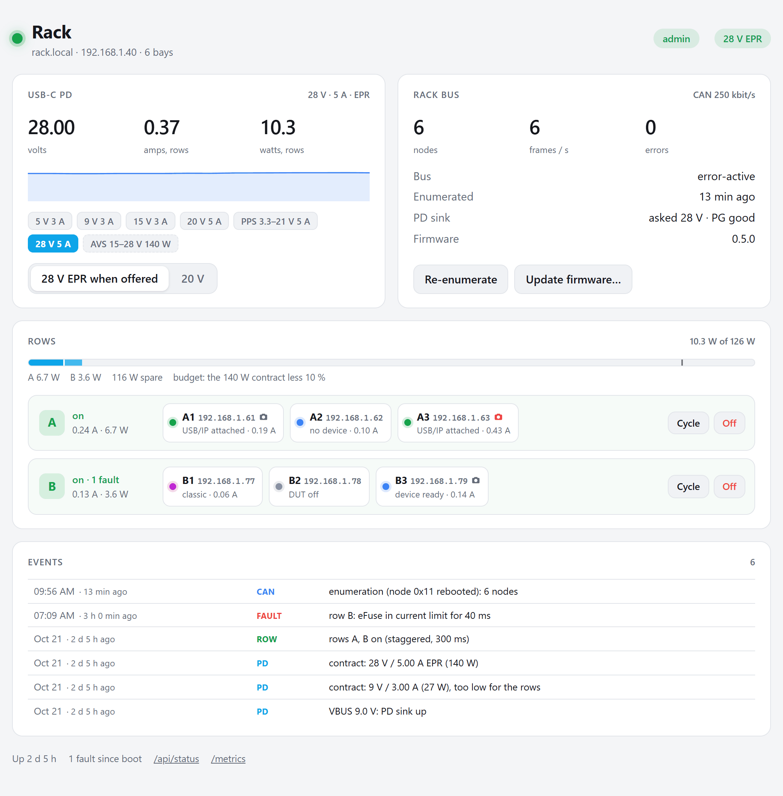
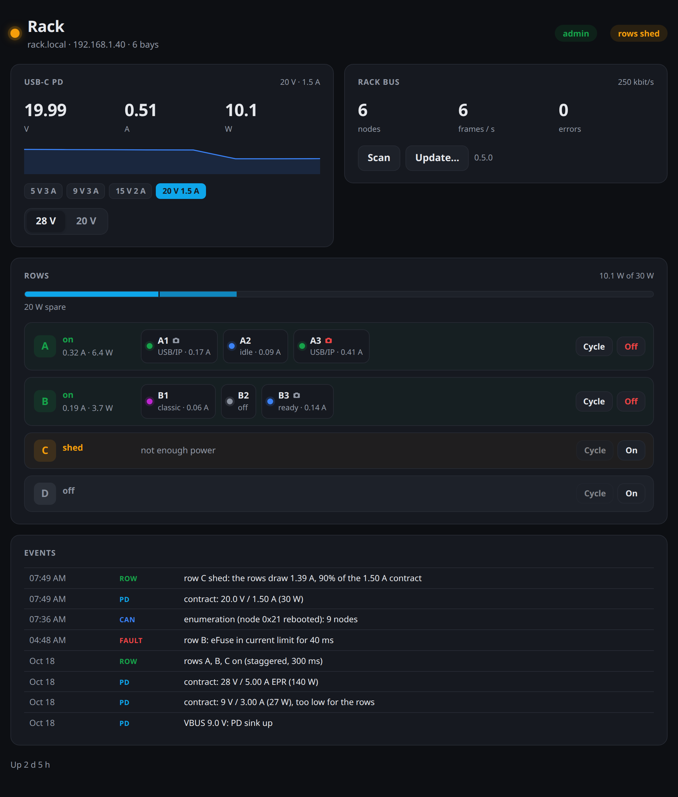
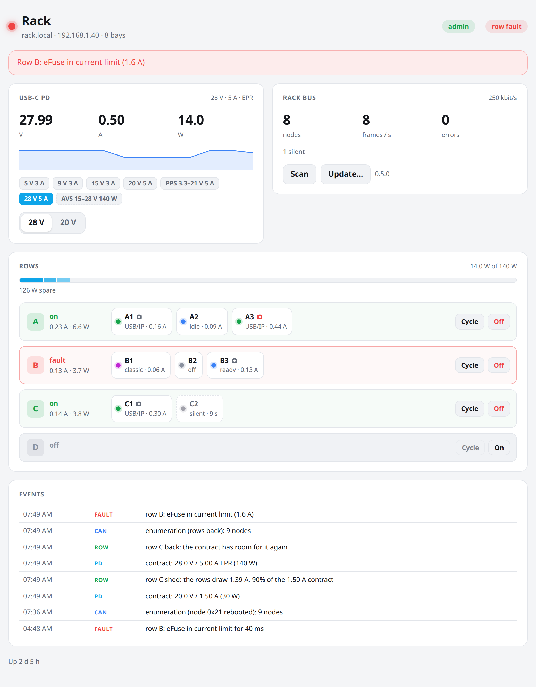
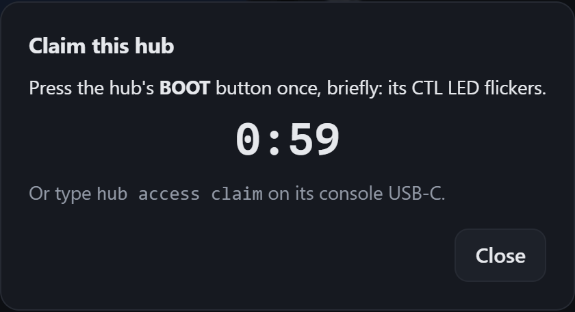
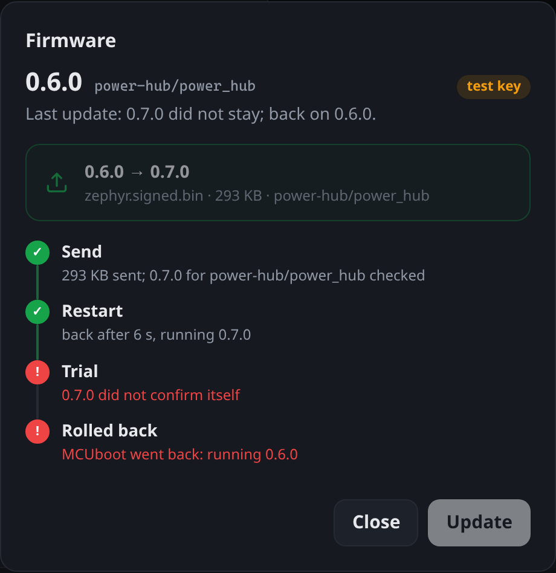

# Power hub firmware (Zephyr)

Firmware for the ESP32-S3 on the [power hub](../../electronics/power-hub/design.py),
the rack controller in the power box: it takes the rack's power from a
USB-C PD charger, switches and meters the four rows, and runs the rack bus
(CAN) that finds every bay node and tells it where it sits.

> **Status:** builds against Zephyr main (pinned in [`west.yml`](../west.yml));
> **not yet run on hardware** — no hub v0.5 has been assembled.  The rack
> bus protocol runs in a simulated rack on native_sim
> ([`common/tests/rack_bus`](../common/tests/rack_bus/)).  See
> [open items](#open-items).


```
firmware/power-hub/
  src/pd.c          USB-C PD: VBUS sense, the CH224A, 28 V EPR when offered
  src/rows.c        rows A–D: eFuse enables (held across resets), FLT, IMON, sequencing, shedding
  src/budget.c      the rows' power budget from the PD contract: which row to shed, which back
  src/bus.c         rack bus master: TWAI, POS tokens, enumeration (common/lib/rack_hub.c)
  src/web.c         status page, JSON API, /metrics
  src/shell.c       "hub" shell commands
  src/events.c      event log (page, shell)
  web/index.html    status page (embedded gzipped; shares /rack.css and /rack.mjs)
  web/dev_server.py the page against a simulated hub
  web/screenshots.py  docs/img/hub-ui-*.png
  tests/budget      budget.c on native_sim with made-up contracts (ztest)
```

Shared with the bay node, in [`firmware/common`](../common/): the rack bus
protocol ([`docs/rack-protocol.md`](../../docs/rack-protocol.md)), the
CH224A driver, Wi-Fi and hostname, the web pages' CSS and helpers, the
development server and screenshot tooling.

## Building and flashing

On a bench before the hub exists: an M5Stack CoreS3 or a XIAO ESP32-S3 with a CH224A board
(`-b m5stack_cores3/esp32s3/procpu` or `-b xiao_esp32s3/esp32s3/procpu`, [docs/bench.md](../../docs/bench.md)).

In the workspace made from [`firmware/west.yml`](../west.yml) (see
[`firmware/README.md`](../README.md#building)):

```bash
west build --sysbuild -b power_hub/esp32s3/procpu hw-testing-rack/firmware/power-hub
west flash        # over the console USB-C (J6): MCUboot, then the signed application
```

`--sysbuild` puts MCUboot in front of the application, for the updates
over the network ([Updates](#updates)); after this first USB flash the hub
can be updated from its page or `bayctl update --hub`.

The console USB-C is in the power box's front wall: it can be reached with
the box closed, and it also powers the controller (not the rows), so the hub
can be flashed and configured in place or on a desk without a PD charger.
It goes straight to the ESP32's USB pins, and the hub never takes the PHY
for anything else: esptool gets the ROM loader whatever the firmware does,
no button needed.  BOOT and RESET (rear-left corner, top side) are a last
resort, pressed with a pin through the lid's RESET / BOOT holes.  The row enables are held across the controller's
resets, so a flash should leave the rack powered (to be checked on the
first hub).  A module that ran other firmware: `west flash --erase` once
(settings partition).

## First boot

The shell runs on the console USB-C (115200, any terminal) only: no telnet,
since it switches rows and has no login of its own.

```console
uart:~$ wifi cred add -s MyLab -k 1 -p secret      # stored in flash (settings)
uart:~$ wifi cred auto_connect
uart:~$ hub id lab1                                 # hostname rack-lab1.local, stored
uart:~$ hub status
```

## What it does

| Feature | Implementation |
|---|---|
| PD contract | the CH224A asks for 9 V at plug-in by itself (CFG1 6.8k); once VBUS is up the firmware powers its I²C pull-ups (I2C_PU), initializes the driver as soon as the chip answers and asks for **28 V EPR** when the charger offers it (PDO 1's EPR Mode Capable bit; tried when the chip shows no offers), 20 V otherwise (`hub pd epr\|20v`, saved); `CONFIG_HUB_PD_ADAPTIVE` (off) starts at 20 V instead and moves to 28 V EPR, without a drop, once a row draws 1.2 A.  The chip cannot report the contract: a request counts once it says PD, PG is low and VBUS_SENSE reads the voltage within 5 %; 28 V that VBUS does not follow within 3 s (`CONFIG_HUB_PD_REQUEST_MS`) falls back to 20 V.  Never above 28 V: the node's `regulator-max-microvolt` refuses it.  A contract under 15 V (`CONFIG_HUB_ROWS_MIN_MV`) never powers the rows; there is no input switch, VBUS is VRACK.  PG high for 20 ms (a renegotiation, a hard reset) sheds every row, except during a request of ours; they come back, staggered, with the next final contract, and the policy runs again |
| Sequencing | rows stay off until the contract has held for 500 ms, then come on one after the other (300 ms apart); the rack bus is enumerated 2 s after the last one, when the nodes have booted |
| Controller reset | the row enables are held (ESP32-S3 pad hold, RTC domain): a hub reboot or a firmware update does not power-cycle the rack; the rows found on are enumerated again |
| Shedding | the rows stay inside the charger's contract (`src/budget.c`, [docs/power.md](../../docs/power.md#keeping-the-rows-inside-the-contract)): the budget is the granted current less 10 % (`hub budget margin`), or a cap by hand (`hub budget cap <W>`); IMON summed every 250 ms, over the budget for 1 s or past the contract for 250 ms, the next row in the shed order (default D, C, B, A) goes off; it comes back, the last shed first, once the budget has room for the most it drew plus 0.2 A for 10 s (twice as long each time it is shed again within a minute).  No contract at all: every row off, back with the next one |
| Row control | `hub row <A–D> on\|off\|cycle [ms]`, the page's buttons, `POST /api/row`; on/off is saved |
| Faults | each eFuse's FLT (current limit, over-temperature) as an event, a count and the page's red row, counted only while the row is on and 10 ms past its soft start (the TPS2660 also asserts FLT in shutdown and start-up); a contract lost (PG) as an event |
| Telemetry | the contract, the granted current, the protocol and PG from the CH224A (it measures nothing); VBUS from the controller's ADC divider; each row's current from IMON |
| Rack bus | TWAI at 250 kbit/s on the TJA1462AT (CAN SIC; STB through `can-transceiver-gpio`); enumeration over the POS tokens, the node table, commands to nodes with retries; the RACK frame every second |
| Network | Wi-Fi station, DHCP, mDNS `rack-<id>.local` (firmware/common's `hwtr_net`, as the nodes) |
| Web | Zephyr HTTP server on port 80: status page, JSON API, Prometheus `/metrics` |
| Access | reading is open; switching rows, the contract choice, the enumeration and the node commands are admin requests, signed with the hub's admin key, claimed with a press on BOOT (see [Access](#access)) |
| CTL LED | on: contract, rows as wanted; slow blink: no PD charger or contract settling; double blink: rows shed; fast blink: a row in fault; flicker: a claim waits for BOOT |

## Rack bus

The protocol is [docs/rack-protocol.md](../../docs/rack-protocol.md); the
cable, the star bus and the POS circuit are [docs/can.md](../../docs/can.md).
The hub's side is `firmware/common/lib/rack_hub.c` (plain C, the same code
the native_sim test drives), wrapped by `src/bus.c`:

* rows are enumerated one after the other, POS low on the others, so only
  one node at a time can ask;
* a node that asks outside an enumeration (it rebooted, or was plugged in)
  makes the hub enumerate everything again: ids depend on positions only;
* a node silent for 3.5 s is shown as lost; one that never confirms its
  address stops its row (the nodes after it cannot get POS).

## Shell

| Command | Effect |
|---|---|
| `hub status` | hostname, PD contract, rows, rack bus |
| `hub pd` | contract and the charger's offers (`*` = in use) |
| `hub pd epr` / `20v` | ask for 28 V EPR when offered / stay at 20 V (saved) |
| `hub row <A–D> on` / `off` | switch a row (saved) |
| `hub row <A–D> cycle [ms]` | power-cycle a row (default 2000 ms off) |
| `hub nodes` | the node table: position, id, MAC, IP, flags, DUT current, firmware |
| `hub enumerate` | enumerate the rack bus again |
| `hub node <C3\|0x23> identify\|reset\|bootloader\|power-cycle\|reboot` | a command to a node (answer in `hub events`) |
| `hub events` | recent events |
| `hub shed [DCBA]` | show or set the shed order (saved) |
| `hub budget [margin <0-50> \| cap <W>\|off]` | the rows' budget: contract or cap, margin, what they draw, rows shed; set the margin or a cap (saved) |
| `hub id [id]` | show or set the rack id, hostname `rack-<id>.local` (saved) |
| `hub access` | admin key set or not, a claim pending |
| `hub access claim` | confirm a pending claim, like a short press on BOOT |
| `hub access reset` | forget the admin key (the hub can be claimed again), like holding BOOT 10 s |

## Web page and API

The page polls `/api/status` every 2 s.  Its row buttons ask for a
confirmation before switching off or power-cycling a row with bays on it; a
click on a bay opens its actions (identify: its LED blinks; reset; into the
bootloader; power-cycle the board; open the bay's own page, and its
camera's live view when it has one).  A small camera mark follows the bays
that have a camera, red while someone watches (STATUS byte 6).

|  |  |
|---|---|
| Light theme | The charger renegotiated down to 30 W: row C shed until there is room again |



*Row B's eFuse in current limit (red banner and row), node C2 silent for
3.5 s (dashed, "no answer"); the events say what happened.*

| Endpoint | |
|---|---|
| `GET /api/status` | `pd` (state, contract, VBUS, the rows' current, the voltage asked for, the granted current, PG, the charger's PDOs), `rows` (state, current, nodes with position, IP, DUT state and current, `camera`: `none`, `ready` or `active`), `budget` (`limit_mw`/`limit_ma`: what the rows may draw, `total_ma`, `margin_pct`, `cap_mw`, `shed`: the rows shed now, `sheds` since boot, `shed_order`), `can` |
| `GET /api/events` | recent events, newest first (`age_s`, `kind`, `text`) |
| `POST /api/row` | `{"row": "B", "action": "on" \| "off" \| "cycle", "ms": 2000}` |
| `POST /api/pd` | `{"pref": "epr" \| "20v"}` |
| `POST /api/enumerate` | `{}` |
| `POST /api/node` | `{"id": 35, "action": "identify" \| "reset" \| "bootloader" \| "power-on" \| "power-off" \| "power-cycle" \| "reboot"}` |
| `GET /api/access/nonce` | a single-use nonce for an admin request |
| `POST /api/access/claim` | `{}` or `{"key": "<64 hex>"}` (the rack's key), then `{"ticket": "…"}` until someone presses BOOT: `{"state": "done", "key": …}` |
| `POST /api/access/check` | signed, `{}`: 200 with the right key, else 403 |
| `GET /api/update` | the firmware: `version`, image `id`, `test_key`, `trial` (on trial: what it waits for, time left), `last` update (`confirmed`, `rolled back`); also `firmware` in `/api/status` |
| `POST /api/update/begin` | signed, `{"size": N, "sha256": "<64 hex>"}`: `{"ticket": …}` |
| `POST /api/update?ticket=…` | the image (`zephyr.signed.bin`), streamed into slot 1; `{"state": "rebooting", "version": …}`, then a test boot |
| `GET /metrics` | `hub_contract_volts`, `hub_contract_amps`, `hub_vbus_volts`, `hub_row_on{row}`, `hub_row_amps{row}`, `hub_row_faults_total{row}`, `hub_nodes`, `hub_nodes_lost`, CAN counters |

To work on the page without a hub:

```bash
python firmware/power-hub/web/dev_server.py        # http://localhost:8767
python firmware/power-hub/web/screenshots.py       # docs/img/hub-ui-*.png (Playwright)
```

The simulated hub has the same endpoints, a 140 W EPR charger and nine
bays, unclaimed (claim it from the page, then `/dev/boot` presses BOOT);
`/dev/drop` makes the charger renegotiate down to 30 W (row C shed),
`/dev/fault?row=C` trips an eFuse, `/dev/lose?node=0x22` silences a node;
`/dev/image?version=0.6.0` is an image to try the update with (laid out as
`zephyr.signed.bin`, unsigned), `/dev/rollback` makes the next update roll
back.

## Access

Anyone on the network can read the page, `/api/status`, `/api/events` and
`/metrics`.  Everything that acts (`/api/row`, `/api/pd`, `/api/enumerate`,
`/api/node`) is an admin request: `X-Bay-Auth: <nonce>:<HMAC-SHA256(key,
nonce \n method \n path \n body)>` with a single-use nonce, as on the bay
nodes (`firmware/common/lib/admin.c`; the page's `rack.mjs` signs).  The key
crosses the network once, when the hub is claimed:

1. the page (or `POST /api/access/claim`) asks; the CTL LED flickers;
2. someone presses the hub's **BOOT** button, or types `hub access claim`
   on its console USB-C, within 60 s: nobody claims the hub from the
   network alone;
3. the browser gets the key and keeps it.  The claim may bring the rack's
   key along, so the hub and the bays share one.



Another browser unlocks the page with the key (the page checks it with
`/api/access/check`); the header's pill says *admin*, *read-only · unlock*
or *unclaimed · claim*.  Lost key: hold BOOT 10 s, or `hub access reset`.

## Updates

Built with `--sysbuild`, the hub takes firmware updates over the network,
like the bay nodes and with the same code (`firmware/common/lib/update.c`):
an admin request opens the update, the signed image streams into slot 1,
the hub restarts into it as a test, and the new firmware confirms itself
once Wi-Fi and the rack bus work again (CAN error-active, at least one node
answering, if there was one before the update); otherwise MCUboot puts the
previous firmware back.  The rows stay on through the restart (pad hold).
The page: *Rack bus › Update firmware…*; the command line:
`bayctl update build/power-hub/zephyr/zephyr.signed.bin --hub`.  The event
log keeps "confirmed itself" or "rolled back".  Details, the signing key
and what is still to be checked on hardware:
[docs/firmware.md › Over the network](../../docs/firmware.md#over-the-network).

|  |  |
|---|---|
| On trial: back after the restart, waiting for the rack bus | Rolled back: the new firmware did not confirm itself |

## CH224A driver

Out of tree in [`firmware/common/drivers/regulator`](../common/drivers/regulator/): the
CH224A has one function, the contract, so it is a regulator (`wch,ch224a`, on the I²C
bus), not a multi-function device.  Register map from the WCH CH224 datasheet (manual
1, v2.1, 5.2.3); Zephyr has no CH224 driver.

| API | What the chip gives |
|---|---|
| `list_voltage` | 5, 9, 12, 15, 20, 28 V: the voltage register's values |
| `set_voltage` | the lowest of those in the range (register 0x0A), else a PPS or AVS voltage in 100 mV steps (0x53, 0x51/0x52) inside a range the charger offers |
| `get_voltage` | the voltage asked for (`startup-microvolt` until then, the CFG1 resistor's), while the status says PD; 5 V otherwise.  The chip cannot report the contract |
| `get_current_limit` | the current the charger grants (0x50, 50 mA steps), with PD only |
| `set_callback` | PG (`pg-gpios`): `REGULATOR_VOLTAGE_DETECTED` / `REMOVED` |
| no `enable`/`disable` | the chip has no switch |
| `regulator_ch224a_get_status()` | the protocol in place (0x09: BC, QC2, QC3, PD, EPR) |
| `regulator_ch224a_power_good()` | PG |
| `regulator_ch224a_get_pdos()` | the charger's offers (0x60–0x8F): the whole (EPR_)Source_Capabilities message, decoded; the datasheet promises the SPR one only from chargers under 100 W |

The chip runs from VBUS: its node carries `zephyr,deferred-init`, and `pd.c`
initializes it once VBUS is up and the chip answers (a deferred init that fails
cannot be run again).

## Pin map

From `electronics/power-hub/design.py` (U4, ESP32-S3-MINI-1); devicetree in
[`boards/hwtr/power_hub/power_hub.dtsi`](../boards/hwtr/power_hub/power_hub.dtsi)
and [`power_hub-pinctrl.dtsi`](../boards/hwtr/power_hub/power_hub-pinctrl.dtsi).

| ESP32-S3 | Net | Use | Devicetree |
|---|---|---|---|
| IO0 | BOOT | SW2 BOOT button (strapping pin) | `boot_button` (`sw0`) |
| IO1 | ADC_IMON_A | row A eFuse IMON (1.404 V/A, 1k + 10 nF), ADC1 ch 0 | `imon_a` |
| IO2 | ADC_IMON_B | row B IMON, ADC1 ch 1 | `imon_b` |
| IO4 | ADC_IMON_C | row C IMON, ADC1 ch 3 | `imon_c` |
| IO5 | ADC_IMON_D | row D IMON, ADC1 ch 4 | `imon_d` |
| IO6 | VBUS_SENSE | VBUS through 100k/10k, ADC1 ch 5 | `vbus_sense` |
| IO7 | CAN_TXD | TJA1462AT TXD | `&twai` |
| IO8 | CAN_RXD | TJA1462AT RXD | `&twai` |
| IO9 | CAN_STB | TJA1462AT standby (10k pull-down) | `can_phy` `standby-gpios` |
| IO10 | POS_A | row A POS token (10k, BAT54S clamp) | `row_a` `pos-gpios` |
| IO11 | POS_B | row B POS | `row_b` `pos-gpios` |
| IO12 | POS_C | row C POS | `row_c` `pos-gpios` |
| IO13 | POS_D | row D POS | `row_d` `pos-gpios` |
| IO14 | ROW_EN_A | row A eFuse SHDN through 10k (100k pull-down: off) | `row_a` `enable-gpios` |
| IO15 | ROW_EN_B | row B SHDN | `row_b` `enable-gpios` |
| IO16 | ROW_EN_C | row C SHDN | `row_c` `enable-gpios` |
| IO17 | ROW_EN_D | row D SHDN | `row_d` `enable-gpios` |
| IO18 | FLT_A | row A eFuse ~FLT (100k pull-up, red LED) | `row_a` `fault-gpios` |
| IO19 | USB_DN | console USB-C D− (USB-Serial-JTAG) | `&usb_serial` |
| IO20 | USB_DP | console USB-C D+ | `&usb_serial` |
| IO21 | FLT_B | row B ~FLT | `row_b` `fault-gpios` |
| IO33 | FLT_D | row D ~FLT | `row_d` `fault-gpios` |
| IO35 | CTL_LED | the controller's green LED (330 Ω) | `ctl_led` |
| IO39 | PD_INT | CH224A PG (open drain, 10k pull-up, low once the contract is in place; also the front PD LED) | `pd_sink` `pg-gpios` |
| IO40 | PD_SCL | I²C0 SCL to the CH224A (its CFG2) | `&i2c0` |
| IO41 | PD_SDA | I²C0 SDA (its CFG3) | `&i2c0` |
| IO42 | I2C_PU | the CH224A's 5.1k pull-ups: driven high once VBUS is up, an input (floating) otherwise | `power_hub` `i2c-pullup-gpios` |
| IO47 | FLT_C | row C ~FLT | `row_c` `fault-gpios` |
| TXD0 (IO43) | U0TX | test pad TP1 | `&uart0` |
| RXD0 (IO44) | U0RX | test pad TP2 | `&uart0` |
| EN | EN | SW1 RESET button | — |

`python3 firmware/tools/check_pinmap.py` checks this table and the board
devicetree against U4 in `design.py`, as it does for the bay node.

## Open items

* **Hardware bring-up not done.**  The CH224A driver is compile-tested only
  (register map from the datasheet).  To check on the first hub: the
  SRCCAP layout at 0x60 (message header, then the PDOs; for EPR an extended
  header first, as two community drivers read it), whether PG goes high
  while the chip moves from 9 to 28 V, how long the 28 V EPR entry takes
  (`CONFIG_HUB_PD_REQUEST_MS`), and what the chip asks for after a hard
  reset.  Also the pad hold across a reset, the IMON calibration and the
  shedding thresholds.
* **Budget from the worst case.**  Shedding follows the measured row
  currents; rows whose bays all jump to their 1.5 A at once can trip a
  charger that tolerates no overload for the 250–500 ms the hub takes past
  the contract.  A static budget (bays × worst case) would be safer but
  sheds rows a 100 W charger could carry.  The thresholds are untried on a
  real charger (docs/bench.md, hub steps 10–14).
* Node hostnames: INFO carries the IPv4 address, not the name; the page
  shows addresses.
* **Updates over the network not run on hardware** (the swap, the rollback,
  the rows through the restart): tested on native_sim and against the
  simulated hub only.
